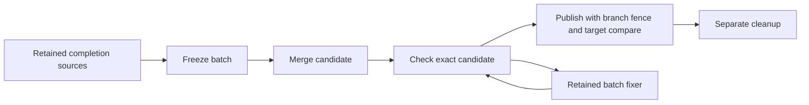

# Integration

A successful task close means the worker pushed its branch and recorded its
result. Delivery means the completed work reached the configured target branch.
The daemon delivers that work through the Git-first integration train.

## Batches and ownership

A train target identifies a project, repository and target branch. Each visit
reads current Git, completion provenance, checks, reviews and batch intent. It
freezes eligible sources into a batch, merges a candidate, tests that exact
commit and publishes it. An idle lane dispatches immediately; a busy lane
accumulates the next batch. Restarts re-observe the retained sources and candidate.

There is one configured publisher per delivery branch. Mutations require a matching
branch lease and fence. Publication checks the expected
target revision and exact CI evidence before pushing. A moved target, unresolved
remote write or human hold causes a recorded wait or gate; it does not authorize
another publisher.



## Read current state

```bash
aq integration status agent-queue
aq task show <task-id>
```

Project status reports current mode, configuration generation, designated
repository, target visits, batches, checks, repairs and blockers. It uses
`projection_kind: train` when the train is selected. It also reports Git delivery
evidence for completed work that holds open
successors or containers. Unknown delivery includes its cause; a task close,
historical operation or branch tip is not proof of delivery.

Task blockers show the specific prerequisite, revision or resource that still
holds the task. Use these facts to resolve the named policy gate or producer
failure. Bounded visits retry eligible work; the retired manual sweep, flush,
adopt and legacy recovery controls are unavailable.

## Modes and policy

The project's `hierarchical_integration_mode` selects development, hierarchy,
train, observe or disabled integration. The train serves development, hierarchy
and train; observe and disabled have no delivery writer. This setting
is distinct from the task's direct or pull-request delivery preference.

## Git-first train

The daemon-wide `integration.git_first` selector must be `active` for delivery.
The code default remains `shadow`, but the Subject runtimes were retired:
`shadow` constructs no delivery engine. It is not a rollback or fallback path.
The `integration.delivery_engine` doctor check diagnoses unavailable delivery.
With `active`, each target
branch (a project default branch, a parent branch, or an open batch's target) is
visited by its own bounded task. A visit fetches once, freezes completed sources
that Git does not yet contain into a batch, merges them onto the target, pushes
the candidate under `aq/batches/`, requires the exact candidate's checks and
reviews, and fast-forwards the target with an expected-old push under the
target's branch lease. A red or conflicting candidate uses one task-free fixer
session on the retained candidate. Its publication uses `aq integration batch-fix
--action push`; later failures reuse the session and checkout. Existing ordinary
repair tasks retain their completion protocol. Git, cached
check and review evidence, and batch intent are read again on every visit, so a
restart or missed notification costs one visit. Status reports `projection_kind:
train` with per-target visits, open batches and blockers. See the
[activation runbook](../guides/git-first-train-runbook.md).

The project-scoped `fast-smooth-train` playbook activation controls admission and
fenced writes once installed. A renamed copy binds through `train.playbook_id`.
Disabling it preserves candidates and lets workers publish and close source work;
re-enabling resumes delivery. Existing projects with no activation or explicit
binding keep their pre-install behavior. Current playbook check settings apply to
pending candidates. Epic checks are advisory unless an enabled project playbook
explicitly requires `tables.parent_episode.required_checks`.

Configure reviewed policy through the existing project configuration
command with its expected generation and operator reason. Repository changes are
refused while live owners or unresolved publication intents retain that repository; changing configuration does
not rewrite historical Subject policy records. See the
[current integration guide](../guides/hierarchical-integration-trains.md).

## Delivery proof and cleanup

Canonical delivery readers bind the exact completion generation, project,
repository and target ref, then prove containment or explicit retained
replacement evidence in Git. They recheck that binding on the database snapshot
before settlement, archive or branch cleanup. A reopened completion invalidates
an older observation. An explicit no-artifact completion releases successors
without inventing a delivered commit.

Shared cleanup preserves stopped writers' unpublished work before releasing an
owner. Obsolete task closes release graph dependencies without republishing the
obsolete source and refuse work still owned by a live Subject. Historical
integration tables and operation journals remain audit data; current controls
do not cancel or adopt their records.

## GitHub access during delivery

GitHub API operations and authenticated Git transfer use the daemon's selected
credential source. Install GitHub CLI (`gh`) on the daemon host in either mode.
Without `integration.github_app`, AQ uses that OS user's existing `gh` login or
token (`GH_TOKEN`, then `GITHUB_TOKEN`, then stored login). With an App
configured, AQ supplies a repository-scoped installation token for each
AQ-owned `gh` call and isolates Git transfer credentials. It does not overwrite
the stored login, expose the token to worker shells or retry an App failure
with a PAT or SSH key. See [configuration](../reference/configuration.md#github-credentials)
for setup and the daemon restart boundary.

The credential only authorizes access to a repository. Task and project scope,
branch ownership, exact revisions, leases, CI evidence and integration trust
still decide whether AQ may publish. Strict-mode App attestation retains its
trust manifest, producer identity and hosted-variable checks; existing-login
mode retains its policy-derived checks. The shared GitHub client and runner
are mapped in the [projects and workspaces module catalog](../reference/modules/workspaces.md#git-boundaries).

App-backed worker and integration delivery are implemented for an already
registered, authorized GitHub repository. App-only onboarding by URL can
validate access, but its clone step remains unavailable in this staged
migration. The final removal of compatibility clients and a live disposable
private-repository acceptance run are still outstanding; see the
[design and acceptance plan](../specs/github-access.md#11-verification-and-acceptance).

## Commit identity

Every commit AQ makes for a project carries one identity: the project's override
from Project Settings, else the installation default chosen at `aq install` (or
later with `aq system config git-identity`), else the documented fallback
`Agent Queue <agent-queue@localhost>` while none is chosen. Worker sessions get
it through `GIT_AUTHOR_*` / `GIT_COMMITTER_*`, and daemon-side merges,
checkpoints and integration commits resolve it the same way. Merges keep the
original authors and commit as the project's identity. Every AQ publication,
whether a worker's `aq git push` or the close pipeline's own push, refuses new
commits committed as anyone else. It reports kept authors without blocking
them. A pool session launched under an older identity is retired at
its next claim. See [Git commit identity](../specs/git-identity.md).

## Code and further reading

* [Retained subject/CI contracts](../../src/integration/runtime_contracts.py) and
  [historical ownership fences](../../src/integration/engine.py).
* [Development policy pins](../../src/integration/development_policy.py) and
  [retained repository reads](../../src/integration/repository_git.py).
* [Git-first train](../../src/integration/train.py), its
  [database sources](../../src/integration/train_sources.py) and
  [batches](../../src/integration/batches.py).
* [Git delivery observer](../../src/integration/delivery_observer.py) and
  [shared receipt records](../../src/integration/records.py).
* [Integration troubleshooting](../guides/integration-troubleshooting.md).
* [Module catalogue](../reference/modules/integration.md).
