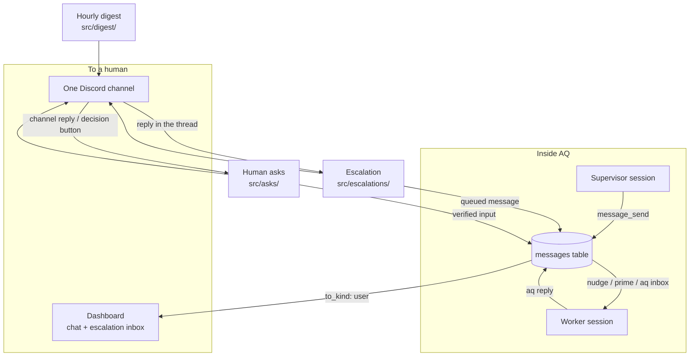
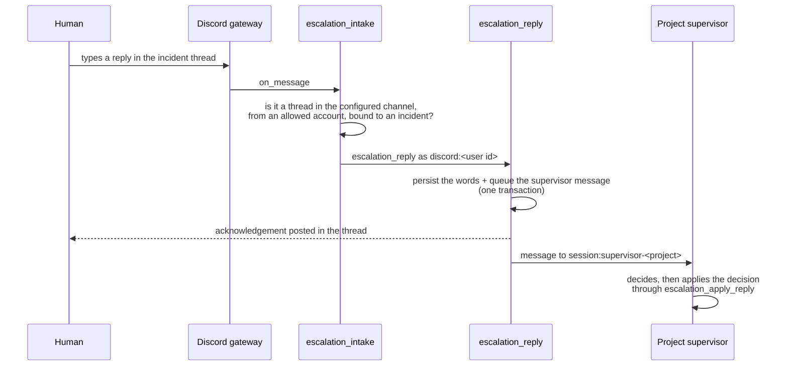

# Messaging, digests and escalations

How text moves in and out of Agent Queue: messages between the daemon, its
workers and you; periodic activity reports; and durable human asks with verified
decisions, plus retained legacy escalation threads.

## Why it exists

A fleet of coding agents generates two very different kinds of communication,
and AQ keeps them apart on purpose.

The first is **work traffic**: a supervisor telling a worker to try something
else, a worker asking a question, an operator answering it. That is
point-to-point, it must survive a session dying, and nobody should have to
watch a chat window for it. AQ stores it as rows in a queue and delivers it
into the recipient's terminal when the recipient is in a state to read it.

The second is **attention traffic**: routine summaries and questions requiring a
human decision. The configured Discord channel can carry a deterministic digest,
optional authored hourly and morning reports, and human asks. Legacy escalation
threads remain available until their destination transfers to the ask channel.
The dashboard keeps the durable records even without Discord.

> **Discord has a bounded operator surface.** The six former slash commands,
> general task controls and per-project channels were retired. `/delete-task`
> remains an explicit authenticated operator action. Legacy escalation choices
> and canonical human asks have decision buttons. Optional
> [supervisor conversations](../guides/discord-conversations.md) route allowlisted
> text to the project supervisor, falling back to the global supervisor.
> [Ask channel mode](../guides/human-asks-rollout.md) takes precedence over both
> conversation and legacy escalation intake.

## Vocabulary

Skim the [glossary](../reference/glossary.md) for the rest; these are the
terms this page leans on.

| Term | Meaning here |
|---|---|
| **Message** | One durable row addressed to a session, a task, a profile or the user. |
| **Recipient kind** | Which of those four a message is addressed to; it decides how delivery happens. |
| **Nudge** | Text typed into a live session's input line and submitted, the way a human would. |
| **Prime** | The context an agent is given at the start of a task (`aq prime`); pending messages ride in with it. |
| **Supervisor** | A long-lived session that owns a project's judgement calls, addressed as `supervisor-<project-id>`. |
| **Digest** | The periodic Discord activity summary — one message, silent when nothing durable happened. |
| **Escalation** | A durable incident that needs a human decision; legacy delivery creates a channel post and thread, while the ask adapter supplies its canonical decision identity. |
| **Delivery** | A row in an outbox recording one intended external send, and what happened to it. |
| **Transport** | The narrow port that actually talks to a chat platform. Today there is one: Discord. |

## Optional supervisor conversations

The `src/conversations/` package supports opt-in Discord conversation intake,
controlled by `discord.conversation.enabled` (false by default). A non-empty
explicit author allowlist, configured guild/channel, enabled messages and sessions,
completed Discord cutover and a bound outbound queue are prerequisites.

`discord.project_id` selects the owning project; a sole project is inferred.
Inputs reach its live named supervisor, then the live global supervisor. With
several projects and no selected project, the global supervisor answers. Replies
can stay in the main channel; existing bound threads remain supported.
`require_mention` defaults to true, and `allow_dm` defaults to false. An operator
can explicitly relax either. Intake does not cold-start supervisors.

When the destination is in ask channel mode, ask intake exclusively owns the
input, including refusals; it never falls back into conversation intake.
Conversation text cannot itself approve work. Enabling conversations makes the
allowlisted identities correspondents of an elevated session, whose tools remain
available. See [Discord supervisor conversations](../guides/discord-conversations.md)
for the trust decision, limits and diagnostics.

## The three lanes



Three things to take from the picture:

* the **message queue** is the substrate — the escalation path ends by writing
  into it, rather than by poking a process;
* the **digest** and **escalations** share one channel and one transport but
  keep separate outboxes, so an outage in one cannot stall the other;
* human asks, legacy escalation replies and opt-in conversations have separate
  authority checks. Asks, conversations and morning reports use the shared
  external outbox; digests use its scheduler while retaining `digest_windows`.

## A realistic example

> Assumes the daemon is running, `messages.enabled` is true (it ships enabled)
> and you are inside a worker session so `$AQ_SESSION_ID` is set. Nothing here
> touches another session's mailbox.

Queue a message to your own session, read it, answer it, and consume it:

```bash
aq message send --to "session:$AQ_SESSION_ID" \
  --project agent-queue \
  --subject "Docs example" --body "Reply here when you see this."
```

```text
Message queued: msg-c8555439f8134d8f869bbabe7c109997 →
session:ac5bb8c6-ca71-484d-827b-5dd8fcc93726
```

```bash
aq message inbox --to "session:$AQ_SESSION_ID"
```

```text
              Inbox — session:ac5bb8c6-ca71-484d-827b-5dd8fcc93726
┏━━━━━━━━━━━━━━━━━━━━━━━━━━━━━━━━━━━━━━┳━━━━━━━┳━━━━━━━┳━━━━━━━┳━━━━━━━┳━━━━━━━┓
┃ ID                                   ┃ From  ┃ To    ┃ Subj… ┃ Body  ┃ State ┃
┡━━━━━━━━━━━━━━━━━━━━━━━━━━━━━━━━━━━━━━╇━━━━━━━╇━━━━━━━╇━━━━━━━╇━━━━━━━╇━━━━━━━┩
│ msg-c8555439f8134d8f869bbabe7c109997 │ sess… │ sess… │ Docs  │ Reply │ queu… │
└──────────────────────────────────────┴───────┴───────┴───────┴───────┴───────┘
```

```bash
aq reply msg-c8555439f8134d8f869bbabe7c109997 "Seen — closing the loop."
```

```text
Replied to msg-c8555439f8134d8f869bbabe7c109997 (reply
msg-eb4b28932e244b258ccdbf0d68965760)
```

Replying acknowledges the original. The reply is itself a pending message row
addressed back to the sender. Consume it with `--inject`, which marks each row
delivered and prints it:

```bash
aq inbox --inject
```

```text
[msg-eb4b28932e244b258ccdbf0d68965760 from session:ac5bb8c6-…]
Seen — closing the loop.
```

```bash
aq message inbox --to "session:$AQ_SESSION_ID"
```

```text
No pending messages for session:ac5bb8c6-ca71-484d-827b-5dd8fcc93726.
```

That is the whole protocol an agent needs: `aq inbox` to see what is waiting,
`aq reply <id> "…"` to answer, `aq message send` to raise something. The
canonical human recipient is `user:dashboard`.

The server, not the client, decides who a reply comes from and goes to. A
worker session can reply only to a message addressed to one of its own
mailboxes in its own project; anything else reads as not found. The reply is
signed as the mailbox the original was addressed to; a worker that names a
different `from_kind` or `from_id` is refused. The reply goes to the original's
sender, so a message from a `system:*` sender cannot be replied to. Supervisor
guidance (`aq agent message`) is signed by the caller's authenticated identity.
A live launch of the target project's own supervisor signs as
`session:supervisor-<project>`, so a worker can reply to it. The operator CLI,
automation, the global supervisor and a stale launch have no such return
address. Their guidance stays `system:supervisor`, and the worker answers it
with `aq message send --to session:supervisor-<project>`.

## Inputs and outputs

| Lane | Input | Output |
|---|---|---|
| Messages | `message_send` (`aq message send`), a playbook's `message_send` step, an escalation reply | A row in `messages`; a nudge typed into a session, a block in `aq prime`, or a `message.sent` event the dashboard renders |
| Digest | Durable work, provider and reroute evidence from other subsystems | At most one Discord message per interval, ≤600 characters, or a persisted silence |
| Human ask | A source-owned question and verified human input | One canonical identity, current context, immutable decision packet and application receipt |
| Legacy escalation | `escalation_create` from a supervisor or trusted core source; `aq question escalate` | While legacy delivery is permitted, one channel post/thread with acknowledgement, relay or resolution |
| Report | Frozen evidence and an optional supervisor author turn | Stored report, scoped deterministic fallback and a bounded external summary |

### Recipient kinds, and what each one means

`to_kind` is not decoration: it selects the delivery policy in
[`src/messages/delivery.py`](../../src/messages/delivery.py).

| `to_kind` | `to_id` looks like | How it is delivered | Parked if undeliverable? |
|---|---|---|---|
| `session` | `supervisor-agent-queue`, or a session name | Nudged when idle; a supervisor address can be woken if asleep | After 24 h absent, the original is archived; only human-origin mail earns a return notice |
| `task` | a task id | Nudges the active holder, or waits for the next inbox/prime | No — it waits for the next session |
| `profile` | a profile id such as `standard-high-claude` | Consumed by `aq inbox` / prime; the engine never touches a session for it | No |
| `user` | `dashboard` | Marked delivered by the engine (`via=platform`); dashboard updates use `message.sent` | No |

Senders (`from_kind`) are `session`, `user` or `system`. A message whose
`project_id` is null is system chat and requires a global administrator.

## How a message reaches a worker

The independent `MessageDeliveryService` runs a delivery pass on startup, on
coalesced `message.sent` events and periodically (`messages.delivery_interval`,
five seconds by default). It does not wait for a scheduler cycle. For each
recipient with pending rows it asks the session runtime a single coarse question through
[`src/messages/session_lens.py`](../../src/messages/session_lens.py) — *what
is this recipient doing right now?* — and acts on the answer:

| Activity | Meaning | What the engine does |
|---|---|---|
| `idle` | Live and quiet | Submits one pointer to the command that reads the body |
| `busy` | Live and mid-turn (output within the last 30 s) | Leaves mail pending for a later pass or inbox/prime injection |
| `sleeping` | A wake-able supervisor with no live session | Cold-starts the supervisor, then nudges |
| `absent` | No live session, and the messenger may not spawn one | Leaves it pending; a `session` recipient is parked after 24 h |

A nudge records a notification attempt, and leaves the message in the pending
inbox. The recipient runs `aq message status <id> --json` to read and acknowledge
the body; another supervisor or an operator inspecting status does not consume
it. Reading the body some other way, such as a non-consuming `aq message inbox`
peek, is not an acknowledgment, so the pointer says so: ``Handle `aq message status
<id> --json` (running it marks the message read).`` Unread notifications retry after
60 seconds, doubling to a five-minute cap. A read message is never nudged again.
After three unanswered attempts, AQ queues one alert with the original body to
the global supervisor. The original stays pending; alerts do not recursively
escalate. Attempt records and alert deduplication survive daemon restarts.

Delivery receipts come from recipient reads (`via="read"`), replies, `aq prime`
(`via="prime"`) or `aq inbox --inject` (delivery stamp only; `via` and `read_at`
remain unset). These use a compare-and-set so racing body reads and injection record delivery only once. A delivery receipt
means the body was handed over; it does not prove the requested work was done.

If a delivered message goes unanswered past `messages.reply_timeout` (120 s by
default) and the recipient's transcript shows a completed assistant turn since
delivery, the engine materialises that turn as a reply with
`via="transcript_tail"`. This is a convenience for agents that answered in
prose instead of running `aq reply`; it is deliberately never applied to an
`agent_question` or `task_recovery` row, because those have explicit commands
and a fabricated answer would be treated as a decision.

Five things bound the fallback, so it can only ever recover an answer that
actually answered that message:

- **The turn must be prose.** A turn with no assistant text — the transcript's
  `[tool_use: Bash]` placeholder, say — is a tool call, not a reply. The first
  prose turn in the window is used, so a tool call never masks the answer
  behind it.
- **The turn must land inside a window.** Only turns between `delivered_at` and
  `delivered_at + messages.reply_window_multiplier × reply_timeout` qualify.
  Without the window, a long-lived session that resumed after a restart would
  "answer" every delivered-but-unreplied row in its backlog — including
  messages from days earlier — with whatever it happened to say next.
- **The sender must be a human.** Rows from `system:*` senders (review
  approvals, watchdog pings, delivery-engine notices) are never swept, and
  neither are rows from agents. A tail reply to a worker would land in its
  mailbox, satisfy its durable message wait and read as the supervisor's
  answer, even when the turn was about different work. Agents get only explicit
  replies (`aq message reply`, `aq agent message --reply-to`).
- **The turn must be attributable to one conversation.** A transcript turn
  names no message, so if anything from another conversation (another project,
  thread or sender) reached the same recipient within one window length of the
  request's delivery, the turn could be about that one and nothing is posted.
- **The reply is inserted atomically.** One transaction locks the request,
  confirms it is unchanged and still unanswered, and writes the reply already
  delivered. An explicit reply locks the same row, so whichever commits first
  wins and the other leaves nothing behind.

Prose that answers an agent is never recovered: transcripts carry no message
correlation, so the recipient must reply explicitly.

## The hourly digest, in one paragraph

Once per interval the daemon reserves a window row, asks the database what
durably happened in it, and either renders one short message or records why it
stayed silent. Work evidence includes a task completion, an attempt that started,
a task comment explicitly marked as progress and a `pr_url` becoming available, plus a
count of live, non-stale attempts. Provider availability and reroute events also
feed the digest; human waits are attention facts, not progress. Heartbeats,
`updated_at` churn, retried notifications and elapsed time are not progress and never wake a window. The walkthrough,
including how to preview one without sending it, is in
[Escalations and the hourly digest](../guides/escalations.md).

## When a machine needs a human

A **human ask** is the canonical identity for a decision, with its source,
ownership, current choices and immutable decision evidence. Dashboard **Needs you**
and `aq ask list --view needs_you` show actionable asks. Use
`aq ask show --ask-id <id>` for current context. Workers report blockers to their
owning supervisor; they have no human-decision authority.

The decision path prepares a preview against the exact source version, then
records a decision with that preview and an idempotency key. Discussion and
ambiguous text remain evidence; they do not become permission to act. Only
verified human input can authorize the selected choice. The operation ledger
records application, including unknown outcomes that require reconciliation.

Ask channel mode posts roots in the channel without creating threads. Inputs
are correlated and verified before interpretation or application. Legacy thread
replies and buttons stop accepting decisions after ownership transfers. Inspect
`aq ask cutover-status` for the destination's durable mode and blockers; the
[rollout guide](../guides/human-asks-rollout.md) describes the operator-only switch.

### Legacy escalation threads

An **escalation** is a durable incident: a project supervisor has decided it
cannot proceed without a person, and has recorded what is blocked, what it
already tried, and exactly what decision it needs. That record lives in the
database and is visible in the dashboard whether or not Discord is configured
at all.

Delivery is a thin renderer over it: one post in the configured channel, one
thread hanging off that post, and every follow-up inside that thread. The
reply path below applies while the destination still permits legacy delivery:



Four properties of that path are worth knowing before you rely on it:

* **Correlation is durable, not clever.** The thread is matched against the
  confirmed receipt stored on the incident's root delivery — never against a
  thread name or a task id — so it survives a restart, a reconnect and a
  second daemon.
* **Identity comes from the gateway.** The author is the account Discord
  authenticated, checked against `discord.authorized_users`, and handed to the
  core as `human:discord:<id>`. A field in the message body claiming to be a
  human, an actor or a project is refused.
* **The reply decides nothing by itself.** It is evidence. Resolving a gate,
  retrying a task or answering a question is the supervisor's call, made with
  the canonical ask prepare/decide path. Compatibility `escalation_apply_reply`
  additionally requires current source/preview context and an exact stored
  declared choice; a supervisor interpretation alone is insufficient.
* **Refusals are silent.** The channel is shared with people; a message that
  does not correlate is dropped without an answer, because replying to every
  unrelated line would turn the channel into a chatbot.

## What Discord no longer does

These are removed, not merely discouraged. If a page, prompt or habit still
tells you to use one, it is out of date.

| Retired | Do this instead |
|---|---|
| The `/status`, `/tasks`, `/explain`, `/peek`, `/gates` and `/attach` slash commands | `aq task list`, `aq task explain`, `aq session peek`, `aq task gate-list`, or the dashboard |
| General task browsing and controls from Discord | The `aq` CLI, MCP or dashboard; `/delete-task` is the explicit deletion exception |
| Per-project channels, channel auto-creation and channel lookup helpers | One channel, set as `discord.channel_id` |
| The lifecycle notification feed (task started / failed / PR opened cards) | The dashboard's live event stream, and the hourly digest for the summary |
| The former gate view classes and callbacks | Canonical ask decisions in Needs you or ask buttons; legacy escalation choice buttons remain until transfer |

Startup still *unregisters* the six retired command names so a stale
registration cannot linger
([`src/discord/slash_commands.py`](../../src/discord/slash_commands.py)), and a
one-way cutover pass converts pre-existing questions, gates and task threads
into escalation identities before inbound routing goes live
([`src/discord/cutover.py`](../../src/discord/cutover.py)).

The `notify.*` event family survives and is not a Discord feature: those events
feed the dashboard's WebSocket stream and any plugin that subscribes
([`src/notifications/events.py`](../../src/notifications/events.py),
[`src/api/websocket.py`](../../src/api/websocket.py)). What was deleted is the
Discord consumer that turned them into channel posts.

## State ownership

| State | Written by | Lives in |
|---|---|---|
| Message rows, replies, delivery stamps | `message_*` commands and [`MessageDeliveryEngine`](../../src/messages/delivery.py) | `messages` table |
| Escalation incidents and their immutable message history | `escalation_*` commands | `escalations`, `escalation_messages` tables |
| One row per intended escalation send, with its receipt | [`EscalationDeliveryService`](../../src/escalations/dispatch.py) | `escalation_deliveries` table |
| One row per digest window, sent or suppressed | [`DigestScheduleService`](../../src/digest/dispatch.py) | `digest_windows` table |
| Ask identity, decisions, source operations and correspondence | `ask_*` commands and source-owned adapters | `human_asks`, immutable decision packets and operation ledger |
| Shared external send and receipt | Domain adapters and `DeliveryScheduler` | `outbound_deliveries`; digest windows retain their own table |
| Morning report and evidence coverage | Report commands and read-only collectors | `morning_reports`, `morning_report_coverage`, `morning_report_facts` |
| Channel, digest and escalation settings | You, via the config file or Settings → Messaging | `~/.agent-queue/config.yaml`, `discord:` section |
| Which account may reply, and who may be mentioned | You | `discord.authorized_users`, `discord.escalation.mention_user_ids` / `mention_role_ids` |

Delivery reservations, receipts and decision deduplication are durable. Rate
windows and intake diagnostics also have bounded in-memory counters. Durable
"have we already said this?" checks use the outbox's unique `dedup_key` for an escalation, the window key for a digest, the
`(transport, external_message_id)` uniqueness for an inbound reply.

## Common failures and recovery

| Symptom | Diagnose | Fix |
|---|---|---|
| `messages are disabled (messages.enabled=false)` from any message command | `aq system get-config` | Set `messages.enabled: true`; it ships enabled, so this is a local override |
| `out of scope: message_list` (or `digest_status`, `escalation_list`) inside a worker session | Nothing is wrong — a worker token may read its own mailboxes only | Run the command from an operator shell or the dashboard |
| A message to a session is never delivered | `aq message list --to-kind session --to-id <name>` and check `delivered` | The target is `absent`; after 24 h the original is archived and a `user` sender receives a `[parked] …` notice |
| Nothing is posted in Discord at all | `aq digest status` — check `settings_errors`, `warnings` and `cutover` | Usually `discord.channel_id` is unset, or the cutover pass has not reported `complete` |
| The channel is quiet but work is happening | `aq digest preview` and read `suppression_reason` | `idle_only` and `already_reported` are correct silence; `all_filtered` means `discord.digest.project_ids` excludes the work |
| A delivery is stuck as `unknown` | `aq escalation get --escalation-id <id>`, or `delivery_health` in `aq digest status` | An external send was ambiguous and could not be reconciled; AQ refuses to repost. Read the thread, then resolve or re-raise the incident deliberately |

## Related pages

* [Escalations and the hourly digest](../guides/escalations.md) — the
  walkthrough: configuring the channel, previewing a digest, answering an
  incident, and the full delivery contract.
* [Sessions](sessions.md) — what `idle`, `busy`, `sleeping` and `absent`
  actually mean, and why a nudge is typed rather than injected.
* [Glossary](../reference/glossary.md) — the terms this page assumes.
* [Module catalog: messaging, digests and escalations](../reference/modules/communications.md)
  — every module named here, one row each.
* [Discord migration runbook](../guides/discord-migration.md) — the operator
  procedure for an installation that predates the single-channel model.

## Source and tests

The implementation is
[`src/messages/`](../../src/messages/),
[`src/messaging/`](../../src/messaging/),
[`src/notifications/`](../../src/notifications/),
[`src/digest/`](../../src/digest/),
[`src/escalations/`](../../src/escalations/),
[`src/asks/`](../../src/asks/), [`src/delivery/`](../../src/delivery/),
[`src/conversations/`](../../src/conversations/), [`src/reports/`](../../src/reports/) and
[`src/discord/`](../../src/discord/). The spec behind the current shape is
[the current messaging-and-human-asks system spec](../specs/systems/messaging-and-human-asks.md).
The Discord simplification spec is a historical design record.

```bash
aq test tests/test_message_delivery.py tests/test_session_lens.py \
  tests/test_digest.py tests/test_escalation_delivery.py tests/test_escalation_intake.py
```
