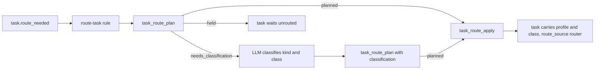

# Playbooks V2

Playbooks are AQ's event-driven automation: a Markdown policy is compiled into a typed, immutable graph, activated deliberately, and then produces durable runs when matching events arrive.

## Why they exist

Some work should happen consistently without putting policy into a daemon branch: route an unassigned task, turn an approved specification into a task proposal, or pause until a person makes a decision. A Playbook V2 makes that policy inspectable. It is a graph of typed steps, not an agent conversation that must be inferred after the fact. The engine records the artifact, state changes, waits, and step receipts so an operator can see both what was configured and what actually happened.

## Vocabulary

* **Source** is the Markdown file in the vault. Its YAML frontmatter states an id, scope and triggers; its body is human-readable policy. See [source parsing](../../src/playbooks/authoring.py).
* **Semantic body** is the proposed JSON `rules` and `steps` graph. AQ supplies source identity, version and live dependency fingerprints rather than trusting those values from the proposal. See [proposal construction](../../src/playbooks/proposal.py).
* **Artifact** is the canonical, SHA-256-addressed V2 JSON definition. It has typed rules, seven possible step kinds, and the command/profile contracts it was compiled against. See [the definition model](../../src/playbooks/definition.py).
* **Activation** selects one artifact at a system, project, or agent-type scope and may enable or disable it. An artifact can exist without being active. See [activation health](../../src/playbooks/activation.py).
* **Run** is one durable execution of one matching rule, pinned to the artifact hash it started with. Its mutable snapshot, receipts and waits are separate from the immutable artifact. See [run state](../../src/playbooks/run_state.py).
* **Human gate** is a durable, operator-resolved decision checkpoint. It can cause an event or resume a playbook wait; it is not a task dependency. A dependency controls whether a task is ready, whereas a gate waits for a decision and may be attached to several tasks.

## A realistic example: route a new task

AQ ships a reviewed system bundle for `default-assignment-routing`, the router every project is bound to unless the local operator re-binds it. On a first installation, the required-playbook reconciler imports and activates that reviewed bundle under the installation receipt described below. Ordinary restarts observe existing activations; repairs require an explicit operator command. The reviewed policy listens for `task.route_needed`, calls `task_route_plan` with its policy block, asks an LLM to classify the task only when the plan needs it, and calls `task_route_apply`, which refuses every caller except the project's bound router. The orchestrator emits that event only for a queued, unassigned task that still owes a route (`route_source` is `unrouted`, or `legacy` once the router is ready). [The current shipped source](../../src/prompts/default_playbooks/default-assignment-routing.md), [reviewed bundle](../../src/prompts/reviewed_playbooks/default-assignment-routing/), and [required reconciler](../../src/playbooks/required.py) are the evidence for those claims.



The input is an event containing at least the task and project identifiers. The output is either a routed task or a failed, inspectable run. The playbook's `## Routing policy` YAML block is the policy: kind to class and ceiling, the code-design lane (Claude first, then Codex), the art-design lane (Codex, held), the OpenCode lanes, the reserved `deep-high` Claude cell and the load balance. `task_route_plan` applies it deterministically; the LLM step only classifies a task whose kind or class the policy cannot decide, recommending `standard-high` for ordinary implementation and coordinated changes and a deep class only for design or a specifically justified exceptional problem. That is a **shipped source policy**. The required activation instead runs the immutable reviewed source/artifact recorded in its bundle; inspect that bundle and its active hash rather than assuming it changed with the Markdown source. A project can use a reviewed project-scope copy with a different policy, bound with `aq project set <project> router <playbook-id>`.

The following read-only command was run while writing this page; it shows the exact validation interface without modifying a vault:

```bash
aq playbook v2-validate --help
```

```text
Usage: aq playbook v2-validate [OPTIONS]

  Validate an immutable Playbook V2 JSON artifact inside the vault against the
  strict model, registered command contracts, profiles, and event schemas.
  Read-only; never installs or activates.

Options:
  --path TEXT  Vault-relative or absolute path to a V2 artifact JSON file.
```

## Inputs and outputs

Artifact compatibility is pinned per definition in optional `required_features`.
Proposal assembly derives the pins from the typed graph and live command
contracts: generated command contracts, collection expressions, nested foreach
graphs, and reads of frozen `context.observed_at` or `context.observation_id`
require `generated_commands_v1`, `collections_v1`, `nested_foreach_v1`, and
`observation_context_v1`, respectively. Command steps and LLM tool exposure both
count. Compiler-supplied pins and `trusted_execution` metadata are discarded.
Command authorization and private-value policy still come from the server's
execution contracts; feature support grants no capabilities.

`trusted_execution.state_schema_version` is a strict positive integer derived
from source frontmatter, defaulting to 1 for state command users. The `state_v1`
and `script_v1` hooks reserve those requirements, but this engine revision refuses
them until their executors are implemented. Future state/script owners extend
the strict metadata model with reviewed execution pins and add support alongside
their execution acceptance checks. They must not enable a feature merely because
its name is recognized.

Empty feature and execution metadata are omitted without removing any legacy
defaults: existing canonical artifact bytes and hashes remain unchanged. Unknown
or unsupported features produce `unsupported_feature` during validation/import,
activation, and execution (including pinned dispatch, dry-run, shadow, and resume).
An affected activation is `invalid` with named feature reasons;
`playbooks.activation_invalid` explains the upgrade remedy. Compatible sibling
activations stay ready. Inspection can still load the strict definition.

Upgrade every intended executor before deliberately activating a new-feature
artifact: older engines reject the additive fields under their strict schema.
Restart does not refresh installed artifacts. Before rollback, disable affected
activations and settle or pause their runs, then explicitly restore compatible
reviewed artifacts; retain additive storage and state. Removing feature pins is
not a compatibility migration.

A rule has one event trigger, an optional typed guard, and an entry step. Triggers can use an equality/membership filter. Within a run, values resolve from the triggering event, the durable run context, prior declared bindings, and a `foreach` item. Validation rejects unavailable names, invalid event paths, incompatible values, unreachable steps, unsafe loops, undeclared outputs, unsupported command outcomes, excessive schemas, and capability violations rather than guessing that they are safe. [Expressions](../../src/playbooks/expressions.py) and [validation](../../src/playbooks/validation.py) implement these checks.

Collection values compose inside inputs, guards, decisions, prompts, and loop
collections. Each operand must be a list; use `coalesce` with an empty list when
an absent or null value should mean “no items”.

| Value type | Fields | Result |
|---|---|---|
| `filter` | `collection`, `item_binding`, `predicate` | Items whose typed condition is true, in input order. |
| `map` | `collection`, `item_binding`, `value` | One resolved value per item, in input order. |
| `len` | `collection` | The nonnegative item count. |
| `diff` | `left`, `right`, optional `key_path` | First left items whose identities do not occur on the right, deduplicated in left order. |

A `filter` predicate or `map` body reads its item using `loop_ref`. Its binding is
local to that body and may shadow an outer expression or `foreach` item without
changing the outer item or any step result. The collection itself resolves in
the enclosing scope. `loop_ref` with `index: true` reads the local zero-based
index. Known array schemas carry their item types through these expressions;
opaque command results are checked against argument types at runtime.

Without `key_path`, `diff` compares canonical JSON identities: object key order
is irrelevant, equal numbers such as `1` and `1.0` match, and booleans remain
distinct from numbers. A dotted `key_path` must exist and identify a scalar on
every item in both operands. Missing paths and non-scalar identities fail.

Evaluation shares a 100,000-visit budget across all inputs of a step or all cases
of one decision. Expression depth is limited to 10; each intermediate or final
collection is limited to 10,000 items and 262,144 encoded JSON bytes. Limits are
checked during construction. Exhaustion produces a named expression diagnostic
under `input_resolution_failed` before command dispatch. Graph explanations show
the predicate, mapped value, and diff key; Advanced retains the canonical typed
expression, subject to the command's redaction policy.

The V2 step vocabulary is deliberately closed:

| Step | Input / output purpose |
|---|---|
| `command` | Calls a registered AQ command with typed inputs and follows its declared outcomes. |
| `llm` | Calls the direct LLM path under a profile, JSON output schema, bounded budget, and optionally narrowed tool policy. |
| `agent_task` | Creates and optionally waits for a delegated task; child capability policy is an intersection, never an escalation. |
| `decision` | Selects an edge from typed conditions plus an explicit default. |
| `wait` | Suspends for an event, a human resolution, a child task, or a timer. |
| `foreach` | Iterates a bounded collection and aggregates its declared result. |
| `terminal` | Ends the rule as `completed`, `failed`, `blocked`, or `cancelled`. |

Live, dry-run, and shadow modes use the same graph and validator. Dry-run and shadow executors report command/AI/delegation/wait behavior without performing live side effects. The executor registry is [explicit](../../src/playbooks/executors/__init__.py), so a newly introduced step cannot silently run in an unsafe mode.

An `agent_task` normally omits `profile_id`. Its optional `intelligence_class`
and `task_type` are hints: creation stores the class as `class_hint`, leaves
the child unrouted, and lets the project's router choose its worker. A named
profile must be a control-plane role (`triage`, `spec-ingest`, `reviewer`, or
`final-reviewer`), created by a service or playbook principal. `pin_provider`
and routing choices hidden in `inputs` are rejected.

Hint-only delegation uses conservative admission: before creating a child,
the executor checks every enabled worker candidate against the parent's
capabilities intersected with `capability_narrowing`. One broader candidate,
an unreadable profile store, or no candidates refuses the step. Class hints,
current capacity and provider availability do not exclude candidates from
this check, since the router may clamp a hint or use a recovered provider.
This allows routing without persisting a new per-task capability policy;
operator edits to profiles remain trusted configuration changes, as for
named-role delegation. Cancellation re-reads the child's eventual profile
and intersects it with the caller's current authority and step narrowing.

## Playbook commands

A `command` step is the only way a playbook changes durable state, and the set of commands it may call is closed. [`CONTRACTS`](../../src/commands/contracts/registry.py) registers each one with a typed argument model, a typed result, named outcomes, the capability a caller's policy must grant, and machine-readable effect clauses. Three surfaces read that single registry, so none of them can drift from it or from each other.

**The reference section.** [Playbook commands](../reference/playbook-commands/README.md) is one page per registered command. The block between the `aq:generated` markers — title, summary, parameters, result fields, outcomes and the execution contract — is written from the registry by [`scripts/gen-command-docs.py`](../../scripts/gen-command-docs.py); everything outside the markers is hand-written prose explaining what the command is for, how it works internally, what it persists, and how it fails. Two families share one state machine and are described once on the index rather than restated per page: [the escalation incident lifecycle](../reference/playbook-commands/README.md#the-escalation-incident-lifecycle) and [the integration operation model](../reference/playbook-commands/README.md#the-integration-operation-model). `aq test tests/test_command_docs.py` is the drift guard — it fails when a registered command has no page, a page names a command that is no longer registered, or a generated block is stale.

**The catalog command.** `aq playbook commands` returns the same registry as data: name, title, summary, documentation URL and the parameter JSON Schema for every command. It reads no vault and touches no run, and it is what the dashboard calls to build its links.

**The documentation link.** A command's page URL is derived once, from the `docs.base_url` setting, as `<docs.base_url>reference/playbook-commands/<command_name>.md` ([`src/docs_urls.py`](../../src/docs_urls.py)). It is never copied into a contract, and presentation metadata is excluded from the contract fingerprint, so pointing `docs.base_url` at a fork or a mirror does not invalidate artifacts compiled against those commands. The dashboard carries it to two places: selecting a command node in a playbook graph shows a **Documentation** link in the side pane, and in a playbook's rendered source preview a backticked command name becomes a link to that command's page. [Command contracts](../reference/cli/contracts.md) documents the contract layer underneath both.

## State ownership

| State | Owner and location | What changes it |
|---|---|---|
| Authored policy | Vault Markdown | An operator/editor writes source; `update-source` supports a source-hash compare-and-swap. |
| Review bundle | Vault bundle directory | `v2-import` verifies exact source, artifact, digest, and manifest metadata before storing its artifact. |
| Artifact bytes | Content-addressed compiled-artifact store plus artifact record | Proposal/import path writes canonical bytes atomically; artifacts are immutable. |
| Active policy | Durable `playbook_activations` row | `activate` chooses an artifact and `set-enabled` controls delivery. Health is recomputed from live contracts and profiles. |
| Run progress | Durable V2 run snapshot and step receipts | The engine advances with versioned transaction boundaries; each run remains pinned to its starting artifact. |
| Suspensions and held events | Durable playbook waits and pending-event records | The wait scheduler and event dispatcher claim/resume them; operators can inspect or resolve held events. |

The in-process [EventBus](../../src/event_bus.py) owns subscriptions only, not a durable event log. It adds `_event_type` and an `event_id`, validates registered payloads by default, and dispatches subscribers sequentially. In development an invalid payload raises; in non-development environments it is warned about and still delivered. `src/event_schemas.py` is the registry that makes source-event references checkable.

## Author, validate, import, and activate

Author the Markdown source in the vault first. Frontmatter must include `id`, `scope`, and a non-empty `triggers` list. Backticked identifiers in the source grant the compiler the names it may place in the semantic graph; this prevents a proposal from smuggling in a command or event path the source never authorized.

For a normal reviewed workflow, the sequence is:

1. Read the authoritative source with `aq playbook get-source` and preserve its hash.
2. Prepare a semantic JSON file containing only `rules` and `steps`; run `aq playbook v2-propose --playbook-id <id> --semantic-body-path <vault-path>` to obtain a reviewable proposal. This read path does not persist or activate anything.
3. Review the exact bundle, then use `aq playbook import --path <bundle-dir>` (for example `reviewed-playbooks/<id>`; the generated `aq playbook v2-import` is the same daemon command). Import validates source and canonical artifact bytes, contracts, profiles, and event schemas, but it does not activate unless you pass `--activate`; otherwise it prints the activate command for the exact hash it stored.
4. Check `aq playbook activation-health --playbook-id <id>` and deliberately run `aq playbook activate --playbook-id <id> --artifact-sha256 sha256:<64-hex>`. Activation refuses invalid or incompatible artifacts.
5. Use `aq playbook dry-run --playbook-id <id> --event '{...}'` for a no-side-effect trace, then inspect real executions with `list-runs`, `inspect-run`, and `run-overlay`.

**Through a document review.** Instead of steps 2–3, an author can submit the review document with the playbook attached (`aq review submit --task-id <task> --file <draft.md> --kind other --title "…" --playbook-id <id> --playbook-body <body.json>`). Submission compiles the vault source and refuses anything that is not activatable, the revision pins the exact artifact hash, and approval stores that artifact — and activates it when the review asked for it — then tells the supervisor. `aq doctor --check reviews.playbook_artifacts` lists approved playbook reviews whose artifact is not stored or not activated. See [Playbook reviews](../guides/reviews.md#playbook-reviews).

`update-source` is a separate convenience path: it atomically writes full Markdown and compiles synchronously. If compilation fails, the previous compiled version stays live. It is not a shortcut around deliberate activation. The exact flags are documented by the [CLI command reference](../reference/cli/commands.md#aq-playbook), and the command implementation is [PlaybookV2Commands](../../src/commands/playbook_v2_commands.py).

> **Warning.** `v2-import` is operator-only and `activate` changes running policy. Test artifacts in a disposable project or vault before activating a policy that can create tasks or mutate operational state.

## Gates, waits, and dependencies

A V2 `wait` with `wait_kind: human` has a closed `outcomes` vocabulary. The eventual decision must be one of those declared values; otherwise the engine records a contract violation instead of inventing an undisplayed branch. Event, task, and timer waits have their own result vocabulary. The pause, receipt, and wait registration commit together, and pending-event matching closes the race where an event arrives while a run begins waiting. [Wait execution](../../src/playbooks/executors/wait.py) and [wait records](../../src/playbooks/waits.py) implement this boundary.

The default pipeline source illustrates a different use of a human gate: `proposal.ready` creates a durable `human` gate and a later filtered `gate.resolved` event commits the approved task batch. It does **not** mean a task waits for another task, and the current default source explicitly does **not** create automatic per-task reviewers, final reviewers, or review/PR gates. See [default-pipeline.md](../../src/prompts/default_playbooks/default-pipeline.md) and [gate commands](../../src/commands/gate_commands.py).

## Shipped policy, local policy, and compatibility

**First installation and its receipt.** An absent or empty vault without a receipt installs exactly six system sources and reviewed bundles: `default-assignment-routing`, `provider-usage-probe`, `provider-failover`, `default-pipeline`, `supervisor-failure-triage`, and `morning-report`. The receipt is `<data_dir>/playbook-installation.json`, outside the vault. Its `activation_pending` attempt is consumed before the first import. A failed or interrupted attempt requires explicit repair; restart never retries it. Deleting a source, reviewed bundle, or even the entire vault does not authorize reinstallation while that receipt remains. A pre-existing nonempty vault gets a consumed receipt without installation, activation, or playbook migration. Keep the receipt when backing up or restoring the data directory. [Required policy handling](../../src/playbooks/required.py) is the source of truth.

**Shipped required defaults.** `default-assignment-routing`, `provider-usage-probe`, and `provider-failover` are the IDs in `REQUIRED_SYSTEM_PLAYBOOK_IDS`. Ordinary startup observes missing, disabled and stale activations without repairing them. Readiness (`/health`, `/ready`) is recomputed from live activation health on every read and after every activation write. An inactive required router retains `task.route_needed` events rather than dropping them. `aq doctor --check playbooks.required` reports the missing guarantees without writing. The explicit `aq doctor --check playbooks.required --fix` restores the three required reviewed bundles and repairs their activations, including re-enabling disabled required rows. Compatible operator artifacts remain active. It does not activate optional defaults or replace authored sources.

**Shipped shared defaults.** `supervisor-failure-triage` and `default-pipeline` are the IDs in `DEFAULT_SYSTEM_PLAYBOOK_IDS`. They activate only during the receipt's initial attempt. Later restart and required-policy repair preserve an operator's removal or disablement. `morning-report` is installed but remains inactive until the operator opts in. Project defaults remain code-owned creation/installer settings. The default pipeline describes spec approval → spec-ingest task and proposal-ready → human gate → task-batch commit.

**Shipped sources, not necessarily active policy.** Integration lifecycle sources and the agent-queue project sources ship as Markdown policies, and `ci-main-sentinel` also ships its reviewed bundle so an operator can import it. Their presence does not prove an installation activated them: a project-scoped policy is always activated per project, by hand.

**Explicit reviewed-bundle refresh.** `v2-import` accepts bundles inside the vault root. Ordinary restart never installs or refreshes them. `aq doctor --check playbooks.reviewed_bundles` reports drift among installed shipped bundles without writing. Its explicit `--fix` refreshes those installed copies, preserves superseded bytes in `<id>.bak-<epoch>`, carries operator notes into the replacement, and repairs required activations when a bundle was refreshed. It leaves uninstalled optional bundles absent and preserves optional activation choices. Use the required-policy fix above when required bundles themselves are missing. The [isolated acceptance kit](../guides/e2e-swarm.md#deliberate-policy-installation-and-project-setup) records these boundaries against real PostgreSQL and daemons.

**Configured local policy.** Activations are durable operator state. A project activation, enabled bit, profile availability, integration policy, and a vault copy can differ from repository sources. Ask `aq playbook activation-health`, `aq playbook list`, and `aq playbook artifacts` rather than inferring policy from a checked-out Markdown file.

**Optional compatibility.** V1 is not an execution runtime: the V1 compiler/runner/manager/store were removed. The V2 lowering path can translate supported legacy pipeline-shaped source into a V2 semantic body, and workflow-stage/human-review resume handlers remain compatibility bridges for durable legacy workflow references. They should not be used to describe V1 as the default. [Pipeline lowering](../../src/playbooks/pipeline_lowering.py), [playbook resume handler](../../src/playbooks/resume_handler.py), and [workflow-stage handler](../../src/workflow_stage_resume_handler.py) show the boundary.

**Proposed work.** Historical specifications under `docs/specs/` and `docs/superpowers/` are design records, not operating instructions. This page only describes code and shipped sources in this checkout.

## Common failures and recovery

| Symptom | Meaning | Recovery |
|---|---|---|
| A trigger appears to do nothing | No enabled, healthy artifact could execute it, or its filter/guard did not match. | Run `aq playbook activation-health`, then `aq playbook pending-events`; use `pending-event-action --action dispatch` only after fixing the cause. |
| Activation is `stale_contract` | A referenced command contract or profile capability fingerprint changed after compilation. The activation stops executing. | Restart observes the problem. For required system policy, run `aq doctor --check playbooks.required --fix`. For installed shipped bundles, use `aq doctor --check playbooks.reviewed_bundles --fix` to refresh recorded bytes; optional/project activations still require deliberate import and activation. If import fails, inspect the named contract or profile. For local policy, re-propose/review/import against current contracts, inspect `artifact-diff`, and activate the compatible artifact. |
| Activation is `invalid` or `question_required` | Validation errors or unresolved compile questions block execution. | Run `v2-validate` on the artifact, correct the source/semantic body, and repeat review/import. |
| An artifact is `unavailable` | The activated artifact bytes are missing, unreadable, or fail their hash check. | Restore/re-import the exact reviewed bundle; do not replace bytes under the same hash. |
| A run paused unexpectedly | A `wait` step or child task requires an external event/decision. | Inspect `run-overlay` for the pinned artifact and receipts; resolve the declared gate or use `aq playbook resume` where the policy expects manual input. |
| A workflow is left after restart | Its owning run/session no longer lines up with durable workflow state. | The startup/periodic orphan recovery reconciles it; inspect the workflow and playbook run rather than recreating it manually. |

## Related pages

* [Glossary](../reference/glossary.md) defines the task and gate vocabulary used here.
* [Agents and routing](agents-and-routing.md) explains profiles and intelligence classes selected by assignment policy.
* [Playbook commands](../reference/playbook-commands/README.md) documents every command a `command` step may call, one page each.
* [Command contracts](../reference/cli/contracts.md) explains the contract layer those pages are generated from, and how a changed contract makes an activation stale.
* [CLI reference](../reference/cli/commands.md#aq-playbook) lists the command surface used to operate V2.
* [API event stream](../reference/api/events.md) explains externally visible fleet events; the internal event contract is narrower and lives here.
* [Module catalog](../reference/modules/playbooks.md) maps every implementation file in this subsystem to this page.

## Source and tests

The main implementation is [the runtime](../../src/playbooks/runtime.py), [engine](../../src/playbooks/engine.py), [definition](../../src/playbooks/definition.py), and [validator](../../src/playbooks/validation.py). Focused coverage is organized around the same boundaries:

```bash
aq test tests/test_playbook_v2_definition.py tests/test_playbook_v2_validation.py \
  tests/test_playbook_v2_compiler.py tests/test_playbook_v2_import.py \
  tests/test_playbook_activation.py tests/test_playbook_artifact_store.py \
  tests/test_v2_engine.py tests/test_event_bus.py tests/test_event_schemas.py \
  tests/test_workflow_pipeline_view.py tests/test_required_playbooks.py
```
