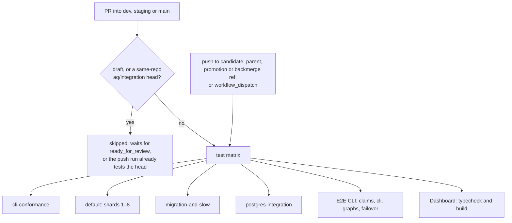

# Continuous integration

What GitHub Actions runs for Agent Queue, when it runs, and — just as
important — what it does not run.

## Why this page exists

AQ's CI runs the full suite **before** a change reaches `main`, never after.
The test workflow runs on pull requests into `dev`, `staging` and `main`, and on pushes to the
integration branches AQ itself creates. A push to `main` does not start it, so
`main`'s own commits carry only the checks of the candidate or PR run that
tested them. Knowing that saves you from waiting for a run that is never going
to appear. The one exception is the break-glass audit: in App credential mode, a
push to `main` without a valid integration attestation runs the suite after the
fact ([`main-attestation.yml`](#main-attestationyml)). The dependency-cache workflow
also runs on `main` without tests; it keeps the cache that every
other run restores ([dependency cache](#dependency-cache)).

## Vocabulary

* **Suite arm** — one entry in the test job's matrix. Eleven run in parallel:
  eight default shards and three specialized arms, each with its own command.
* **Integration branch** — a branch AQ's integration service creates to assemble
  and test candidate work before it reaches `main`; its refs look like
  `aq/integration/p-<32 hex>/r-<32 hex>` and `aq/batches/**`. The train
  promotes the exact tested SHA to its configured target (currently `dev`).
* **Parent snapshot ref** — an immutable
  `aq/parent/<task>/<operation hash>/<generation>/<sha>` ref that tests one
  parent generation. The parent-CI publisher that pushed these refs had no
  production caller and is retired; the `aq/parent/**` trigger is kept.

## The workflows

These, in [`.github/workflows/`](../../.github/workflows/). There was also
`docs.yml`, which built a MkDocs site and deployed it to GitHub Pages; it was
retired — see [there is no documentation
build](#there-is-no-documentation-build).

| Workflow | Triggers | What it does |
|---|---|---|
| [`tests.yml`](../../.github/workflows/tests.yml) | `pull_request` into `dev`, `staging` or `main` (opened, synchronize, reopened, ready_for_review); push to `aq/integration/**`, `aq/batches/**`, `aq/parent/**`, `aq/promote/**` and `aq/backmerge/**`; `workflow_dispatch`; `workflow_call` | Eight default shards, three specialized arms and four stateful CLI scenario groups against real PostgreSQL services, plus dashboard typechecking and a production build. |
| [`train-candidate.yml`](../../.github/workflows/train-candidate.yml) | Successful push-triggered `Tests` completion on `aq/integration/**` or `aq/batches/**` | Posts `aq-train/candidate` on the exact tested head SHA; runs no tests. |
| [`main-attestation.yml`](../../.github/workflows/main-attestation.yml) | Push to `dev`, `staging` or `main` | Verifies the pushed SHA's branch attestation; only an unattested push in App mode calls `tests.yml`. See [below](#main-attestationyml). |
| [`venv-cache.yml`](../../.github/workflows/venv-cache.yml) | After each `Main attestation` run (`workflow_run`); hourly `schedule`; `workflow_dispatch` | Saves `tests.yml`'s `.venv` cache entry on `main`. Installs dependencies and runs no tests. See [dependency cache](#dependency-cache). |
| [`macos-acceptance.yml`](../../.github/workflows/macos-acceptance.yml) | Push to `ci/macos-acceptance**`; `workflow_dispatch` | The native macOS install journey, recorded by a human rather than gating a merge. |

> **Note.** Pushes to `dev`, `staging` and `main` run the attestation
> audit rather than starting `tests.yml` directly. An unattested push in App
> mode does run the reusable suite. Candidate, PR and managed local validation
> remain distinct evidence; see [pull requests and delivery](pull-requests.md).

## `tests.yml`



### Which pull requests run

Every pull request into `dev`, `staging` or `main` runs the Python matrix, E2E groups and dashboard
job, from a fork or a task branch alike, with two exceptions decided by each job's `if:`:

* A **draft** runs nothing until it is marked ready for review; the
  `ready_for_review` event then starts the run.
* A **same-repository PR whose head is an `aq/integration/**` branch** skips its
  run, because the push to that branch already tested the same head SHA and
  those check runs appear on the PR. A fork's branch of the same name gets no
  push run here, so its PR still runs.

The job checks out the exact event SHA (the PR's merge with its base, for a
`pull_request` event) and asserts it with `git rev-parse HEAD`.

### The suite arms

| Arm | Command |
|---|---|
| `cli-conformance` | `aq test tests/test_cli_inventory.py tests/test_cli_conformance.py -n 2 --dist loadfile` |
| `default-1/8` … `default-8/8` | `pytest tests/ -n 4 --dist loadfile --splits 8 --group N --splitting-algorithm least_duration --ignore=tests/test_cli_inventory.py --ignore=tests/test_cli_conformance.py` |
| `migration-and-slow` | `pytest tests/ -n 4 --dist loadfile -m "migration or slow"` |
| `postgres-integration` | `pytest tests/ -n 4 --dist loadfile -m "(integration or perf) and not migration and not slow" --ignore=tests/test_e2e_cli_stateful.py` |

Every arm appends `--timeout=120 --durations=50 -rfE` to its command.
`pytest-timeout` (installed by the `dev` extra) limits each test to 120 seconds,
including fixture setup and teardown. A timeout names the failed test and dumps
thread stacks; `-rfE` keeps failed/error node IDs in the final summary, and
`--durations=50` reports the 50 slowest setup, call and teardown phases.

Known slow tests may use a bounded `@pytest.mark.timeout(seconds)` override.
Each stateful CLI scenario item has its own 540-second limit, including a
fresh world's setup on its shard's first item. Items share a module-scoped
world within a shard; setup, scenario subprocesses and teardown also have bounded
timeouts. The whole group still has an eleven-minute
Actions step deadline. A marker does not extend that deadline.
See [pytest-timeout's documentation](https://github.com/pytest-dev/pytest-timeout)
for marker precedence and timeout behavior.

`fail-fast: false`, so one red arm does not hide the others. A cache-miss
dependency install has a 12-minute step deadline and the test step a 20-minute
one (11 minutes for an E2E scenario group, whose individual items have 540-second
limits); each job times out at their sum plus three minutes for checkout,
PostgreSQL, migrations and cleanup (35 minutes, 26 for `e2e-cli`). A shared 10-minute total let a slow PyPI spend the
tests' time: in the 40 runs up to 36831813696, eight jobs were cancelled after
installs of 306–600 seconds, while no test or scenario step took over 332
seconds. Run 38601833262 later exhausted the ten-minute test step on two
progressing default shards, with collection taking up to three minutes, and
run 38612265340 exhausted fifteen minutes on a slow runner (collection 3:06,
PostgreSQL checkpoints of 270 s) at 92% of a shard that took 8:37 one run
earlier. The 20-minute step limit leaves time for completion and pytest's failure diagnostics;
the 120-second per-test deadline remains in force. These limits bound failures
and improve diagnostics. Profiling on 2026-09-26 measured the
unsharded default suite at about 21 minutes; it now runs in eight shards as
described below. The original stateful CLI smoke measured 11–16 minutes; its scenarios now
run in four separate jobs with 11-minute scenario steps, as described below. Hosted
runner timings must confirm that the groups finish within those caps. A longer test marker does not make that job fit within its cap.

Worker counts are explicit: four for the broad suite arms, matching the
profiled hosted runner, and two for the two CLI test files. Local `aq test`
runs still use the box's resource caps; these counts apply to CI.

The conformance job also runs a separate serial CLI startup performance check:
`AQ_PERF_STRICT=1 aq test -m perf -p no:xdist -s tests/test_cli_startup_offline.py`.
This is the explicit exception to CI's usual wall-clock-budget opt-out.

The default shards inherit the marker deselects from `pyproject.toml`'s
`addopts`, which is why the other two arms exist: they select exactly what the
default one drops. Tests with a `migration` or `slow` marker belong to
`migration-and-slow`, including those also marked `integration` or `perf`.
The legacy SQLite import and PostgreSQL substrate suites run there too,
including the real template-creation coordination check.
The `cli-conformance` arm is separated so a CLI-surface
change fails visibly instead of inside fourteen thousand other results, and it
is the one arm that goes through the `aq test` wrapper. Its two files are
ignored by every default shard, so they execute once.

Wall-clock budgets still skip in the `postgres-integration` arm: they need
`AQ_PERF_STRICT=1`, which CI does not set for that arm, because a hosted runner's load makes
them measure the runner rather than the code. Statement-count budgets, which
are deterministic, do run. See [testing](testing.md#latency-budgets).

### Dashboard typecheck and build

`Dashboard (typecheck/build)` is a required check for both parent snapshots and
root train candidates. It checks out and verifies the exact event SHA, sets up
Node 24, caches npm downloads using the root `package-lock.json`, and runs
`npm ci` from the repository root to install both npm workspaces. It then runs
`npm run typecheck` and `npm run build` in `dashboard/`. Both scripts generate
the TypeScript client from the committed `openapi.json`; the build runs
`tsc -b` followed by Vite's production build. A TypeScript error or failed build
fails the check. The job has a 15-minute total deadline, with separate 8-minute
install, 2-minute typecheck and 3-minute build limits.

The sixteen required check names and their derived version `ci-4f7c710bba01`
are recorded in [the train policy](../config/agent-queue-train-policy.json) and
[the App trust manifest](../../.github/agent-queue-integration.json). The
operator must approve rotation from `ci-4c6e0c2a989c` before rebinding the
installed policy and updating the `AQ_INTEGRATION_REQUIRED_CHECK_VERSION`
Actions variable. Existing train operations retain their frozen policy
snapshots; landing the workflow and manifest does not update those snapshots
or the installed project policy. Follow the
[train policy handoff](../config/agent-queue-train-policy.md) and
[App-mode rotation procedure](../config/app-mode-train.md#95-changing-the-required-check-set-rotation).

### Default shard timings and refresh

[`pytest-split`](https://github.com/jerry-git/pytest-split) selects each default
shard using the committed [`.test_durations`](../../.test_durations) map. The
`least_duration` algorithm balances the sum of test times, including fixture
setup and teardown. Selection happens before xdist assigns the selected files
to four workers with `--dist loadfile`. The eight groups are disjoint and
together select the complete default suite. New test IDs use the average
stored duration; removed IDs do not affect selection.

The test step has a 20-minute deadline and each matrix job has 35 minutes:
12 for a cold dependency install, 20 for tests, and three for setup and cleanup.
Earlier 10- and 15-minute step budgets cancelled progressing shards during
slow collection, PostgreSQL checkpoints or shutdown. The current limits leave
room for reporting and worker teardown without changing per-test timeouts.

After every started test step, including failures, `Check test runtime budget`
measures elapsed wall time and emits an Actions warning above 80% of the step
budget (16 minutes). The annotation names the suite and elapsed/budget seconds;
it does not change the test result. Investigate these warnings and refresh the
timing map from a complete passing hosted run before rebalancing shards.
Stored test seconds are summed across workers; they are a balancing input,
not a wall-clock guarantee. Check actual step times after changing the shard
count or refreshing the map. The separately selected integration and migration
suites retain their own commands.

The initial map comes from the 2026-09-26 local default profile with eight
workers (`local-default-n8.txt` in the task's CI profiling data). It sums the
reported setup, call, and teardown phases. That run had failures and setup
errors, so these are seed timings, not passing-test evidence. Pytest hid phases
below 0.005 seconds; collected IDs without reported timings are seeded with
0.015 seconds (three phases at that reporting threshold). The map is filtered
to the default test IDs collected when it was created.

Each default shard uploads a `default-durations-N-ATTEMPT` artifact with measured
setup, call, and teardown times for its selected tests. Download all eight from
one completed, passing default matrix run and one run attempt, then refresh:

```bash
python scripts/merge_test_durations.py /path/to/downloaded-artifacts
```

The helper accepts extracted artifacts in subdirectories. It rejects missing or
duplicate shards, overlapping test IDs, and invalid durations before replacing
the map. Review the test result, collected ID count, and `.test_durations` diff,
then commit it. Use a complete successful run; interrupted or failing runs may
record only some phases and are unsuitable for balancing.

Alternatively, refresh from an unsharded default run on the disposable
PostgreSQL test service:

```bash
aq test tests/ --store-durations --clean-durations
```

This uses the normal test slot, full-suite lock, and worker cap, and replaces
the map with measured setup, call, and teardown times while removing stale IDs.
Do not add `--splits` or `--group` to this refresh command: a cleaned map
from a single shard would discard the other seven shards' measurements.

Every shard has its own check name. The parent and root required-check lists
in [the train policy](../config/agent-queue-train-policy.json) must include all
eight. Existing installations using the former `Tests (default)` name need the
operator to rebind that policy and update any explicit merge-required checks
or GitHub branch rules when adopting this workflow.

### Dependency cache

The suite arms share an `actions/cache` entry for `.venv`, keyed by runner
OS, architecture, the resolved Python patch version, and both Python package
manifests (plus Python lockfiles when present). There are no fallback restore
keys: a dependency or interpreter change creates a fresh environment. On a
miss, CI creates the venv and installs `.[dev,cli]` and the generated client's
build backend, `poetry-core`. Both the suite and E2E jobs allow a 60-second
pip socket timeout and at most three complete installation attempts, separated
by five seconds. This lets an interrupted wheel download recover even when
pip's connection retries do not restart it. Success ends the retry loop;
exhausting all three attempts fails the job with pip's exit code. The install
step's own 12-minute deadline bounds every attempt.

A run can restore an entry saved on its own ref or on the default branch, never
one saved on another PR or branch. `tests.yml` does not run on `main`, so every
PR merge ref, integration candidate and parent snapshot used to save its own
copy and miss on its first run: all fifteen jobs of run 36828502487
cold-installed from PyPI, and one runner's slow mirror cancelled a shard at its
10-minute deadline before any test ran.
[`venv-cache.yml`](../../.github/workflows/venv-cache.yml) keeps the entry on
`main` instead. Its one job, `Warm venv cache`, checks out `main`, sets up the
same Python and computes the same key, and looks the key up without
downloading it. On a miss it installs what a `tests.yml` miss installs,
retrying a stalled PyPI download under a 30-minute deadline, and saves the
venv. It runs no tests. It starts:

* after every `Main attestation` run (`workflow_run`), so a dependency change
  that lands on `main` is cached within minutes;
* hourly (`schedule`), to re-create the entry after a runner image changes the
  resolved Python patch version, or after GitHub evicts it (unused for seven
  days, or over the repository's cache size limit);
* by hand, with `gh workflow run venv-cache.yml --ref main`. Dispatch it on
  `main`: an entry saved on any other branch is readable only there.

None of these is a push or pull_request event, so the warm-up adds no check to
a PR and never gates a train ref. Train onboarding counts any workflow with a
push trigger as a gate, which is why it does not follow pushes to `main`
directly. A PR or candidate whose manifests match `main` restores the venv on
its first run, and its log shows `Cache restored from key: venv-v1-…`. One that
changes a manifest still installs once, on its own ref.
[`tests/test_ci_trigger_policy.py`](../../tests/test_ci_trigger_policy.py) pins
the warm-up's triggers, holds its Python setup, cache path and key to both
`tests.yml` jobs', and checks that it installs the same requirements.

Every run adds `.venv/bin` to `PATH` and reinstalls both local packages as
editable with `--no-deps --no-build-isolation`. This keeps the current source,
entry points and generated client in use even when their code changed without
a dependency change. Cached dependencies need no download or resolution on a
hit. Bump the `venv-v1` key prefix, in both workflows, to rebuild unchanged
dependency manifests.

This removes repeated setup work; it does not establish a five-minute job
budget. The default shards and the integration smoke tests still need their
test time measured on hosted runners after any performance changes.

### Stateful CLI scenario groups

The `e2e-cli` job runs the [Tier 1 end-to-end kit](../guides/e2e-swarm.md) on
the same PR, candidate, parent, promotion and backmerge events. Its four matrix
entries run in parallel with `fail-fast: false`, each with a twelve-minute
cache-miss install step, an eleven-minute scenario step and a 26-minute total
job deadline. The scenario step selects by the trailing hyphen in pytest IDs
(`-k 'claims-'`, for example); using `-k cli` would also match the module name.

| Group | Scenarios |
|---|---|
| `claims` | S1–S3, S7, S19 |
| `cli` | S5, S8–S9, S12, S17, S20 |
| `graphs` | S10, S16b, S18, S6 |
| `failover` | S4, S11, S13–S15, S16a |

These are **21 individually reported pytest items**, covering all 20 shell
scenarios once, with S16 split into two items. S16a checks outage detection and
rerouting; S16b prepares its own outage and checks recovery, undo and all-down.
S15 now checks the current integration command surface and absence of retired
controls. S20 proves train-mode delivery through local managed validation.

Each shard owns one module-scoped disposable world: database, daemon, port,
vault and repositories. S1–S3 share state; selecting S2 or S3 alone prepares its
predecessors. Other item boundaries remove task/session fixtures and restore
configuration. Failed cleanup prevents reuse, and teardown destroys the world.
These runners use no xdist. Each item has its own 540-second pytest limit;
`--durations=0` reports every item's phases. CI uploads JUnit and per-shard
`TIMING` JSONL artifacts, including on failure.

Fixture registration, cleanup and condition inspection use the public command
API. Ordinary CLI calls use a preloaded Unix-socket launcher that forks a fresh
process per invocation. Races, wait commands, plugin probes, help and version
still use fresh interpreters. See [the shared-fixture measurement
report](../reports/2026-09-30-e2e-shared-fixtures.md) for the measured changes.

Both boundaries in [the train policy](../config/agent-queue-train-policy.json)
require all four `E2E CLI (...)` checks. Existing installations must rebind the
policy and update explicit merge-required checks or GitHub branch rules when
adopting a changed check set. `postgres-integration` excludes the E2E module
and covers the remaining integration tests.

### Environment

* Each job starts a disposable `postgres:18` container with `docker run`, with
  `POSTGRES_TEST_DSN` pointed at its localhost port. The image, like the
  `E2E CLI` jobs' service image, is pulled from Google's Docker Hub mirror,
  `mirror.gcr.io/library/postgres:18`: anonymous Docker Hub pulls are rate
  limited per runner IP, and a login secret would not reach pull requests from
  forks. The test matrix explicitly pulls the image before starting the
  container, retrying up to three times with five seconds between attempts to
  recover from transient mirror errors such as `unknown blob`. Exhausted pulls
  fail the job; container-start errors are not retried. GitHub Actions service
  containers do not accept PostgreSQL server arguments. The server runs with
  `max_connections=300` so concurrent xdist workers can lease databases without
  exhausting the default 100 connections. It also uses `fsync=off`,
  `synchronous_commit=off`, and `full_page_writes=off` to reduce checkpoint and
  database-teardown costs for this disposable data. These settings are confined
  to CI. A bounded TCP readiness check runs before migrations or tests; failed
  jobs print the PostgreSQL logs, and an always-run step removes the container
  and its volumes.
  [`tests/pg_dsn.py`](../../tests/pg_dsn.py) rewrites that DSN per xdist worker
  (`…_gw0`, `…_gw1`, …) and creates each worker's database on first use —
  sharing one database across concurrent workers would let one worker's reset
  truncate another's in-flight state.
* `AQ_REQUIRE_POSTGRES_TESTS=1`, a compatibility guard for helpers imported
  outside normal pytest startup.
* `GIT_AUTHOR_*` / `GIT_COMMITTER_*` identities, because the Git-integration
  tests create real commits and hosted runners ship with none.
* The `migration-and-slow` arm applies the whole Alembic chain to a scratch
  database (`ci_migration_check`) before the tests run, so a migration that
  only works against an already-populated database fails loudly. Other arms
  skip this standalone check; their test fixtures still provision PostgreSQL
  normally. The SQLite half of this check went away with the backend — it was
  never a proxy for production, since SQLite accepted DDL PostgreSQL rejects
  outright.

### Concurrency

```yaml
concurrency:
  group: tests-${{ github.ref }}
  cancel-in-progress: true
```

One group per ref: `refs/pull/<n>/merge` for a PR, the branch for an
integration candidate. A newer push to the same PR or integration branch
cancels its obsolete run. Parent snapshot refs are named by SHA, so no two
share a group. A run that [`main-attestation.yml`](#main-attestationyml) calls
takes the caller's ref, `tests-refs/heads/main`, so a newer unattested push
cancels an older one's audit run: the tip is what matters.

Until 2026-09-24 `main` was a trigger and its group was keyed by commit, so a
burst of merges could not cancel the run of the merge commit that broke it (two
PRs, each green on its own stale base, put a red `main` together on
2026-09-03). That class is now caught before `main`: in train mode the train
tests the assembled candidate and promotes that exact SHA, and `pr_merge`
refuses a PR whose head is behind its base
(`integration.merge_require_up_to_date`, on by default), so its PR run tested
the combination that lands.

The same incident is why generated artefacts and the change that causes them
belong in one commit — see [code generation](codegen.md#state-ownership).

## `main-attestation.yml`

The hosted half of the App-mode attestation (App-mode integration train spec
§7.2). Its `attestation` job sparse-checks-out one file,
[`src/integration/hosted_attestation.py`](../../src/integration/hosted_attestation.py),
a standard-library script that mirrors the daemon's `select_trusted_attestation`:
it finds the newest `Agent Queue Integration Attestation` check run from the App
in `AQ_INTEGRATION_ATTESTATION_APP_ID`, requires canonical payload text and a
matching `external_id`, checks the payload's repository, head and
`AQ_INTEGRATION_REQUIRED_CHECK_VERSION`, and reads every attested check run back
from GitHub. It writes `attested`, `configured` and `reason` as step outputs.

On `dev` it checks the integration attestation. On `staging` and `main` it
requires the promotion attestations for steps `staging` and `release`, respectively,
and binds each proof to its exact target ref. The repository trust manifest names
both promotion attestations. The
[activation plan](../config/dev-staging-main-github-plan.md) records the matching
branch rules and Actions variables.

* **Variables unset** (development mode, before the cutover):
  `configured=false`, and nothing else runs.
* **Attested** (a train promotion): `attested=true`, and no second CI runs.
* **Anything else** (a break-glass push, or any API or parse error):
  `unattested-ci` calls `tests.yml`, whose checks appear as
  `unattested-ci / Tests (…)`. They never collide with the required names the
  train observes on a candidate.

`tests/test_hosted_attestation.py` builds payloads with the daemon's
`AttestationPayload`, so the two canonicalizations cannot drift apart.

## There is no documentation build

This documentation set is **GitHub-rendered Markdown with relative links**.
Nothing compiles it, nothing deploys it, and there is no documentation site.

It used to have one. `.github/workflows/docs.yml` built a MkDocs Material site
on every push to `main` touching `docs/**` and published it to GitHub Pages at
`electricjack.github.io/agent-queue/`. That site predated this documentation
set and was never migrated to it: by the time it was removed, **49 of the 77
pages listed in `mkdocs.yml`'s `nav:` block did not exist** — the entire
`mkdocstrings` `api/` tree plus `getting-started.md`, `architecture.md` and the
`git-sync-*.md` pages — so the deploy served a stale, partly-404 mirror of the
documentation on every merge.

Rather than maintain a second navigation over the same tree, the site was
retired. `mkdocs.yml`, `.github/workflows/docs.yml`, `scripts/generate-docs.sh`
and `pyproject.toml`'s `docs` extra were all deleted; the one navigation that
remains is [the documentation map](../documentation-map.md).

> **Operator step.** Deleting the workflow stops future deploys but does not
> remove what is already published. The `github-pages` environment and the
> Pages site itself are repository settings and have to be disabled by hand
> (Settings → Pages → *Unpublish site*, then Settings → Environments →
> `github-pages`).

Practical consequence for a documentation change: your links must resolve in
the GitHub file browser, from the directory of the file they are in. Nothing
else checks them, so run [`check-docs.py`](../../scripts/check-docs.py) over
the pages you edited. The one check that gates a push is the coverage
manifest:

```bash
python3 docs/plans/documentation-overhaul/refresh_inventory.py --check
```

## What CI does not do

* It does not run the suite on a push to `main` unless that push is unattested
  in App mode, or on a push to a task branch that has no PR. Use
  `gh workflow run tests.yml --ref <branch>` for either.
* It does not lint. Ruff runs in [pre-commit](checks.md#lint) if you install
  the hooks, and nowhere else.
* It does not run dashboard lint or the Vitest suite; those remain local
  checks ([checks](checks.md#frontend)). Typechecking and the production build
  run in `Dashboard (typecheck/build)`. The dashboard
  *server*'s Python suites (`tests/test_dashboard_server_*.py`) do run, in the
  default arm like any other test file; they stage a small synthetic bundle
  rather than building the real one.
* It does not run Tier 2 of the [end-to-end kit](scripts.md#supported-end-to-end-kit),
  which launches real provider sessions. The four E2E CLI groups run Tier 1.
* It does not publish anything. There is no release workflow and no
  documentation deploy — see [builds and releases](releases.md) and
  [above](#there-is-no-documentation-build).

## Inputs and outputs

| Input | Output |
|---|---|
| A PR into `dev`, `staging` or `main` opened, updated, reopened or marked ready | Sixteen check runs on the PR's merge with its base |
| A push to `aq/integration/**`, `aq/batches/**`, `aq/parent/**`, `aq/promote/**` or `aq/backmerge/**` | Sixteen check runs on that exact SHA, which the integration service reads as candidate or parent evidence |
| A draft PR, or a same-repository PR from `aq/integration/**` | A skipped job; the push run covers the integration head |
| `workflow_dispatch` | The same matrix, on demand, from the Actions tab |
| A push to `main` | One `Main attestation` check run; with the Actions variables set and no valid attestation, also sixteen `unattested-ci / …` check runs; then one `Warm venv cache` run, which saves the venv cache only if `main`'s key is new |
| The hourly schedule | One `Warm venv cache` run on `main`, which installs and saves only on a miss |

## State ownership

CI owns nothing durable. Every database it creates lives in a disposable
PostgreSQL container, and no job writes back to the repository. Between runs it
keeps only Actions cache entries, chiefly the `.venv` entry `venv-cache.yml`
keeps on `main`. `tests.yml` and `venv-cache.yml` hold only `contents: read`;
their checkouts use the default token and push nothing.

## Common failures and recovery

| Symptom | Likely cause | Do |
|---|---|---|
| No `Tests` check on your PR | The PR is a draft, or its base is outside `dev`, `staging` and `main`. | Mark it ready for review, or run `gh workflow run tests.yml --ref <branch>`. |
| No `Tests` run on a `main` commit | Expected — a push to `main` is not a trigger. A promoted candidate's commit shows its integration run's checks. | `gh workflow run tests.yml --ref main` if you need one. |
| `unattested-ci / Tests (…)` checks on a `main` commit | The push carried no valid integration attestation: a break-glass push, or the `Main attestation` step's `reason`. | Read the `Main attestation` run's summary; fix forward if the suite is red. |
| `default` arm red, others green | An ordinary regression. | Reproduce locally: `aq test <the failing file>`. |
| `migration-and-slow` red only | You touched schema or a migration. | Reproduce with `-m "migration or slow"` on those files. |
| `postgres-integration` red only | A statement-count budget moved, or an `integration`-marked test. | `aq test -m "integration or perf" <file>` on a quiet box. |
| `cli-conformance` red | The CLI inventory is stale. | `python scripts/generate-cli-command-inventory.py` |
| `Install dependencies on cache miss` runs although your manifests match `main` | `main` has no entry for this key yet: the runner resolved a new Python patch version, or `Warm venv cache` has not run, or failed, since the change. | Check `gh cache list --ref refs/heads/main`; run `gh workflow run venv-cache.yml --ref main`. |
| `main` red after a change landed | Two changes that are individually green and jointly broken, or a change that reached `main` without a run. | Reproduce with `aq test` on the failing files, or dispatch a run on `main`; fix forward. |

## Related pages

* [Local checks](checks.md) — how to be reasonably sure before you push.
* [Testing](testing.md) — the markers the suite arms slice by.
* [Code generation](codegen.md) — the drift guards CI enforces.
* [Pull requests and delivery](pull-requests.md) — how work actually reaches `main`.
* [CI at integration boundaries](../guides/integration-ci-boundaries.md) — the
  trigger policy and parent snapshot refs.

## Source and tests

[`.github/workflows/tests.yml`](../../.github/workflows/tests.yml),
[`.github/workflows/main-attestation.yml`](../../.github/workflows/main-attestation.yml),
[`.github/workflows/train-candidate.yml`](../../.github/workflows/train-candidate.yml),
[`.github/workflows/venv-cache.yml`](../../.github/workflows/venv-cache.yml),
[`src/integration/hosted_attestation.py`](../../src/integration/hosted_attestation.py),
[`.github/agent-queue-integration.example.json`](../../.github/agent-queue-integration.example.json).

```bash
aq test tests/test_ci_trigger_policy.py tests/test_agent_queue_train_policy.py tests/test_integration_attestation.py tests/test_attestation_check_run_id.py tests/test_hosted_attestation.py
```
