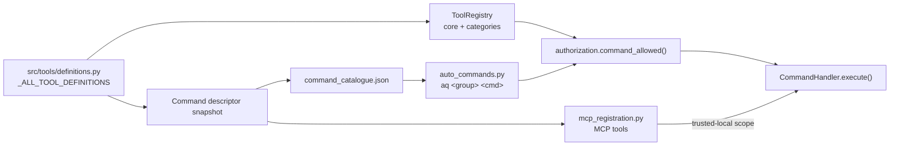

# Agent-facing tools

An AI agent can reach Agent Queue two ways: by shelling out to `aq`, or by
calling a **tool** — a JSON Schema description of one command, handed to a
model so it can call it natively. Both paths delegate command execution to:
`CommandHandler.execute(name, args)`. The tool layer is a *presentation* of
the command surface, not a second surface.

This page covers where tool definitions come from, how they are grouped and
discovered, what filters them, how MCP publishes them, and the agent skills
that ship alongside. For the CLI itself see [the CLI contract](README.md).

> **AQ is CLI-first, on purpose.** The shipped tool guidance tells a worker to
> prefer `aq …` for anything exploratory, because a command line costs one or
> two thousand tokens of learned usage while a large tool schema costs tens of
> thousands. Native tools are for the handful of calls made mid-turn where a
> tool call genuinely beats a subprocess.

## Where tool definitions come from

[`src/tools/definitions.py`](../../../src/tools/definitions.py) holds
`_ALL_TOOL_DEFINITIONS`: a list of plain dicts, each `{"name",
"description", "input_schema"}`, where `name` is a `CommandHandler` command.
These definitions feed the shared command inventory. The CLI uses a packaged
catalogue generated from that inventory, so help works with the daemon down.

The shared descriptor snapshot (`src/commands/command_inventory.py`) composes
that list with typed contracts, fallback schemas, discovered handlers and
plugin registrations. MCP, API code generation and command-catalogue
generation project its transport view. Explicit definitions retain precedence
on those transports; typed playbook contracts use a separate view, and schema
disagreements are recorded in descriptor audits. This does not make the
transport schemas runtime validators.

The CLI reads the generated, committed `src/tools/command_catalogue.json`,
without importing the handler. The data flows are:



A command with no definition here is still dispatchable — the MCP layer
discovers `_cmd_*` methods and synthesises a schema for them — but it will
use its typed contract or fallback schema if present. A genuinely
argumentless handler gets an empty-object schema; an argument-taking command
without a schema is marked opaque in the descriptor inventory.

## Categories, core tools, and on-demand loading

[`ToolRegistry`](../../../src/tools/registry.py) splits the definitions in
two. A tool listed in `_TOOL_CATEGORIES` belongs to a named category; a tool
listed nowhere is **core** and is included by the registry's core-tools API.
Core includes `find_applicable_tool` and `load_tools`. This grouping comes
from the former conversation tool-loading loop; it does not configure a
running tmux harness's tools.

Selected categories and their CLI groups are below. This is not a complete
inventory: commands also cover knowledge/records, reviews, waits, jobs,
collaboration, routing and other areas. Category assignment and CLI overrides
live in `definitions.py`; use `aq --help` for the installed tree.

| Category | CLI group | What it covers |
|---|---|---|
| `task` | `aq task` | Task lifecycle, approval, dependencies, archives, results. |
| `project` | `aq project` | Project CRUD, workspaces, project metadata. |
| `agent` | `aq agent` | Agents, profiles, profile import/export. |
| `playbook` | `aq playbook` | Compilation, runs, human-in-the-loop review and resume. |
| `system` | `aq system` | Token usage, logs, events, config, diagnostics, prompts. |
| `git` | `aq git` | Branch, commit, push, PR, merge, remote URL. |
| `files` | `aq file` | Read, write, edit, glob, grep. |
| `notes` | `aq note` | Project notes and promotion to specs. |
| `memory` | `aq memory` | Semantic memory search and save. |
| `message` | `aq message` | The inter-agent and user message queue. |
| `escalation` | `aq escalation` | Durable human escalations. |
| `digest` | `aq digest` | The hourly activity digest. |
| `discord` | `aq discord` | Shared-channel housekeeping. |
| `mcp` | `aq mcp` | The MCP server registry and tool catalog. |
| `pool` | `aq pool` | Worker pool sizing. |
| `formula` | `aq formula` | Reusable task-graph templates. |
| `graph` | `aq graph` | Server-side spatial task-graph layout. |
| `plugin` | `aq plugin` | Plugin lifecycle. |

Two commands drive discovery:

* **`load_tools`** returns executable names for a category or one tool. It
  does not inject schemas into a running harness. The old `ChatAgent` loop
  that performed that injection is gone. It remains an internal command,
  excluded from CLI and MCP; the registry's core/category APIs remain useful
  to code that explicitly consumes them. Loading never grants authority.
* **`find_applicable_tool`** (`aq system find-applicable-tool`) searches tools
  by describing what you want to do. It is backed by
  [`ToolIndex`](../../../src/tools/tool_index.py), an in-memory cosine-
  similarity index over tool names and descriptions, rebuilt at startup and
  never persisted. If the embedding provider is unavailable the index simply
  stays empty and the command falls back to keyword overlap in tool names
  and descriptions (`method: "keyword"`). Results describe the registry;
  they are not currently filtered by dispatchability or capability, so a
  match is not evidence that this caller can execute it.

## What an agent is actually shown

`load_tools` does not hand back everything in a category. Two filters run
first, and both exist to avoid advertising unavailable commands:

1. **Dispatchability** — a definition with no backing `_cmd_*` method and no
   plugin command is dropped, with a reason. Advertising `memory_search` with
   the `aq-memory` plugin uninstalled would produce a confusing "unknown
   command" on the next turn, so the command reports that the plugin is not
   installed instead.
2. **Capability** — names the caller's policy could not dispatch are dropped
   *silently*. Discovery uses the same `command_allowed` predicate the
   dispatch gate uses
   ([`src/commands/authorization.py`](../../../src/commands/authorization.py)),
   so the two cannot drift. Which commands a caller cannot reach is operator
   information, not agent information; it goes to the daemon log.

## MCP

When enabled, the daemon embeds a streamable-HTTP MCP server on the same host and port as
its API (`mcp_server.host` / `mcp_server.port`, default `127.0.0.1:8081`),
mounted at `/mcp`.

**What it publishes.** Every authored tool definition, plus every discovered
`CommandHandler` command and plugin command, minus the *effective exclusions*:
`DEFAULT_EXCLUDED_COMMANDS` ∪ `mcp_server.excluded_commands` from the config
file ∪ the comma-separated `AGENT_QUEUE_MCP_EXCLUDED` environment variable
([`src/mcp_registration.py`](../../../src/mcp_registration.py)). The shipped
defaults exclude `shutdown`, `restart_daemon`, `update_and_restart`,
`run_command`, `load_tools`, `session_token` (a credential minter is never
something an MCP client should reach) and `subagent_event` (harness telemetry
an LLM has no reason to hand-write).

**Registry versus session launch.** With both `mcp_server.enabled` and
`inject_into_tasks` true, the registry exposes a synthetic `agent-queue`
entry pointing at `/mcp`. Profiles store external-server names, but session
launch currently does not resolve them into harness MCP configuration.
Workers reach AQ through `aq`; external MCP must be configured in the harness
outside AQ. The registry and catalog work independently of launch.

**Caller identity limitation.** MCP publication is process-wide, not filtered
per caller. The HTTP middleware rejects invalid bearer tokens, but the MCP
handler currently does not forward the resolved request scope to `execute`.
Calls therefore use trusted-local identity, apart from the fixed MCP scope
for `question_*`. The intended worker capability boundary is not enforced by
this transport. Use the authenticated CLI/HTTP path for session-scoped calls.
Read-only `agentqueue://` resources also read directly from shared state.

Set `mcp_server.enabled` explicitly: the dataclass defaults to true, but a
YAML `mcp_server` section that omits `enabled` currently loads it as false.

> **Proposed, not implemented.** The aq-surface design describes a second
> mount at `/mcp-task` exposing a small task-scope allowlist. The
> configuration substrate exists (`mcp_server.task_scope.enabled`,
> `allowlist_extra`) but nothing reads it: `enabled` defaults to false and the
> endpoint is not served. Do not describe it as a shipped surface. The
> allowlist's *intent* — a small set of mid-turn calls — is what the shipped
> tool guidance names today.

## `aq schema` — the enum catalog

Agents guess magic strings. `aq schema` exists so they do not have to. It
prints a pure, code-owned catalog built by
[`src/surface_schema.py`](../../../src/surface_schema.py) with no database and
no daemon:

```bash
aq schema --json
```

```text
{"schema_version": 1, "data": {"schema_version": 1, "enums": {"task_status": ["DEFINED", "READY", "ASSIGNED", …
```

It carries `task_status`, `task_type`, `dependency_type`, `gate_type`,
`gate_status`, `hierarchy_error`, `claim_result`, `claim_phase`, `lifecycle`,
`session_state`, `agent_state` and `outcome`. The values are owned by the
subsystems that define them; `aq schema` is a projection with its own
`schema_version`. The same catalog is available as the `get_schema` command,
so REST and MCP callers get it too.

Read a value from here rather than from any page, including this one — a
documented enum is a snapshot, `aq schema` is the truth.

## Harness tool names

[`src/known_tools.py`](../../../src/known_tools.py) is a different register
entirely: it names the tools the *harness* provides (`Read`, `Write`, `Edit`,
`Bash`, `Glob`, `Grep`, `WebSearch`, `WebFetch`, `Agent`, `Skill`, …), which
is the vocabulary a profile's harness-tool allowlist is written in. Validation
is deliberately soft — `validate_tool_names` returns unrecognised names as
warnings, not errors, so a custom MCP-provided tool still works.

The module also parses a profile's `install:` manifest (`npm`, `pip`,
`commands`), which is what `aq agent check-profile` validates and `aq agent
install-profile` acts on.

## Shipped agent skills

Eight skills ship in [`src/skills/`](../../../src/skills/) and are seeded
during vault setup, not at each session start. Claude's target is
`~/.claude/skills/`; Codex (`~/.codex/skills/`) and Gemini
(`~/.gemini/skills/` and `~/snap/gemini-cli/common/.gemini/skills/`) are seeded
when their corresponding harness homes exist. They are the agent-facing
documentation of this surface — short, task-shaped, and loaded on demand:

| Skill | Covers |
|---|---|
| `aq-cli` | Orientation: how to find any command and get detail on it. |
| `aq-knowledge` | Canonical durable records, scoped search, revision guards and readback. |
| `aq-mini-projects` | Explicitly requested bounded ideation in one task, ending in plan review. |
| `aq-tasks` | The task lifecycle from a worker's seat, and `aq task explain`. |
| `aq-comms` | Messages, the inbox, and reporting a blocker to a human. |
| `aq-workspaces-and-git` | The assigned worktree, its branch, committing, pushing, opening a PR. |
| `aq-playbooks-and-gates` | Inspecting a paused run and resolving a human gate. |
| `aq-reviews` | Document reviews by seat — author, reviser, dispatched reviewer — and the opt-in adversarial review recipe across model families. |

Installation is **write-if-absent** (`ensure_default_aq_skills`): editing a
skill in this repository does **not** update an already-installed copy. The
`skills.installed_drift` doctor check reports the divergence.

Every `aq …` invocation inside these files is machine-checked against the live
Click tree by `tests/test_guidance_docs.py`, along with the prime templates and
the pages in this directory — a subcommand that no longer exists, a positional
id passed to a generated command, or an option the command does not take all
fail that test.

> **Two shipped skills carried stale claims** — entries 8 and 9 of the
> [known-inaccuracies ledger](../../plans/documentation-overhaul/known-inaccuracies.md),
> both now corrected in tree: `aq-playbooks-and-gates` described per-task
> reviewer and final-reviewer creation as part of the shipped default pipeline,
> and `aq-comms` described a `UserPromptSubmit` inbox hook that was removed on
> 2026-08-27. Because installation is write-if-absent, an install that already
> has the old copy keeps it until it is re-seeded — `aq doctor --check
> skills.installed_drift` reports the divergence and `--fix` re-copies the
> shipped file after backing the installed one up as `SKILL.md.bak`.

## State ownership

| State | Written by | Where it lives |
|---|---|---|
| Tool definitions | Source, at edit time | [`src/tools/definitions.py`](../../../src/tools/definitions.py) |
| Category assignment | Source | `_TOOL_CATEGORIES`, `_CLI_CATEGORY_OVERRIDES` in the same module |
| The semantic tool index | Daemon startup | Memory only; rebuilt every start |
| Core/category tool views | `ToolRegistry` | Computed views; no automatic harness schema injection |
| Offline CLI catalogue | `scripts/generate-command-catalogue.py` | `src/tools/command_catalogue.json`; regenerate, never hand-edit |
| MCP exclusions | Code, config file, environment | `DEFAULT_EXCLUDED_COMMANDS`, `mcp_server.excluded_commands`, `AGENT_QUEUE_MCP_EXCLUDED` |
| MCP server registry entries | `aq mcp …` | `vault/[projects/<pid>/]mcp-servers/*.md` |
| Installed agent skills | `ensure_default_aq_skills`, write-if-absent | The harness's skill directory |

## Common failures and recovery

| Symptom | Diagnose with | What it means |
|---|---|---|
| A tool the agent calls answers "unknown command" | `aq system find-applicable-tool --description "<what you wanted>"` | The definition exists but nothing backs it — most often an uninstalled plugin. |
| A tool is missing from an agent's list | `aq agent get-profile --profile-id <id>` | The profile's `## Capabilities` block does not allow it; discovery drops it silently by design. |
| A command works from the CLI but not over MCP | `aq system get-config --section mcp_server` | It is in the effective exclusion set. |
| `find_applicable_tool` returns nothing at all | daemon log at startup | Without embeddings, keyword matching is used; zero matches can mean no keyword overlap. |
| An installed skill disagrees with this repository | `aq doctor` (`skills.installed_drift`) | Skill installation is write-if-absent; the installed copy is older. |
| An enum value is rejected | `aq schema` | Read the value from the catalog rather than a document. |

## Related pages

* [The CLI contract](README.md) — the surface these tools mirror.
* [Command groups](commands.md) — the same commands as CLI leaves.
* [Command contracts](contracts.md) — the typed layer playbooks use, which is
  stricter than a tool definition.
* [`aq prime` and the session hooks](prime.md) — the tool-guidance section a
  worker actually reads.
* [Module catalog: CLI](../modules/cli.md).

## Source and tests

Definitions [`src/tools/definitions.py`](../../../src/tools/definitions.py);
registry [`src/tools/registry.py`](../../../src/tools/registry.py); semantic
index [`src/tools/tool_index.py`](../../../src/tools/tool_index.py); discovery
commands [`src/commands/tool_commands.py`](../../../src/commands/tool_commands.py);
harness tool names [`src/known_tools.py`](../../../src/known_tools.py); enum
catalog [`src/surface_schema.py`](../../../src/surface_schema.py); MCP
registration [`src/mcp_registration.py`](../../../src/mcp_registration.py).

```bash
aq test tests/test_tool_registry.py tests/test_tool_index.py tests/test_known_tools.py \
        tests/test_surface_commands.py tests/test_session_tool_allowlist.py \
        tests/test_command_capability_authorization.py tests/test_guidance_docs.py
```
