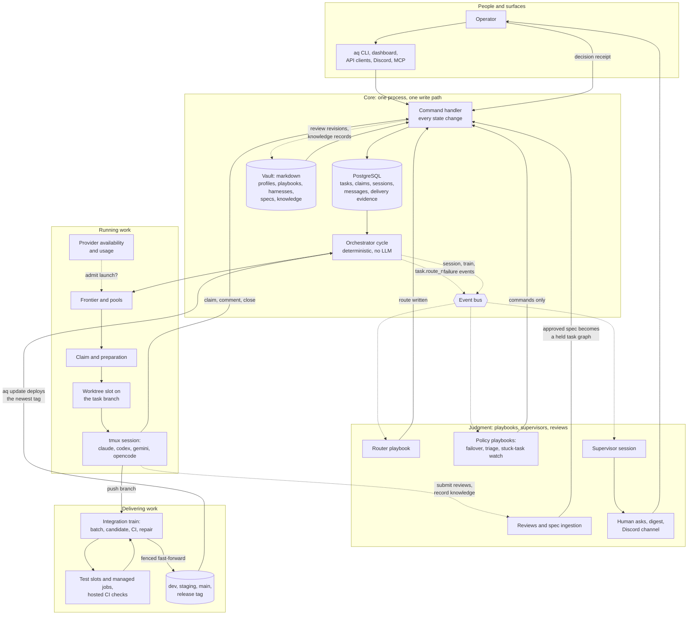

# Agent Queue: the vision and the system map

**Status:** the parent vision spec for the system map, rebuilt on 2026-10-20
from the eighteen per-system specs in this directory. The system list it
follows is the approved inventory ([INVENTORY.md](INVENTORY.md)); an earlier
draft of this page, written before the child specs existed, was withdrawn as
out of date and served only as an outline. This page explains why Agent Queue
exists, the model every part of it shares, how the systems fit together end to
end, the principles that decide trade-offs, where the project stands today and
the roadmap assembled from each child's planned work. It links every child
spec and repeats none of their detail.

Read this page first, then the child spec for the system you are about to
touch, then the matching `docs/concepts/` page for what the code does today.
Where this page and a child spec disagree, the child spec wins; where a child
spec and the code disagree, the code wins and the spec needs a revision.

## 1. The problem

A coding agent in a chat window is a good pair programmer and a poor
employee. It forgets between sessions, it cannot be handed a backlog, it
cannot be stopped and resumed, nobody can tell afterwards what it was asked to
do or why it decided what it decided, and when it finishes, its work is a diff
on a laptop rather than a commit on the shared branch. Running twenty of them
at once makes every one of those problems twenty times worse: they trample
each other's checkouts, run the whole test suite at the same moment and freeze
the box, exhaust the same provider quota, and ask the same human the same
question in five places.

Agent Queue exists to turn that pair programmer into a workforce. It is a
daemon that holds a durable graph of work, decides without a model in the loop
which piece of it may run now, starts a coding-agent CLI in an isolated
checkout to do it, watches that process rather than trusting its output,
carries the finished branch through CI onto the shared branch without a human
merge, and asks the human only when the human's judgment is genuinely needed,
in one place, once. Everything it knows about policy is a text file a person
can open and edit. Everything it does is a command whose result is recorded.

The measure of success is simple: a spec approved in the morning lands on the
development branch by the afternoon, with the operator having answered a
handful of real questions and none of the fake ones.

## 2. The core model

Eight nouns carry most of the weight. Every system below exists to create,
move or observe one of them.

**Task.** The durable unit of work: a title, a description, acceptance
criteria, a route, deliverables and a result. Tasks form a graph: an epic
contains children and phases, typed edges block, gates and holds pause, and a
formula expands one task into a generated subgraph. A task's status is a state
machine from defined through ready and in progress to completed, failed or
blocked. Whether a task may start is derived from the graph inside the same
transaction as every write, never set by hand. Closing a task records evidence
of what was done and which checks ran; it delivers nothing by itself.

**Project.** A repository plus its policy: which integration mode publishes
it, which router assigns its work, which playbooks run for it, whether it has
its own supervisor. Projects share one fleet of agents on one machine, but
each is its own queue with its own branch layout.

**Profile and route.** A profile is a markdown file in the vault describing
one kind of agent: the harness CLI it runs, the intelligence class that picks
its model per provider, its grants, its role prompt and rules. Worker profiles
are derived, one rung per intelligence class and installed harness, never
authored by hand. A route is the class, profile and provider intent written
onto one task by the project's router, which is itself a playbook; nothing can
claim an unrouted task.

**Claim and session.** A claim is the epoch-fenced proof that one worker holds
one task, so a worker that lost its task cannot act on it. A session is one
run of a coding-agent CLI (Claude Code, Codex, Gemini CLI or OpenCode) in its
own tmux window, built from a profile, a harness description and a task. The
task is the record, the claim is the proof, and the session is the process the
daemon observes, nudges, restarts or quarantines.

**Workspace.** Where a session works: a worktree slot carved from the
project's retained checkout, on a branch named for the task. The branch is the
thing that lasts; the slot is salvaged, reset and reused between tasks, and
one wrapper makes every git and GitHub call so no credential ever lands in an
agent's environment.

**Playbook.** A policy, written as markdown in the vault, compiled into an
immutable artifact addressed by its hash and activated deliberately at system,
project or agent scope. Playbooks run on events the daemon emits and act only
through the same commands a person could run. Routing, provider failover,
failure triage, spec ingestion, the stuck-task watch and the morning report
are all playbooks.

**Message and ask.** Agents, the daemon and the human talk through durable
internal mail; an idle agent is woken with a one-line pointer to its inbox. A
question only the human can answer becomes one ask with one decision receipt,
shown in the dashboard and one Discord channel, and the human's own words,
not an agent's reading of them, are what gets applied.

**Review and knowledge record.** Documents a human decides on (specs, plans,
proposals, research) are submitted as numbered revisions and approved, sent
back or rejected, with dependent work held behind a gate until approval. What
agents learn is kept as typed, versioned, linked knowledge records, and a
bounded bundle of the relevant ones reaches every agent when it starts.

Behind those eight sits the rule that defines the whole design: **mechanism
in code, policy in playbooks**. The daemon's scheduler cycle is deterministic
and makes no model calls. Anything that needs judgment (which agent, what to
do when a provider is down, whether a failed task is worth retrying) is a
playbook driving commands, and the playbook is a file the operator can read,
diff and replace without a deploy.

## 3. How the systems fit together

The inventory names eighteen systems. Grouped by what they do for a unit of
work, they form five layers around one durable store.

| Layer | Systems | What it does for a task |
|---|---|---|
| Surfaces | [api-and-clients](api-and-clients.md), [dashboard](dashboard.md), [plugins-mcp-and-tools](plugins-mcp-and-tools.md), [operations-and-recovery](operations-and-recovery.md) | Lets people and agents see and change it, and keeps the daemon itself installed, updated and healthy |
| Core | [daemon-core](daemon-core.md), [configuration-and-vault](configuration-and-vault.md), [task-graph](task-graph.md) | Records it, validates every change to it, decides what it unblocks |
| Running work | [scheduling-and-claims](scheduling-and-claims.md), [routing-and-profiles](routing-and-profiles.md), [providers](providers.md), [sessions-and-harnesses](sessions-and-harnesses.md), [projects-workspaces-git](projects-workspaces-git.md) | Chooses who does it, when, where and with which model, and keeps that process alive |
| Delivering work | [integration-and-delivery](integration-and-delivery.md), [test-service-and-jobs](test-service-and-jobs.md) | Carries the finished branch through checks onto the shared branch |
| Judgment | [playbooks](playbooks.md), [supervisors-and-policy](supervisors-and-policy.md), [reviews-and-knowledge](reviews-and-knowledge.md), [messaging-and-human-asks](messaging-and-human-asks.md) | Decides the things a scheduler cannot, and asks a human when it must |

The diagram follows one task from a spec to the shared branch. Solid arrows
are the path the work takes; dashed arrows are the events and observations
that let the judgment layer act without being in the call path.

Reading the picture top to bottom:

1. **Everything enters through one door.** The CLI, the dashboard, the
   generated API clients, the embedded MCP server, Discord replies and every
   playbook step converge on the command handler. The CLI, the dashboard and
   the clients reach it over the daemon's one local HTTP port; MCP tools and
   Discord call it in the same process. It validates the request against the
   caller's scope and the current state, applies it, and returns a result.
   There is no second write path, which is why a refusal from it is an answer
   rather than an obstacle. An agent finishes its task by running an ordinary
   close command; the daemon never waits on the agent's output.

2. **Two stores, each the truth for something.** PostgreSQL owns the facts
   that change quickly and must survive a restart: tasks, claims, sessions,
   messages, jobs and delivery evidence. The vault, an Obsidian-compatible
   folder of markdown, owns the facts a person authors: profiles,
   intelligence classes, harness descriptions, playbook sources and project
   notes. A watcher projects vault files into database rows, and the file
   wins when they disagree. Two things flow the other way: every review
   revision is mirrored into the vault at a fixed path, and knowledge records
   are written out to it so a person can read what the agents learned.
   Shipped content is seeded only where no copy exists, so operator edits
   survive upgrades.

3. **The cycle is a clock, not a brain.** Every few seconds the orchestrator
   checks for a pending deploy, reconciles every session, sweeps gates and
   promotes newly unblocked tasks, sizes the worker pools, admits launches
   against provider availability, ticks the integration train and the
   managed jobs, and emits typed events for anything that changed. A failed
   step is isolated and logged, and the next cycle runs. The event bus is
   not durable, so anything that must not be lost (mail delivery,
   integration, waits) keeps its own table and reconciler, and the cycle is
   the backstop that re-drives it.

4. **Routing is the first judgment.** A new task carries only hints. The
   cycle emits a route-needed event; the project's router playbook plans a
   route from the task's kind, class hint, risk and current provider
   headroom, and writes it back through a command under a fleet-wide lock.
   Only the router writes routes, the policy names profiles by class and
   harness rather than by a specific file, and control-plane roles such as
   the spec ingester and the reviewers are assigned by role instead.

5. **The frontier becomes a claim, and the claim becomes a process.** Pool
   workers run a loop of claim, work, close-and-claim-next. One shared set of
   frontier rules decides what is claimable; the claim is fenced by an epoch
   so a stale worker cannot mutate a task it lost. Preparation salvages and
   resets a worktree slot and checks out the task branch; the session system
   launches the harness CLI in tmux only after its row is committed, with a
   scrubbed environment and a rendered brief. The reconciler then watches
   that process every cycle: it classifies exits, nudges a quiet agent,
   restarts a stalled one and quarantines a repeat offender, and it keeps
   live sessions across a daemon restart by re-adopting them.

6. **Closing is evidence, delivery is a train.** The worker pushes its branch
   and closes with the checks it ran; the close itself refuses if messages
   are unread, a review revision is unpublished, deliverables are unmet or
   children are still open. Completion writes a provenance ref in git. The
   integration train selects those refs on its next visit, seals them into a
   batch, builds one candidate on the target branch, runs the required
   checks on that exact commit (local checks as managed jobs, hosted checks
   on GitHub), files one bounded repair task when it is red, and
   fast-forwards the target under a fence. Promotion carries a tested commit
   from dev to staging continuously and from staging to main on request with
   an annotated version tag, and the daemon's own update command deploys the
   newest tag.

7. **Judgment subscribes; it does not sit in the path.** Failure triage,
   provider failover, the stuck-task watch, the usage probe and the reports
   are playbooks on the event bus. A supervisor is an ordinary agent session
   made special by a profile and an elevated token; it wakes only when mail
   arrives and goes back to sleep when there is nothing to supervise. When
   something needs a human, it becomes one ask with one decision receipt,
   delivered to the Discord channel and the dashboard from a durable row,
   and the answer flows back through a command like any other change.

8. **Documents are reviewed, not committed.** A spec, plan or report is
   submitted as a revision, mirrored to the vault, optionally attacked by a
   reviewer from another model family, and decided by the operator through
   the same ask mechanism as every other human decision. An approved
   implementation spec becomes a task graph that stays held until a fidelity
   reviewer has checked it against the document, then releases as a unit.

## 4. Design principles

The principles below are the ones that have decided real trade-offs in the
code and that every child spec names in its own invariants. The historical
statement is [guiding-design-principles](../design/guiding-design-principles.md);
this list is what survived contact with operation.

**Mechanism in code, policy in playbooks.** The daemon decides nothing that
needs judgment. Scheduling, claims, fences, reconciliation and the train
primitives are deterministic Python. Routing, failover, triage, ingestion and
the reports are playbooks, versioned by hash, activated on purpose and
replaceable without a deploy. A playbook never does anything its reviewed
artifact did not declare.

**One write path, one handler.** Every state change, from every surface and
every playbook, is a named command through the command handler, checked
against a contract and the caller's scope. Commands return a result that
says whether they succeeded and why not. A changed contract makes an
activated playbook stale rather than silently wrong.

**Human-readable files are the source of truth for policy.** Profiles,
playbooks, harness descriptions, intelligence classes, formulas and project
notes are markdown in the vault; the database rows that mirror them are
projections. Settings are one YAML file beside an optional secrets file that
an operator can read, diff and back up. Credentials are environment
references, redacted on read.

**A process is observed, never trusted.** A worker's words in a terminal
prove nothing. The claim epoch, the session row, the pushed branch and the
provenance ref are the evidence. The daemon classifies how a session ended
rather than asking it, and when it cannot prove a worktree is clean it holds
the slot rather than resetting commits that may be someone's.

**A refusal is an answer.** Scope checks, ownership fences, stale claims,
unread mail and CI policy say no for a recorded reason. The correct response
is to report it, never to route around it with another tool, a force flag or
an edit to state. Operator surfaces answer "out of scope" to a worker token
by design.

**One owner per delivery.** Each repository's target branch has exactly one
publisher: the integration train. Workers push checkpoints and never merge;
a human never merges either. A moved target, a red check or a hold produces
a wait, a repair task or a gate, never a second publisher, and "is this
delivered?" is answered from git, not from a status column.

**Durable where it matters, events everywhere else.** Subsystems emit typed
events and subscribe to them rather than calling each other, so new behaviour
arrives as a playbook on an existing event. But the bus is in-memory, so
mail, asks, integration, jobs and waits each keep a durable row and a
reconciler, and nothing a human sees in Discord comes from an event alone.

**Reduce human effort, keep human judgment.** The system asks when scope,
authority or taste require it, binds the answer to the exact work it
approves, and otherwise proceeds. There is no mandatory review chain and no
automatic per-task reviewer; review is one explicit, risk-based task, and the
human's typed words are what gets applied.

**Be polite to the shared machine.** Many agents share one box, one database
and one provider quota. Test runs take a box-wide slot and a per-session
worker cap, long commands run as detached jobs that survive a restart, pool
sizing watches resources, and provider failover moves work rather than
hammering a vendor that said no.

**Never fabricate health.** No reset counters, no invented passes, no deleted
branches to look clean. An unavailable check is unavailable, never green; a
job result tells a broken environment from a broken test; retired work shows
as retired.

**Fewer moving parts.** There is no in-process agent runtime: every agent is
a CLI in tmux. Persistence is PostgreSQL only. Discord is a notification
surface with reply buttons, not a control plane. Generated files are
regenerated, never hand-merged. A candidate system that shares a mechanism
with another is folded in, not split out; the inventory records each such
decision.

## 5. Current state

Agent Queue is a working factory on one machine, with five large efforts
built but not yet landed. In plain terms:

- **The core runs today.** One daemon process composes the scheduler, the
  command handler, the event bus and the embedded API and MCP server over a
  PostgreSQL schema. Every state change goes through the one handler, and a
  restart leaves agent sessions alive so the daemon can re-adopt them.
- **Agents are tmux sessions on four harnesses.** Claude Code and Codex are
  first class; Gemini CLI and OpenCode launch and reconcile but lack usage
  reading, transcripts or resume. Launch, reconcile, adopt, prime, nudge,
  handoff, transcripts and live terminals are all live. The old durable-wait
  model is still what runs on the shared branch.
- **Work flows from spec to tasks to branches to the development branch with
  no person in the loop**, through mandatory playbook-driven routing,
  fleet-wide worker pools with fenced claims and resource gating, and a
  git-first integration train that assembles, checks, repairs and settles
  batches. Continuous promotion to staging runs; no release to main has been
  cut yet.
- **Operator tooling is broad.** Installer, PostgreSQL provisioning, tag and
  branch-tracking deploys, backup and restore, more than a hundred doctor
  checks, fleet metrics, recovery paths for stranded work, policy profiles,
  document reviews with adversarial dispatch, and knowledge records enabled
  for a named list of projects.
- **The dashboard is a two-process design** with a tile command center, a
  spatial task graph, live event streams and a phone focus mode. Its
  performance envelope was never met or re-measured, and its tests do not
  run in CI.
- **Five epics are mostly built but not on the shared branch.** Fast and
  smooth integration, event-driven hibernation, held spec ingestion, the
  playbook building-blocks refactor and the human-ask cutover each have most
  children complete on an epic branch and wait on a landing, a cutover leaf
  or an operator step.
- **The biggest measured pain is waiting, not failing.** Delivery to the
  development branch has a median under half an hour but a slow tail of many
  hours, almost all of it stuck rather than slow, and idle pool sessions have
  burned hundreds of session-hours. The admission view, the delivery
  watchdog, idle/busy dispatch and hibernation are the planned answers.
- **Several shipped features are off by default or audit-only.** Playbooks,
  managed jobs, capability enforcement, the task state machine, git-first
  delivery and smart test selection all ship behind switches that this
  operator has turned on and a fresh install would not.
- **Security assumes one trusted operator.** Loopback API callers, MCP callers
  and dashboard viewers are all treated as the local operator, and per-profile
  MCP grants are never applied. The distributed worker nodes proposal is the
  only item that would change this.
- **Multi-provider support is real but uneven.** Failover, allocation, usage
  probes and budgets ship for Claude and Codex; Gemini has availability only;
  direct model calls are logged but not budgeted.
- **Documentation lags code in every system**, with dead code alongside: the
  inert memory plugin, the retired subject reconciler, the empty runtime
  registry, dead seeders. The eighteen system specs are the attempt to
  re-establish one current description per system; historical specs will
  then point at them.
- **A long tail of known defects has no filed task.** The ask-system bugs,
  the plugin lifecycle defects, the daemon's broken success-contract paths
  and most per-system gap lists are proposed fixes awaiting an owner. Each
  child spec names its own.

Three things are worth saying plainly to a newcomer. The integration train
is the youngest large system, and most open engineering is about making it
fast and smooth rather than correct. Hibernation and human asks are
mid-cutover: both have approved designs and most packages landed, and what
remains is flipping defaults and deleting the compatibility paths. And the
shipped playbooks predate the building-blocks refactor, so the policy you read
in a vault today may differ from the one that ships next.

## 6. Roadmap

The roadmap is assembled from each child spec's planned-work section. It is
grouped by the outcome each effort serves rather than by the system that owns
it, and ordered by dependency rather than by date. Nearly all open work
belongs to five live epics (fast and smooth integration, event-driven
hibernation, held spec ingestion, the playbook building-blocks refactor and
the human-ask cutover), one large proposal still in review (distributed
worker nodes), a set of operator-facing views, and a long tail of unfiled
fixes. The appendix maps every line to its task identifiers; section 7 lists
each system's share.

### 6.1 Faster, safer delivery to the shared branch

Finished work reaches the development branch through the integration train.
Today the median wait is under half an hour, but one task in ten waits many
hours, and most of the slow cases are stuck rather than slow. This theme
replaces the timed train with one that departs when work is ready, tells slow
from stuck, repairs red batches in place, and makes "can this task run or
land?" one shared answer instead of several checks that disagree.

- Strict git containment, event-driven readiness, a reconciler that derives
  owners and delivery from git every cycle, and regeneration at batch
  assembly: landed on the epic branch, awaiting merge.
- A delivery watchdog that redrives a stuck batch once, with its policy in a
  reviewed playbook, doctor stall checks and a waiting view: ready.
- Idle/busy dispatch, so the train departs when capacity is idle and queues
  while busy, replacing the timed cadence: ready.
- One admission view shared by the frontier, the pools, the explain command
  and the delivery guards: ready. Provider availability and route
  claimability become inputs to it.
- Deterministic grouping of a red batch's failures, build failures first,
  then parallel fixers working in place on the batch branch: planned. These
  fixers are the first execution path that bypasses the claim.
- Warm workspaces with a shared compiler cache, and relocation tooling for
  moving a project off a slow mount: planned.
- Stacked prerequisite branches by default, advisory epic checks unless a
  project opts in, and an author-assisted merge on close: planned.
- Opt-in speculative CI for the next batch on hosted runners: planned.
- Completion-to-development latency metrics with a per-stage breakdown, then
  a dashboard panel: ready, then planned.
- Live promotion of the current staging build: in progress. Shipped policy,
  profiles, skills and docs aligned to the new contract, then a validated
  flow with operator cutover manifests: planned.

### 6.2 Agents that wait instead of burning hours

A worker waiting on CI, a review or another task today keeps its session
alive and polls. Event-driven hibernation gives agents typed, verifiable wait
conditions: the agent sleeps in place or hibernates (compaction summary, WIP
commit, release the folder) and resumes as a fresh primed session only when
the condition is met or a supervisor decides. Every child of this epic except
the final cutover is complete on its branch.

- Verified waits, wake-on-condition, hibernate and resume, three new task
  statuses, a wait graph that raises blocker priority, and timer and CI
  watchers as event sources: landed on branch, awaiting merge.
- A wait service beside the cycle, a mutation fence that refuses changes
  conflicting with a pending wait, generated wait routes and clients, wait
  panes in the dashboard, and held mail so a waiting session receives only
  wait outcomes: landed on branch.
- Waits on a human never time out and show as "waiting on you" in digests
  and reports: landed on branch.
- The cutover: flip the wait-policy defaults, refuse the old wait format,
  ship the doctor checks and the runbook: ready. A wait-policy configuration
  section with per-project overrides lands with it.

### 6.3 Spec ingestion held for a fidelity review

When a design spec is approved the daemon turns it into a graph of tasks.
Until now that graph committed immediately. Held ingestion keeps the new
batch held until a fidelity reviewer confirms it matches the spec, then
releases it. The schema, the hold predicate, held batch creation and the
review commands are on the base branch; nothing yet releases a held batch
through a supported command and no reviewer profile ships, so an approved
spec today produces work nobody can claim without a manual step.

- Release and recovery: the fenced release command is done on its branch;
  recovery, doctor checks, a downgrade guard and an end-to-end scenario are
  paused.
- Post-release structure repair (relocate a root, split, retire with a
  replacement): complete, with split not yet on base.
- Policy and profiles: ship the fidelity-reviewer profile, narrow the
  spec-ingest profile's grants, fix the docs: in progress. Installed copies
  keep the old grant until an operator reseeds.
- API, dashboard and CLI: batch endpoint and clients, a held status in the
  dashboard, then batch commands, doctor checks and MCP tools: in progress.
- The default pipeline gains fidelity-review-on-held and release-on-receipt
  rules, so an approval flows from ingest to review to release with no
  person in the loop unless scope is questioned: ready.

### 6.4 Playbooks as reusable building blocks

The building-blocks refactor gives playbooks generated command descriptors
for every daemon command, expressions, durable loops, local state,
observation snapshots and a script step, so that policy like the stuck-task
watch can be pure reviewed markdown with no watch-specific Python. The
refactor is complete and green on its branch but not yet on the shared
branch, and most other playbook work waits behind it.

- Land the refactor branch, then run acceptance on this box, a migration and
  rollback rehearsal, and deliberate activation: completed, awaiting landing;
  the rest blocked on it.
- One immutable command descriptor beneath contracts, MCP, API and CLI, with
  an audit and a CI invariant that every command is covered: landed on
  branch.
- Evaluate rewriting each of the eleven shipped playbooks onto the building
  blocks (routing, failover, usage probe, failure triage, morning report, the
  CI sentinel, the two promotion playbooks, GitHub issue triage, the default
  pipeline): one evaluation per bundle, ready; a yes files one implementation
  task, a no records why.
- The script-roots fix conflicts with a later no-sandbox decision and may be
  dropped: blocked.
- Shared rules, subgraphs and a per-container view so the object loop stops
  compiling to five copies of one sweep: drafted, not filed.

### 6.5 One place to ask the human

Questions for the operator used to reach them through several publishers:
escalations, review notifications, Discord and digests, each with its own
tables and code paths. This work routes every human question through a
single ask ledger and a shared outbox. The ask system is complete and tested;
what remains is the operator cutover of each destination and the deletion of
the duplicate publishers.

- Production enablement: run the ask migrations, move each destination
  through its modes, exercise the test matrix, record each switch with its
  compatibility deadline: paused, operator work.
- Remove the duplicate human publishers: rename the escalation tables to ask
  correspondence, drain human deliveries into the shared outbox, delete the
  review notifier and the human paths in escalation code: ready.
- Verify the installed cleanup, including the vault mirror of the Discord
  spec and profile and skill drift: ready, operator work.
- Supervisor and worker templates and the review and comms skills updated,
  with the global supervisor executing the cutover while the human keeps
  review decisions: ready.
- Known ask bugs (a channel flag that ignores project, a config change that
  retires writers, no sweep for stuck applications): proposed, unfiled.

### 6.6 Seeing the system: dashboard, metrics and releases

This theme adds the views the other themes need and closes the gap between
what the performance work set out to achieve and what has been measured.

- Delivery latency panel with median and slow-tail figures, time breakdown,
  backlog and shared blockers: planned, waiting on the metrics endpoint.
- Task graph redesign: the first phase landed; edges, zoom, hover, minimap,
  chrome, rails and engine tuning are not filed.
- A feedback and what's-new pane, an installation-wide ideas list with a
  review lifecycle, and a version policy: spec approved, plan in review,
  nothing filed.
- Dashboard performance under load: static separation done, read-latency
  isolation not, and the load envelope not re-measured: partly landed.
- Development-branch releases: branch tracking and promote commands shipped;
  a durable release-history record is in review. Restore rehearsals are
  approved and not started.
- Open recovery bugs (a failed slot reset, a train deadlock) and the
  documentation fixes for dead doctor ids: open and proposed.
- Smart test selection stays in shadow until its promotion bar is met; an
  adaptive resource planner over measured job history is in review.

### 6.7 Beyond one box: distributed worker nodes

Everything today assumes one machine: any loopback caller is the operator,
and tmux sessions, test slots and workspaces live where the daemon runs. The
distributed worker nodes proposal, in review with no tasks filed, adds a
control plane plus an execution-worker service per host with authenticated
requests everywhere, so agents, jobs and workspaces can run on other
machines. A containerised variant was withdrawn.

- A node gateway that authenticates every request and retires "loopback
  means operator".
- Launch becomes a request to a node; sessions, transcripts, the live
  terminal and workspaces move behind the worker service and gain a node
  dimension; git access goes through a broker or short-lived tokens.
- Test slots and workspace capacity become per node; per-node install,
  health and deploy.
- Forwarding the authenticated scope through the MCP handler, applying
  profile MCP grants at launch and a task-scoped MCP endpoint: designed, not
  filed.

### 6.8 Documentation truth, knowledge rollout and unfiled hygiene

Every child spec records that its docs lag its code, that dead code remains,
and that known defects have no filed task. This theme gathers that long tail.
Most items here are proposed rather than scheduled.

- Accept the eighteen system specs and this page, and repoint historical
  spec banners to the matching system spec: in progress.
- Knowledge gates still open: a semantic-retrieval pilot, a paid-extraction
  pilot, and deprecating legacy memory after two releases with a restore
  proof: operator decisions. A versioned read-only adapter handshake so the
  external memory plugin can load again: designed, not filed.
- Knowledge defects (claim epoch missing from worker writes, no finding or
  research category, context delivery tied to a restart-required switch):
  proposed.
- Providers: ledger direct-path calls against budgets, add a Gemini usage
  reader, fix documentation drift: proposed.
- Sessions: fourteen known gaps, including Gemini as a second-class harness
  and half-wired Codex resume: follow-up candidates.
- Routing, configuration, daemon-core and the test service each carry a
  short list of documentation and dead-code fixes named in their child specs:
  proposed.

## 7. The eighteen systems

One paragraph per system, in the inventory's order, followed by its planned
work in plain words. Each child spec owns the detail: its source packages,
tables, commands and tests, the review state of every vault spec it cites, and
the full planned-work list this page summarises. Task identifiers are
collected once in the appendix.

### 7.1 [daemon-core](daemon-core.md)

The long-running process and the single owner of state. It composes every
service into one process, owns the one write path through which every state
change flows as a named, contract-checked command, runs the deterministic
scheduler cycle that makes no model calls, publishes what happened on a
validated in-process event bus, and owns the PostgreSQL schema and its
migration guard. The guard exists because worker sessions once stamped the
production database with unmerged revisions; workers now run with a refusal
sentinel instead of a database URL. Keeping the cycle small and ordered is
what lets policy live in playbooks.

**Planned work.**
- Fast and smooth integration adds idle/busy dispatch, a Git-truth reconciler run every cycle, one admission view and a one-shot redrive of stuck delivery (ready; reconciler landed on branch).
- Hibernation adds a wait service beside the cycle, a mutation fence in the command handler, new task statuses and about 372 schema lines; all landed on branch except the cutover (ready).
- Distributed worker nodes would move tmux execution into a worker service so the daemon stops owning sessions (in review).
- The human-ask cutover touches only the report and conversation outbox bindings at start (ready).
- The 18 system specs, once accepted, repoint the historical subsystem specs (in progress).

**Gaps today.** Three return paths break the success contract, the event bus is fragile, the cycle is a long mixed-ownership method with other loops ordered only in code, and authorization audits rather than enforces.

### 7.2 [task-graph](task-graph.md)

The durable record of what work exists, how it depends on other work, and
whether each piece may start. It stores tasks and statuses, typed edges,
gates, labels and holds, a self-settling hierarchy of epics and phases, and
the evidence a close must present. From those facts it derives, inside each
write's transaction, one persisted blocked bit per task that scheduling,
claims, the explain command and the dashboard read instead of re-deriving the
rules. A worker filing emergent work gets it as a child of the task it holds,
and that child blocks the parent's passing close. It never decides who runs a
task or when it is delivered.

**Planned work.**
- The admission view (ready), stacked prerequisite branches, advisory epic checks and the author-assisted merge on close (defined) change how readiness and close are computed.
- Held ingestion's release and recovery, profile rules and operator surfaces are in progress with one leaf paused.
- Hibernation's verified waits overlap with gates as the "what am I waiting for" vocabulary; the cutover is ready.
- The task graph UI redesign is partly built: tokens, card stripes and edge styles are in; zoom bands, rails, minimap and retune are not.

**Gaps today.** The state machine is warn-only by default, held batches have no release path, blocks edges have two delivery truths, docs disagree with code, and the task command module is 6,700 lines of mixed concerns.

### 7.3 [scheduling-and-claims](scheduling-and-claims.md)

How ready work becomes a running agent with no model anywhere in the path.
One shared set of frontier rules decides what is claimable; pools keep the
right number of workers alive on the projects that need them; a claim hands
one task to one worker, fenced by an epoch so a stale worker cannot act on a
task it no longer holds. Sweeps keep the frontier honest: unrouted work is
sent to the router, unpushed commits from a dying session are pushed to a
rescue branch, and expired integration leases are broken. Repeated identical
refusals stop a session and disable its workspace rather than letting it spin.

**Planned work.**
- The one admission view is the fix for pools sizing on demand the frontier then refuses (ready); warm workspaces and stacked prerequisites are defined.
- Idle/busy dispatch and the delivery watchdog change how train-repair demand is created and what receipts the frontier reads (ready); in-place fixers are the first path that bypasses the claim (defined).
- The hibernation cutover flips derived scheduler waits and admission reservations on (ready); the claim-preparation handoff regression is fixed and provider allocation is complete.
- The expired-reservation re-lease is implemented; an adaptive resource planner and distributed nodes are in review and not started.

**Gaps today.** Idle workers burned about 578 session-hours in four weeks, docs and code disagree on several defaults, preparation state is lost on restart, slow filesystems hit the preparation timeout, and stale modules remain.

### 7.4 [routing-and-profiles](routing-and-profiles.md)

Who should do a task: which harness runs it, how much model it deserves and
with what permissions. Profiles describe what an agent is; intelligence
classes name an effort level independently of vendor so one class resolves to
different models on each provider; routing picks, per task, the profile that
runs it. A reviewed routing playbook makes the decision and writes it onto the
task before anything may claim it, spreading load across providers by quota
and headroom and keeping risky work off cheap models. Every choice is
explainable afterwards.

**Planned work.**
- Evaluating a router rewrite onto building blocks is ready; the refactor's activation handoff is blocked.
- Held ingestion adds the fidelity-reviewer profile (done on branch), narrows the spec-ingest grant (ready) and covers docs (defined).
- Shipped-policy alignment updates templates, prime text and skills with additive capability sync (defined); the admission view takes route claimability as one input (ready).

**Gaps today.** Class order names retired classes and omits the Astra classes, lane prose contradicts the lanes, no track record is measured, docs predate risk-aware routing, and several routing fields are vestigial.

### 7.5 [sessions-and-harnesses](sessions-and-harnesses.md)

Agent Queue never runs a model itself. Every agent is a third-party coding CLI
in its own tmux session, and those CLIs were built for a person at a keyboard:
they show trust dialogs, crash, hit usage limits, compact their context and
sit at a finished turn forever. This system turns them into workers a
scheduler can start, watch, talk to, restart and stop unattended. Each CLI is
described in a harness file; a session launches only after its row is
committed; every session is reconciled each cycle through a deterministic
ladder of nudges, restarts and quarantine; agents are briefed between turns by
one rendered prime; and transcripts and a live terminal let a human always
look in.

**Planned work.**
- Event-driven hibernation replaces v1 waits with verified conditions, sleep or hibernate, and resume as a fresh session; every child but the cutover is complete on branch.
- The cutover flips defaults, refuses old wait bodies, ships doctor checks and the runbook, and is routed to a Codex worker (ready).
- Fast and smooth integration's waiting view, idle/busy dispatch and admission view are ready; author budgets as verified waits, warm workspaces and policy alignment are defined.
- Distributed worker nodes would move sessions behind an execution worker per host (in review); fourteen known gaps have no filed task.

**Gaps today.** Docs lag the code, Gemini has no transcript, hooks or resume, Codex resume is half wired, a restart-requested event has no subscriber, and doctor still calls a waiting session idle.

### 7.6 [projects-workspaces-git](projects-workspaces-git.md)

Each agent needs a directory it can write to, on the right branch, that no
other agent is using and that holds nothing left over from the last task, and
its work must reach GitHub under a known identity with a credential that never
leaks into its environment. This system registers projects and repositories,
grows and recycles isolated worktree slots, runs every git and GitHub call
through one async wrapper that about a hundred source files import, and
verifies the daemon's retained object stores before trusting them. Dirty
slots are quarantined rather than reset, and a retained-store incident pauses
integration for that project only.

**Planned work.**
- Warm workspaces with a shared compiler cache and native-storage relocation tooling are defined under fast and smooth integration; stacked prerequisites by default is defined; the admission view is ready.
- Distributed worker nodes would move the slot lifecycle and retained-integrity work behind an execution worker with brokered git credentials (in review).
- The duplicate-publisher removal may touch repository policy fields (ready); the GitHub issue triage rewrite evaluation is ready.

**Gaps today.** A lock-mode spelling mismatch, a refusal that fails open on database error, no code guard against pushing the default branch, legacy clones still using a shared stash stack, unrecovered pack corruption, and several stale docs.

### 7.7 [integration-and-delivery](integration-and-delivery.md)

Getting finished work onto a shared branch without a human merge. A worker's
close records that the work was done, but puts it nowhere anyone can use it;
with dozens of agents finishing in parallel, somebody must merge their
branches, run CI, find which one broke it, send the fix back, and never push a
red commit or lose one. The train assembles completed work into a candidate on
the target branch, verifies that exact commit with the required checks,
repairs red or conflicting candidates through bounded fix tasks, publishes
green ones with a fenced fast-forward, promotes tested commits down a branch
chain to a release tag, and answers "is this delivered?" from git.

**Planned work.**
- Strict containment, event-driven readiness, the Git-truth reconciler, regeneration at assembly and repair helpers are complete on the epic branch, not yet on dev.
- Ready: the delivery watchdog, completion-to-dev metrics, idle/busy dispatch and the one admission view.
- Defined: failure grouping, in-place parallel fixers, advisory epic checks, warm workspaces, storage relocation, stacked prerequisites by default, author-assisted merge, speculative CI, policy alignment, and the validation and cutover manifests.
- The live staging promotion is in progress; rewriting the sentinel and promotion playbooks is ready behind the playbooks refactor; the duplicate human publishers removal is ready.
- Deleting the retired subject reconciler is stage 4 of the train spec with no open task.

**Default delivery resolved (2026-10-23).** The Git-first train is always active, and delivery edges use current Git admission. The remaining recorded gaps are legacy protocol size (81k lines against a 12k target), p90 latency of 6.3 hours with no watchdog, and promotion beyond staging not yet observed.

### 7.8 [playbooks](playbooks.md)

Where policy lives, written as markdown in the vault rather than Python. Each
playbook says "when this event happens, run these steps"; the system compiles
it into an immutable, hash-addressed artifact that an operator reviews and
activates deliberately, then runs it durably across restarts, human waits and
timers, never doing anything the reviewed artifact did not declare. The
shipped default pipeline is the bridge from an approved spec to a task graph,
with a human gate on the proposal. Three required playbooks (routing, the
provider usage probe and provider failover) gate the daemon's health and are
restored by the reconciler. Agent cron and the object loop live here too.

**Planned work.**
- The building-blocks refactor is complete and CI-green but its checkpoint is still working and the branch is not an ancestor of main; most playbook work waits on it.
- Acceptance, migration rehearsal and activation handoff are blocked on the landing; the script-roots fix is blocked and conflicts with the no-sandbox decision.
- Eleven shipped-playbook rewrite evaluations are ready, using the stuck-task watch as reference; a yes files one task, a no records why.
- Held ingestion adds two default-pipeline rules (ready); fast and smooth integration aligns factory policy and bundles (defined); the hibernation cutover touches wait steps (ready).
- Shared rules, subgraphs and a per-container view are a draft with no task.

**Gaps today.** The system is off by default with audit-only enforcement, run events cannot chain, dispatch has no prefilter or cooldown, update-source bypasses health, and shipped content has drifted (bundles without sources, stale vault copies, dead recovery code).

### 7.9 [messaging-and-human-asks](messaging-and-human-asks.md)

Three kinds of correspondent, agents, the daemon and the human, each often not
listening. This system owns every message between them so that no feature
invents its own notifier: durable internal mail and a delivery engine that
wakes idle agents with a one-line pointer; conversation threads, including the
human talking to a supervisor from Discord; escalations and asks for asking
the human; and one Discord channel, an hourly digest and optional
supervisor-authored reports for telling them. It guarantees durability, that
nothing is ever typed into a human's draft, that an uncertain send is never
posted twice, and that what the human typed, not an agent's reading of it, is
applied.

**Planned work.**
- Production enablement of the ask system is paused operator work; removing the duplicate publishers is ready; verifying the installed cleanup follows it.
- Hibernation's held mail and never-expiring human waits are complete on branch; the cutover is ready.
- The morning-report playbook rewrite evaluation is ready behind the playbooks refactor.
- When the system-spec set is accepted, historical messaging specs point here.

**Gaps today.** Discord 429s may go uncounted, the ask channel flag ignores project and config fingerprint, stuck ask applications have no sweep, direct escalation producers bypass the ask path, and docs describe the old delivery model; none of the ask bugs is filed.

### 7.10 [supervisors-and-policy](supervisors-and-policy.md)

Where the judgment the deterministic daemon cannot supply lives. Each project
can have a supervisor agent, and there is always a global one; they are
ordinary tmux agent sessions made supervisors by a profile, a session name and
an elevated token. A supervisor wakes only when mail arrives and is drained
back to sleep when idle; a project with its supervisor disabled has its mail
rerouted to the global one. The system also records the human's durable hold
and release decisions on integration work, which no operator grant can make
on their behalf, packages a project's policy as a portable archive, and
carries the factory policy page every agent role follows. Supervisors steer;
workers implement.

**Planned work.**
- Fast and smooth integration rewrites factory policy, templates and skills, validates the flow with cutover manifests, adds the delivery watchdog and makes epic checks advisory (ready / defined).
- Rewrite evaluations for failure triage and the morning report are ready, requested by the human on 2026-10-20.
- The duplicate-publisher removal is ready; the operator cutover tasks are ready and paused, with the global supervisor executing and the human keeping review decisions.
- Held ingestion changes the spec-ingest profile and default-pipeline rules (ready / defined); the hibernation cutover ships grant sync (ready); the script-refusal task is blocked.

**Gaps today.** The documented system prompt is not loaded, three config knobs do nothing, the stall patrol exists only if the supervisor registered it, operator holds are read in three places, and policy profiles have no applied state.

### 7.11 [reviews-and-knowledge](reviews-and-knowledge.md)

Two kinds of writing that must not be treated like code. Documents a human
decides on are submitted as numbered revisions that the operator approves,
sends back or rejects, with dependent work held behind a gate until approval;
an approved implementation spec becomes a task graph that stays inert until a
fidelity reviewer has checked it against the document. Every revision is
mirrored into the vault, and a file edited outside the review blocks the
decision until it is imported. What agents learn lives as typed, versioned,
linked and searchable knowledge records with explicit authority rules, and a
bounded context bundle delivers the relevant ones at start-up through the
prime, the launch prompt and the supervisor start.

**Planned work.**
- Held ingestion P0 to P2 are on base; P3 release is done on branch with recovery paused; P4 structure repair is complete; P5 profiles and pipeline rules are in progress; P6 API and dashboard are on branch with the CLI leaf defined.
- Once release and the pipeline rules reach main, an implementation approval flows from ingest to review to release with no person in the loop unless scope is questioned.
- Ingesting the system-inventory spec is paused; the default-pipeline rewrite evaluation is ready; the vision-spec rewrite is defined.
- Knowledge gates G5 to G7 (semantic retrieval, paid extraction, legacy deprecation) are operator decisions with no task.

**Gaps today.** Nothing consumes held and receipt events so held graphs need a manual step, the from-spec CLI skips ingestion, docs describe commit-immediately ingestion, worker knowledge writes fail on a missing claim epoch, and legacy memory surface is dead code.

### 7.12 [providers](providers.md)

All work ends in a call to a model vendor, and vendors fail in ways the daemon
cannot ignore. This system answers "can we use this provider right now, and if
not, what happens to the work waiting on it". It tracks a per-provider
availability state fed by typed evidence, refuses launches against a dead
provider and proves recovery with a single canary, re-routes queued work only
among the routes the router recorded, checkpoints in-flight work to a pushed
commit and a handoff note when a provider fails under it, reads each
provider's own usage report before it runs dry, keeps the token ledger and
budgets, and offers a direct model-call path for completions that need no
coding-agent session.

**Planned work.**
- All provider epics (failover, allocation, exhaustion handoff, headroom routing, pane detection, recovery flapping, expired login) are complete; nothing open targets providers directly.
- Rewrite evaluations for provider-failover and provider-usage-probe are ready behind the playbooks refactor.
- The admission view changes where availability is read and explained, not how it is computed (ready); playbook activation and script tasks are adjacent and blocked.
- Ledgering direct-path calls, a Gemini usage reader and three documentation fixes are proposed, not filed.

**Gaps today.** Direct-path tokens count toward no budget, Gemini has no usage or transcript reader, exhaustion detection parses free text, budgets are a cutoff not a pacing signal, and a stray AWS region can misroute Anthropic calls.

### 7.13 [configuration-and-vault](configuration-and-vault.md)

Where an install keeps the durable, operator-owned state that is not in
PostgreSQL. Settings live in one YAML file beside an optional secrets file,
loaded into one validated typed object that fails loudly on bad input,
hot-applies the sections that are safe to change live and flags the rest as
needing a restart. The vault is an Obsidian-compatible folder of profiles,
intelligence classes, harnesses, formulas, task templates and project notes;
shipped content is seeded only where no copy exists so operator edits survive
upgrades, and a watcher reloads definitions when a file changes. Credentials
are environment references, redacted on read and restored on write.

**Planned work.**
- No epic targets configuration; the hibernation epic adds a wait-policy section that must be classified hot or restart with a regenerated schema when it lands.
- Fast and smooth integration adds per-project settings (author budget, speculative CI, build cache) omitted from dumps at default, and deprecates the cadence settings; most are defined, one is ready.
- The human-ask cutover updates shipped templates and skills and keeps the Discord spec mirror byte-identical, checked by SHA-256 (ready / paused).
- Held ingestion narrows the shipped spec-ingest profile, which installed copies will not pick up without an operator reseed (ready / defined).
- The playbook evaluations change the reviewed bundles that seeding refreshes (ready); the script-roots fix is blocked and likely to be dropped.

**Gaps today.** The memory plugin is always skipped so facts and overrides do nothing, tuning bypasses the command handler, hot reload misses cached sub-configs, portable config ignores overlays, and docs and dead code have drifted widely.

### 7.14 [api-and-clients](api-and-clients.md)

One daemon with many callers that all need the same commands, the same state
and the same refusals. This system is the daemon's HTTP and WebSocket surface
plus the two clients generated from it: one door on one local port, almost
every command turned into a typed route automatically, an identity attached to
every request, a schema from which the Python and TypeScript clients are
generated and never hand-edited, and an event stream with sequence numbers
that a reconnecting client can replay and that is filtered per caller scope.

**Planned work.**
- Held-ingestion fields on task detail, a batch endpoint and regenerated clients are done on the epic branch; the CLI, doctor and MCP leaf is defined.
- Seven generated wait routes, wait models and a waits metrics group are complete on the hibernation branch; the final leaf flips defaults and refuses old wait bodies.
- Delivery-latency metrics extend the metrics API and models for the dashboard; the metrics task is ready and the panel is defined.
- Distributed worker nodes would add a node gateway that authenticates every request and retire "loopback means operator"; in review, no tasks filed.

**Gaps today.** Any local process without a token runs as the operator, the CLI never moved to typed routes, two exclusion lists must be kept in step, commands can silently lose their route, and there is no API versioning.

### 7.15 [dashboard](dashboard.md)

The operator's browser workspace. The CLI can answer any single question, but
nobody can watch a graph of hundreds of nodes, a fleet of live terminals and a
review queue one command at a time. The dashboard gives one place, on a
desktop or a phone, to see a project's whole work graph as a spatial map,
follow and steer agents as events arrive, read and approve reviews, inspect
playbook runs and change settings. It computes no policy and owns no work
state; every change goes through the same command layer as everything else. A
separate small process serves the page, so a daemon restart never takes it
away, and it strips any viewer claim a remote browser could use to approve as
the operator.

**Planned work.**
- Held-ingestion status pill, held-batch section and proposal-preview mode are done on their branch, not yet on dev (in progress).
- A delivery-latency panel with median, p90, breakdown and blockers is defined, waiting on the metrics endpoint.
- Wait explain, wait graph and wait metrics are complete on the hibernation branch; the cutover flips the defaults (ready).
- Task graph redesign Phase A landed; Phases B to D (edges, zoom, minimap, rails, engine tuning) have no tasks.
- Feedback, ideas and versioned releases: spec approved, plan in review, nothing filed; performance under load is implemented except read-latency isolation and re-measurement.

**Gaps today.** Vitest does not run in CI, the performance envelope was missed and never re-measured, the dashboard server is unsupervised and daemon-down shows a blank page, there is a single operator identity, and several rule breaches and unrouted pages remain.

### 7.16 [test-service-and-jobs](test-service-and-jobs.md)

The project's own suite is about fourteen thousand tests that need PostgreSQL,
and twenty agents each told to "run the tests" will freeze the machine. A
polite foreground runner waits for one of a few box-wide slots, caps parallel
workers to the session's CPU share and keeps slow test families off unless
asked. A managed job queue runs long, finite commands (tests, lints, builds,
the end-to-end smoke, the train's own local CI) in detached processes that
survive a daemon restart and finish with a durable result that tells a broken
environment from a broken test. Smart test selection records which modules a
change could affect but only observes today, and GitHub Actions supplies the
hosted check names integration waits on.

**Planned work.**
- Deterministic failure grouping with build precedence and opt-in speculative CI on hosted runners are defined under fast and smooth integration.
- Managed jobs and long-running commands are implemented; smart selection is delivered except promotion, which needs replay evidence that does not exist yet.
- An adaptive resource planner and distributed worker nodes are in review and not started; the coverage uplift is an unstarted draft.

**Gaps today.** Jobs are off by default so local train CI cannot produce checks, selection is shadow only, the slot gate has holes, CI does not test main on push, and stale code never records measurements or known failures.

### 7.17 [operations-and-recovery](operations-and-recovery.md)

Everything that gets Agent Queue onto a machine, keeps it running, changes its
code safely and gets it back to a correct state when something breaks:
install, start, stop and a session-preserving restart, a watchdog, update and
tag deployment, backup and restore, the doctor health checks with fixes,
metrics and logs, and the recovery paths for stranded work. The automatic
deploy check is the first call in every cycle and stands down while any
recovery hold or prior failure stands. Its promise is that an orchestrator for
unattended agents is safe to leave alone.

**Planned work.**
- The hibernation cutover adds two doctor checks with fix, a runbook with rollback order and rewritten guides (ready).
- Fast and smooth integration adds relocation commands with preview, apply and rollback, delivery-latency metrics, operator checklists and the Git-truth reconciler replacing the owner-recovery sweep (ready / defined / landed on branch).
- Held-ingestion operator surfaces and recovery checks are defined and paused respectively; the human-ask operator cutover is paused and its verification ready.
- Distributed nodes, a durable release-history record, restore rehearsals and canonical-origin admission are reviewed but unfiled.
- A failed slot reset and a dev train deadlock are open tasks; the documentation fixes for dead doctor ids are unfiled but first in line.

**Gaps today.** The legacy update path has no backup or rollback, operator docs cite six removed doctor checks, the orphan-stamp check cannot run offline, two backup implementations with no pruning, and doctor is global and overstates its honesty.

### 7.18 [plugins-mcp-and-tools](plugins-mcp-and-tools.md)

How the single command surface is extended and how an agent discovers what is
on it. Plugins let the daemon gain capabilities without a core change, and a
failing plugin is disabled rather than taking the daemon down. MCP runs in
both directions: the daemon serves its own commands as an endpoint, and
operators register external servers for profiles to name. One table of tool
schemas feeds the CLI, the MCP tool list and the generated API clients, and
the shipped skills teach agents how to use the surface. In practice workers
reach the daemon through the CLI in their terminal, and the external memory
plugin stays unloaded until its handshake is re-established.

**Planned work.**
- Command descriptors give one immutable snapshot beneath contracts, MCP, API and CLI with an audit and CI invariant; complete on branch, not on dev.
- Held-ingestion batch tools and doctor checks are defined under an in-progress parent.
- Skills and prime text change for wait conditions (ready), the duplicate-publisher removal (ready), drift results on this box (ready) and shipped-policy alignment (defined).
- The task-scoped MCP endpoint and the memory-plugin adapter handshake are designed but not scheduled; scope forwarding, profile MCP grants, the inbox plugin and lifecycle fixes are proposed, not filed.

**Gaps today.** MCP callers are all trusted local, profile MCP grants are never applied, two schema sources disagree on 14 commands, plugin lifecycle hooks are broken or unenforced, and the MCP and tools docs describe a system that no longer exists.

## 8. Where to go next

- What the systems are and where each one's evidence lives: [INVENTORY.md](INVENTORY.md).
- What the code does today, per mechanism: [docs/concepts/](../../concepts/README.md), in its listed reading order.
- The normative admission, delivery and recovery contract every role follows: [factory policy](../../concepts/factory-policy.md).
- Which package owns what: [repo map](../../contributing/repo-map.md).
- The design records this page summarises: [docs/specs/](../README.md) and [docs/specs/design/](../design/README.md).
- Working rules for agents and people in this repository: [AGENTS.md](../../../AGENTS.md).

## Appendix: task identifiers

The narrative above names no task identifiers. For anyone who needs to find
the work, the five epics behind the roadmap themes are: fast and smooth
integration `stark-willow-95`; event-driven hibernation `bold-zenith-11`;
held spec ingestion `sharp-cascade-53`, `nimble-lantern-37` and
`calm-orbit-69`; the playbook building-blocks refactor `clear-impact-72`,
`wise-orbit-24`, `agile-vault-38`, `agile-stone-80` and `bright-grove-21`;
the human-ask cutover `calm-grove-14`, `vivid-pinnacle-60` and
`vivid-rapids-36`. This system map is `eager-vault-55` (its inventory
predecessor was `solid-flare-36`). The table below, collected from the child
specs' planned-work sections as of 2026-10-20, lists every identifier they
cite; the child specs re-query before writing their own.

| System | Planned item (short) | Task ids | Status |
|---|---|---|---|
| api-and-clients | Held ingestion P6 API/dashboard/CLI | `calm-orbit-69`, `calm-orbit-69.1`, `calm-orbit-69.3`; review `rev-agile-beacon` | in progress |
| api-and-clients | Wait routes and models | `bold-zenith-11`, `bold-zenith-11.22`; review `rev-fleet-orbit` | in progress; last leaf ready |
| api-and-clients | Delivery latency metrics API | `stark-willow-95`, `stark-willow-95.4`, `stark-willow-95.5`; review `rev-fair-lantern` | ready / defined |
| api-and-clients | Distributed worker nodes gateway | review `rev-eager-quest` | in review |
| configuration-and-vault | Wait-policy config section | `bold-zenith-11`; reviews `rev-bold-pinnacle`, `rev-fleet-orbit` | in progress |
| configuration-and-vault | Flip defaults and cut over | `bold-zenith-11.22` | ready |
| configuration-and-vault | Fast and smooth integration epic | `stark-willow-95`; review `rev-fair-lantern` | in progress |
| configuration-and-vault | Replace the timed train window | `stark-willow-95.7` | ready |
| configuration-and-vault | Epic checks advisory opt-in | `stark-willow-95.10` | defined |
| configuration-and-vault | Shared build cache setting | `stark-willow-95.11` | defined |
| configuration-and-vault | Author budget settings | `stark-willow-95.15` | defined |
| configuration-and-vault | Speculative CI setting | `stark-willow-95.16` | defined |
| configuration-and-vault | Align shipped policy and ratchets | `stark-willow-95.17` | defined |
| configuration-and-vault | H09 templates, skills, spec mirror | `calm-grove-14`; review `rev-sharp-zenith` | ready |
| configuration-and-vault | H09-OPS drift check and reseed | `vivid-rapids-36`; review `rev-sharp-zenith` | ready |
| configuration-and-vault | H08 counterpart | `vivid-pinnacle-60`; review `rev-sharp-zenith` | paused |
| configuration-and-vault | Held spec ingestion (three parts) | `nimble-lantern-37`, `calm-orbit-69.3`, `sharp-cascade-53.2`; review `rev-agile-beacon` | in progress / defined / paused |
| configuration-and-vault | Spec-ingest profile rewrite | `nimble-lantern-37.2` | ready |
| configuration-and-vault | Held ingestion docs | `nimble-lantern-37.3` | defined |
| configuration-and-vault | Playbook building-block evaluations | `clear-impact-72.1–.11`; review `rev-smart-flare` | ready |
| configuration-and-vault | Playbook refactor F3 | `wise-orbit-24` | blocked |
| configuration-and-vault | Playbook script roots | `agile-vault-38` | blocked |
| configuration-and-vault | System inventory ingestion | `grand-zenith-64` | paused |
| configuration-and-vault | In-flight specs (inventory, hibernation, integration, ask, ingestion, blocks, knowledge records) | reviews `rev-bright-rapids`, `rev-bold-pinnacle`, `rev-fleet-orbit`, `rev-fair-lantern`, `rev-sharp-zenith`, `rev-agile-beacon`, `rev-smart-flare`, `rev-fleet-cascade`, `rev-solid-ridge` | approved |
| daemon-core | Idle/busy train dispatch | `stark-willow-95.7` (depends `bold-zenith-11.7`, `.8`, `.11`, `.12`) | ready |
| daemon-core | Git-truth reconciler | `stark-willow-95.19` | completed on branch |
| daemon-core | One admission view | `stark-willow-95.13` | ready |
| daemon-core | Redrive stuck delivery once | `stark-willow-95.3` | ready |
| daemon-core | Remaining integration children | `stark-willow-95` `.11`, `.5`, `.8`, `.9`, `.14`, `.15`, `.17`, `.18` defined; `.1`, `.2`, `.6`, `.20` completed | defined / completed |
| daemon-core | Hibernation composition, cycle, commands, models, schema | `bold-zenith-11` | completed on branch |
| daemon-core | Hibernation cutover | `bold-zenith-11.22` | ready |
| daemon-core | Distributed worker nodes | reviews `rev-eager-quest`, `rev-steady-ember` (withdrawn) | in review |
| daemon-core | Human-ask outbox bindings | `calm-grove-14`, `vivid-pinnacle-60`, `vivid-rapids-36` | ready / paused |
| daemon-core | System-spec set and banners | `eager-vault-55`; reviews `rev-bright-rapids`, `rev-smart-nexus` | in review |
| daemon-core | Checked, no daemon-core change | `sharp-cascade-53`, `nimble-lantern-37`, `calm-orbit-69`, `wise-orbit-24`, `agile-vault-38`, `clear-impact-72` | n/a |
| dashboard | Held ingestion P6 dashboard | `calm-orbit-69`, `calm-orbit-69.1`, `calm-orbit-69.2`, `calm-orbit-69.3`; reviews `rev-agile-beacon`, `rev-bright-meadow` | in progress |
| dashboard | Delivery latency panel | `stark-willow-95.5`, `stark-willow-95.4`, `bold-zenith-11.8` | defined |
| dashboard | Wait explain, graph, metrics | `bold-zenith-11`, `bold-zenith-11.8`, `bold-zenith-11.20`, `bold-zenith-11.22` | in progress; `.22` ready |
| dashboard | Task graph UI redesign B–D | review `rev-bold-current` | approved; not filed |
| dashboard | Feedback, ideas, versioned releases | reviews `rev-bright-ember`, `rev-amber-delta` | approved; plan in review |
| dashboard | Performance under load | `wise-ember`; reviews `rev-eager-falcon`, `rev-bold-quest` | implemented; remainder unfiled |
| dashboard | Mobile dashboard, Tailscale fix (settled) | reviews `rev-brisk-delta`, `rev-crisp-delta`, `rev-solid-harbor`, `rev-smart-nexus` (withdrawn) | implemented |
| integration-and-delivery | Strict containment and cutover | `stark-willow-95.1`, `stark-willow-95.2` | completed on branch |
| integration-and-delivery | Event-driven readiness | `stark-willow-95.6` | completed on branch |
| integration-and-delivery | Git-truth reconciler | `stark-willow-95.19` | completed on branch |
| integration-and-delivery | Regeneration at batch assembly | `stark-willow-95.20` | completed on branch |
| integration-and-delivery | Repair and merge helpers | `stark-willow-95.21`, `stark-willow-95.22` | completed on branch |
| integration-and-delivery | Redrive stuck delivery once | `stark-willow-95.3` | ready |
| integration-and-delivery | Completion-to-dev metrics | `stark-willow-95.4` (depends `bold-zenith-11.1`) | ready |
| integration-and-delivery | Dashboard delivery panel | `stark-willow-95.5` (depends `bold-zenith-11.8`) | defined |
| integration-and-delivery | Idle/busy dispatch | `stark-willow-95.7` | ready |
| integration-and-delivery | Deterministic failure groups | `stark-willow-95.8` | defined |
| integration-and-delivery | Parallel fixers | `stark-willow-95.9` | defined |
| integration-and-delivery | Advisory epic checks | `stark-willow-95.10` | defined |
| integration-and-delivery | Warm workspaces | `stark-willow-95.11` | defined |
| integration-and-delivery | Native-storage relocation | `stark-willow-95.12` | defined |
| integration-and-delivery | One admission view | `stark-willow-95.13` (depends `bold-zenith-11`) | ready |
| integration-and-delivery | Stacked prerequisites by default | `stark-willow-95.14` | defined |
| integration-and-delivery | Author-assisted parent merge | `stark-willow-95.15` | defined |
| integration-and-delivery | Speculative next-batch CI | `stark-willow-95.16` | defined |
| integration-and-delivery | Align policy and ratchets | `stark-willow-95.17` | defined |
| integration-and-delivery | Validate and cut over | `stark-willow-95.18` | defined |
| integration-and-delivery | Promote staging | `promote-51310235aa3e3abe39f05fef` | in progress |
| integration-and-delivery | Rewrite integration playbooks | `clear-impact-72.1`, `clear-impact-72.7`, `clear-impact-72.8` | ready |
| integration-and-delivery | Hibernation wait records | `bold-zenith-11` (`.22` ready) | in progress |
| integration-and-delivery | Remove duplicate publishers, repo policy | `calm-grove-14`, `vivid-rapids-36` | ready |
| integration-and-delivery | System map part 2 | `eager-vault-55` | in progress |
| integration-and-delivery | Delete the subject reconciler | `quick-glacier-88` | no open task |
| integration-and-delivery | Governing specs | reviews `rev-fair-lantern`, `rev-quick-pinnacle` (withdrawn), `rev-fair-impact`, `rev-vivid-quest`, `rev-smart-lantern`, `rev-agile-apex`, `rev-agile-ridge`, `rev-swift-glacier`, `rev-stark-summit`, `rev-sharp-quest`, `rev-swift-flare`, `rev-prime-current`, `rev-bold-pinnacle`, `rev-fleet-orbit`, `rev-bright-ember`, `rev-amber-delta` | approved / in review |
| messaging-and-human-asks | Ask cutover prerequisites | `calm-delta-23`, `fair-journey-56` | completed |
| messaging-and-human-asks | H08-OPS production enablement | `vivid-pinnacle-60` | paused |
| messaging-and-human-asks | H09 remove duplicate publishers | `calm-grove-14` | ready |
| messaging-and-human-asks | H09-OPS verify installed cleanup | `vivid-rapids-36` | ready |
| messaging-and-human-asks | Hibernation epic | `bold-zenith-11`; reviews `rev-bold-pinnacle`, `rev-fleet-orbit` | in progress |
| messaging-and-human-asks | Held mail | `bold-zenith-11.12` | completed on branch |
| messaging-and-human-asks | Human waits | `bold-zenith-11.18` | completed on branch |
| messaging-and-human-asks | Hibernation cutover | `bold-zenith-11.22` | ready |
| messaging-and-human-asks | Morning-report playbook rewrite evaluation | `clear-impact-72.5` (under `clear-impact-72`) | ready |
| messaging-and-human-asks | System-spec set and inventory ingest | `eager-vault-55`, `grand-zenith-64` | open / paused |
| operations-and-recovery | Hibernation cutover | `bold-zenith-11.22`; reviews `rev-bold-pinnacle`, `rev-fleet-orbit` | ready |
| operations-and-recovery | Native-storage relocation | `stark-willow-95.12`; review `rev-fair-lantern` | defined |
| operations-and-recovery | Delivery latency metrics | `stark-willow-95.4` | ready |
| operations-and-recovery | Dashboard delivery panel | `stark-willow-95.5` | defined |
| operations-and-recovery | Operator checklists and cutover manifests | `stark-willow-95.18` | defined |
| operations-and-recovery | Git-truth reconciler | `stark-willow-95.19` | completed on branch |
| operations-and-recovery | Held-batch operator surfaces | `calm-orbit-69.3`; reviews `rev-agile-beacon`, `rev-bright-meadow` | defined |
| operations-and-recovery | Held-batch recovery side | `sharp-cascade-53.2` | paused |
| operations-and-recovery | H08-OPS cutover | `vivid-pinnacle-60`; review `rev-sharp-zenith` | paused |
| operations-and-recovery | H09-OPS verification | `vivid-rapids-36` | ready |
| operations-and-recovery | Distributed worker nodes | reviews `rev-eager-quest`, `rev-steady-ember` (withdrawn) | in review |
| operations-and-recovery | Dev-branch releases and release history | reviews `rev-smart-lantern`, `rev-agile-apex`, `rev-amber-delta` | approved; plan in review |
| operations-and-recovery | K14 restore rehearsals | reviews `rev-crisp-beacon`, `rev-agile-glacier`, `rev-nimble-dune`, `rev-solid-ridge` | approved; not started |
| operations-and-recovery | Canonical-origin admission | review `rev-prime-current` | approved |
| operations-and-recovery | slot_reset_failed recovery | `fleet-apex-16` | open |
| operations-and-recovery | dev train deadlock | `amber-orbit-84` | open |
| operations-and-recovery | System-spec set | `eager-vault-55`; review `rev-bright-rapids` | open epic |
| playbooks | Land the building-blocks refactor | `bright-grove-21`, `agile-stone-80`, PR #1689 | completed, awaiting landing |
| playbooks | Refactor F3 acceptance and activation | `wise-orbit-24` | blocked |
| playbooks | Playbook scripts refused by default | `agile-vault-38` | blocked |
| playbooks | Evaluate rewriting shipped playbooks | `clear-impact-72` (`.1`–`.11`; blocked on `agile-stone-80`) | in progress; children ready |
| playbooks | Held ingestion L5.2 default-pipeline rules | `nimble-lantern-37.2` (docs `nimble-lantern-37.3`) | ready / defined |
| playbooks | Fast smooth integration S4 | `stark-willow-95.17` | defined |
| playbooks | Hibernation cutover | `bold-zenith-11.22` | ready |
| playbooks | Held-ingestion recovery and CLI | `sharp-cascade-53.2`, `calm-orbit-69.3` | paused / defined |
| playbooks | System map part 2 | `eager-vault-55` | in progress |
| playbooks | Building-blocks design and implementation specs | reviews `rev-steady-ridge`, `rev-smart-flare` | approved |
| playbooks | Deliberate playbook installation | review `rev-fresh-journey` | implemented |
| playbooks | Fast smooth rev3 playbook policy; held ingestion; inventory | reviews `rev-fair-lantern`, `rev-agile-beacon` (`nimble-lantern-37`), `rev-bright-rapids` | approved / in review |
| playbooks | Recently implemented routing, morning report, project defaults | reviews `rev-vivid-impact`, `rev-azure-flare`, `rev-wise-impact`, `rev-azure-current` (withdrawn), `rev-crisp-nexus`, `rev-eager-grove`, `rev-wise-nexus` (withdrawn) | implemented |
| plugins-mcp-and-tools | Command descriptors | `bright-grove-21.1`, `bright-grove-21.2`, `bright-grove-21`; review `rev-smart-flare` | completed on branch |
| plugins-mcp-and-tools | Held ingestion batch tools | `calm-orbit-69.3`, `calm-orbit-69`, `sharp-cascade-53.2`; review `rev-bright-meadow` | defined |
| plugins-mcp-and-tools | Skills text: wait conditions | `bold-zenith-11.22` | ready |
| plugins-mcp-and-tools | Skills text: duplicate publishers | `calm-grove-14` | ready |
| plugins-mcp-and-tools | Skills text: drift results on this box | `vivid-rapids-36` | ready |
| plugins-mcp-and-tools | Skills text: align with shipped policy | `stark-willow-95.17` | defined |
| plugins-mcp-and-tools | Adjacent playbook work | `clear-impact-72`, `wise-orbit-24`, `agile-vault-38` | in progress / blocked |
| projects-workspaces-git | Warm workspaces and compiler cache | `stark-willow-95.11` | defined |
| projects-workspaces-git | Native-storage relocation | `stark-willow-95.12` | defined |
| projects-workspaces-git | Retained prerequisite stacks by default | `stark-willow-95.14` | defined |
| projects-workspaces-git | One admission view | `stark-willow-95.13` | ready |
| projects-workspaces-git | Distributed worker nodes | review `rev-eager-quest` (authors `bold-harbor-17`, `steady-forge-17`); `rev-steady-ember` withdrawn | in review |
| projects-workspaces-git | Retained git corruption (delivered) | review `rev-swift-flare`; `crisp-crest-36` | delivered |
| projects-workspaces-git | Branch-tracking deployment, git identity | `nimble-grove-32`, `fresh-cascade-88` | complete |
| projects-workspaces-git | Duplicate publishers, repo policy | `calm-grove-14` | ready |
| projects-workspaces-git | GitHub issue triage rewrite evaluation | `clear-impact-72.4` | ready |
| projects-workspaces-git | The 18 system specs | `eager-vault-55` | open epic |
| providers | Completed provider epics | `bold-rapids`, `nimble-bridge`, `fresh-rapids-73`, `grand-ember-77`, `vivid-stone-92`, `steady-horizon-12`, `bright-ridge-85` | complete |
| providers | provider-failover rewrite evaluation | `clear-impact-72.9` (under `clear-impact-72`; depends `bright-grove-21`, `agile-stone-80`) | ready |
| providers | provider-usage-probe rewrite evaluation | `clear-impact-72.10` | ready |
| providers | One shared admission view | `stark-willow-95.13` | ready |
| providers | Playbooks F3 and script refusal | `wise-orbit-24`, `agile-vault-38` | blocked |
| reviews-and-knowledge | P0 schema and hold predicate | `sharp-beacon-11` | completed |
| reviews-and-knowledge | P1 held batch creation | `fresh-cascade-19` | completed |
| reviews-and-knowledge | P2 fidelity review commands | `prime-forge-80` | completed |
| reviews-and-knowledge | P3 release and recovery | `sharp-cascade-53` | in progress |
| reviews-and-knowledge | task_batch_release | `sharp-cascade-53.1` | completed on branch |
| reviews-and-knowledge | Recovery, doctor, downgrade guard, e2e S21 | `sharp-cascade-53.2` | paused |
| reviews-and-knowledge | P4 post-release structure repair | `grand-cascade-34` | completed |
| reviews-and-knowledge | P5 policy, profiles, pipeline, docs | `nimble-lantern-37` | in progress |
| reviews-and-knowledge | fidelity-reviewer profile | `nimble-lantern-37.1` | completed on branch |
| reviews-and-knowledge | spec-ingest profile and default-pipeline rules | `nimble-lantern-37.2` | ready |
| reviews-and-knowledge | Held ingestion docs | `nimble-lantern-37.3` | defined |
| reviews-and-knowledge | P6 API, dashboard, CLI | `calm-orbit-69` | in progress |
| reviews-and-knowledge | API models, batch endpoint, clients | `calm-orbit-69.1` | completed on branch |
| reviews-and-knowledge | Dashboard held state and batch panel | `calm-orbit-69.2` | completed on branch |
| reviews-and-knowledge | aq batch CLI, doctor, MCP | `calm-orbit-69.3` | defined |
| reviews-and-knowledge | Held ingestion design and implementation specs | reviews `rev-bright-meadow` (revised by `quick-ember-55`), `rev-agile-beacon` (written by `eager-cascade-72.1`) | approved |
| reviews-and-knowledge | Ingest the system inventory spec | `grand-zenith-64` | paused |
| reviews-and-knowledge | default-pipeline rewrite evaluation | `clear-impact-72.3` | ready |
| reviews-and-knowledge | H09 one place to ask | `calm-grove-14` | ready |
| reviews-and-knowledge | H08-OPS / H09-OPS rollout | `vivid-pinnacle-60`, `vivid-rapids-36` | paused / ready |
| reviews-and-knowledge | Rewrite the vision spec | `eager-vault-55.19`; `rev-smart-nexus` withdrawn | defined |
| reviews-and-knowledge | Knowledge gates G5–G7 | reviews `rev-agile-glacier`, `rev-bright-harbor`, `rev-nimble-dune`, `rev-solid-ridge`, `rev-crisp-beacon`, `rev-bright-ridge` | no task filed |
| reviews-and-knowledge | Recently completed | `bright-willow-50`, `calm-current-60`, `steady-forge-22`, `grand-delta-18`, `vivid-torrent-24`, `stark-forge-10.1`, `.2`, `.3`, `.5`, `.7`, `keen-meadow-10`, `quick-flare-87`, `quick-pinnacle-13`, `prime-stone-95`, `stark-ridge-68`, `solid-ridge-41` | completed |
| routing-and-profiles | Router rewrite evaluation | `clear-impact-72.2` (parent `clear-impact-72`) | ready |
| routing-and-profiles | Playbooks refactor F3 | `wise-orbit-24` | blocked |
| routing-and-profiles | Held ingestion P5 | `nimble-lantern-37` (`37.1` completed, `37.2` ready, `37.3` defined); review `rev-agile-beacon` | in progress |
| routing-and-profiles | Align shipped policy and ratchets | `stark-willow-95.17` | defined |
| routing-and-profiles | One admission view | `stark-willow-95.13` | ready |
| routing-and-profiles | Rewrite the vision spec | `eager-vault-55.19` | defined |
| routing-and-profiles | Vault specs behind the system | `keen-vault-26` (`rev-vivid-impact`), `smart-beacon-29` (`rev-azure-flare`), `solid-apex-59` (`rev-wise-impact`), `grand-nexus-50` (`rev-vivid-dune`), `nimble-lantern-37` (`rev-agile-beacon`) | approved |
| scheduling-and-claims | Fast and smooth integration epic | `stark-willow-95`; review `rev-fair-lantern` | in progress |
| scheduling-and-claims | One admission view | `stark-willow-95.13` | ready |
| scheduling-and-claims | Warm workspaces | `stark-willow-95.11` | defined |
| scheduling-and-claims | Retained prerequisite stacks by default | `stark-willow-95.14` | defined |
| scheduling-and-claims | Idle and busy train dispatch | `stark-willow-95.7` | ready |
| scheduling-and-claims | Delivery watchdog | `stark-willow-95.3` | ready |
| scheduling-and-claims | Parallel fixers in place | `stark-willow-95.9` | defined |
| scheduling-and-claims | Hibernation cutover | `bold-zenith-11.22` | ready |
| scheduling-and-claims | Claim-preparation handoff regression | `amber-cascade-54`, PR #1697 | completed |
| scheduling-and-claims | Provider worker allocation | `nimble-bridge.1`–`.13` | completed |
| scheduling-and-claims | Expired reservation lease | review `rev-prime-current` | implemented |
| scheduling-and-claims | Paused acceptance task resumes | review `rev-prime-summit` | withdrawn |
| scheduling-and-claims | Resource-aware planner 2 | review `rev-grand-cascade` | in review |
| scheduling-and-claims | Distributed worker nodes | review `rev-eager-quest` | in review |
| scheduling-and-claims | Retrospective on stalls | review `rev-quick-pinnacle` | withdrawn |
| sessions-and-harnesses | Event-driven hibernation epic | `bold-zenith-11`; reviews `rev-bold-pinnacle`, `rev-fleet-orbit` | in progress; children on branch |
| sessions-and-harnesses | Cutover | `bold-zenith-11.22` | ready |
| sessions-and-harnesses | Redrive stuck delivery, waiting view | `stark-willow-95.3`; review `rev-fair-lantern` | ready |
| sessions-and-harnesses | Idle-busy dispatch | `stark-willow-95.7` | ready |
| sessions-and-harnesses | One admission view | `stark-willow-95.13` | ready |
| sessions-and-harnesses | Author context through parent merge | `stark-willow-95.15` | defined |
| sessions-and-harnesses | Warm candidate and fixer workspaces | `stark-willow-95.11` | defined |
| sessions-and-harnesses | Align shipped policy | `stark-willow-95.17` | defined |
| sessions-and-harnesses | Rewrite the vision spec | `eager-vault-55.19` | defined |
| sessions-and-harnesses | Distributed worker nodes | review `rev-eager-quest` | in review |
| sessions-and-harnesses | OpenCode compaction-loops spec | review `rev-noble-glacier` | completed |
| supervisors-and-policy | Fast and smooth integration epic | `stark-willow-95`; review `rev-fair-lantern` | in progress |
| supervisors-and-policy | Align shipped policy and ratchets | `stark-willow-95.17` | defined |
| supervisors-and-policy | Validate the flow, cutover manifests | `stark-willow-95.18` | defined |
| supervisors-and-policy | Redrive stuck delivery once | `stark-willow-95.3` (consumes `bold-zenith-11.12`) | ready |
| supervisors-and-policy | Epic-level checks advisory | `stark-willow-95.10` | defined |
| supervisors-and-policy | Playbook building blocks evaluations | `clear-impact-72`, `clear-impact-72.11`, `clear-impact-72.5`; review `rev-smart-flare` | in progress; ready |
| supervisors-and-policy | H09 remove duplicate publishers | `calm-grove-14` | ready |
| supervisors-and-policy | H09-OPS / H08-OPS cutover | `vivid-rapids-36`, `vivid-pinnacle-60` (parent `stark-forge-10` completed) | ready / paused |
| supervisors-and-policy | Held ingestion P5 | `nimble-lantern-37` (`.2` ready, `.3` defined); review `rev-agile-beacon` | in progress |
| supervisors-and-policy | Hibernation and verified waits | `bold-zenith-11` (`.22` ready, `.12` completed); review `rev-fleet-orbit` | in progress |
| supervisors-and-policy | Refuse playbook scripts by default | `agile-vault-38` | blocked |
| supervisors-and-policy | Governing and historical specs | reviews `rev-fresh-journey`, `rev-fair-ridge`, `rev-sharp-zenith`, `rev-fair-lantern`, `rev-smart-flare`, `rev-fleet-orbit`, `rev-keen-current`, `rev-brisk-flare`, `rev-azure-flare`, `rev-vivid-grove`, `rev-swift-current`, `rev-brisk-impact`, `rev-azure-current` (withdrawn), `rev-eager-beacon`, `rev-stark-horizon`, `rev-amber-harbor` (withdrawn), `rev-quick-pinnacle` (withdrawn) | approved / implemented / withdrawn |
| task-graph | One admission view | `stark-willow-95.13` | ready |
| task-graph | Retained prerequisite stacks default | `stark-willow-95.14` | defined |
| task-graph | Epic-level checks advisory | `stark-willow-95.10` | defined |
| task-graph | Author-assisted fenced parent merge | `stark-willow-95.15` | defined |
| task-graph | Held ingestion P3 release and recovery | `sharp-cascade-53` (`.2` paused) | in progress |
| task-graph | Held ingestion P5 | `nimble-lantern-37` | in progress |
| task-graph | Held ingestion P6 | `calm-orbit-69` | in progress |
| task-graph | Event-driven hibernation | `bold-zenith-11`, `bold-zenith-11.22` | in progress; leaf ready |
| task-graph | System map part 2 and vision rewrite | `eager-vault-55`, `eager-vault-55.19` | in progress |
| task-graph | In-flight specs | reviews `rev-bright-meadow`, `rev-agile-beacon`, `rev-fair-lantern`, `rev-bold-pinnacle`, `rev-fleet-orbit`, `rev-bold-current`, `rev-bright-rapids` (approved), `rev-smart-nexus` (withdrawn as out of date) | approved / in review / withdrawn |
| test-service-and-jobs | Deterministic failure groups | `stark-willow-95.8` (blocked by `.7`; under `stark-willow-95`) | defined |
| test-service-and-jobs | Speculative next-batch CI | `stark-willow-95.16` (blocked by `.7`, `.9`; blocks `.18`) | defined |
| test-service-and-jobs | Per-system specs and README rewrite | `eager-vault-55` | open epic |
| test-service-and-jobs | Jobs, selection, planner, nodes and adjacent specs | reviews `rev-prime-dune`, `rev-amber-crest`, `rev-sharp-crest`, `rev-smart-beacon`, `rev-grand-cascade`, `rev-eager-quest`, `rev-agile-orbit` | final / approved / in review |
