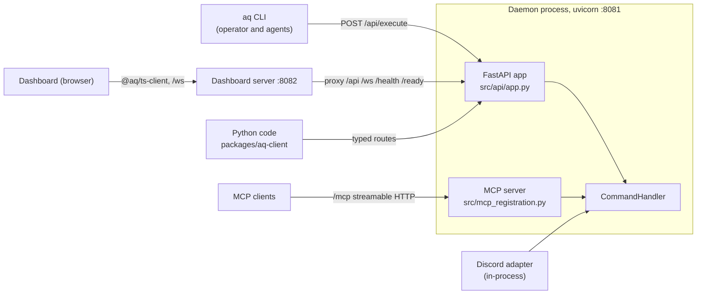

# System spec: api-and-clients

Status: describes the system as of 2026-10-20 (base `22cffd1b7`). This is system 14 of the
eighteen in the agent-queue system inventory (vault
`projects/agent-queue/specs/2026-10-20-agent-queue-system-inventory.md`, review
`rev-bright-rapids`, approved at revision 1 when this was written). It explains what the
system is for, how it works today, where it stops, and what is planned. It links to the
existing reference and contributor documents rather than repeating them: the route-by-route
reference is [`docs/reference/api/`](../../reference/api/README.md), the module catalogue is
[`docs/reference/modules/api.md`](../../reference/modules/api.md), and the regeneration
workflow is [`docs/contributing/codegen.md`](../../contributing/codegen.md).

## 1. Purpose

Agent Queue is one daemon with many callers: the `aq` CLI an operator types into, the same
CLI run by agents inside their tmux sessions, the React dashboard in a browser, and Python
or TypeScript code someone writes against a running daemon. All of them need to run the same
commands, see the same state and get the same refusals. If each caller reached into the
daemon its own way, every rule about who may do what would have to be written once per
caller, and they would drift.

The api-and-clients system is the daemon's HTTP and WebSocket surface and the two clients
generated from it. It gives every out-of-process caller one door:

- **One process, one port.** A FastAPI application on `127.0.0.1:8081` serves every route,
  stream and the OpenAPI schema.
- **Commands are endpoints.** Almost every route is generated from a `CommandHandler`
  command, so adding a command adds a typed route without hand-writing one.
- **Identity on every request.** A request without a bearer token is the trusted local
  operator; a request with an agent session's token is scoped to that session's task and
  project. The same scope check runs whichever route the call takes.
- **A schema the clients are built from.** `openapi.json` is generated offline from the
  app, and the Python client (`packages/aq-client/`) and TypeScript client
  (`packages/aq-ts-client/`) are generated from that file and never hand-edited.

## 2. How it works today

### 2.1 Vocabulary

| Term | Meaning |
|---|---|
| **Command** | A `CommandHandler` method (`src/commands/`). Every state change in Agent Queue is one. Commands return `{"success": bool, ...}` or `{"error": ...}` dicts. |
| **Generated command route** | `POST /api/{category}/{command}`, built at startup from the tool definitions. Its OpenAPI `operationId` is the command name. |
| **Hand-written route** | A route whose shape is not a command call: a path parameter, a file body, HTML, server-sent events. |
| **`/api/execute`** | The generic route the CLI uses: `{"command", "args"}` in, `{"ok", "result" \| "error", "details"}` out. |
| **Request scope** | `RequestScope` (`src/api/auth.py`): who the caller is. `local` (no token) or `session` (a valid agent token). |
| **Session token** | An `aqs_`-prefixed bearer token minted when a session starts, stored hashed, revoked when it ends. |
| **Elevated** | A session scope that may run any command (supervisors), still fenced to its project when it has one. |
| **Response model** | A Pydantic model in `src/api/models/` that a generated route answers with, and the schema name a client sees. |
| **Generated artifacts** | `openapi.json`, `packages/aq-client/` and its boilerplate digests; the TypeScript client's sources are regenerated locally and not tracked. |

### 2.2 What runs where

The API is not a separate service. The daemon starts an embedded uvicorn server
([`src/embedded_mcp.py`](../../../src/embedded_mcp.py), `run_mcp_server`) on the
`mcp_server` config section's `host` and `port` (default `127.0.0.1:8081`), restarting it
with backoff if it dies. Uvicorn serves one FastAPI app built by `create_app`
([`src/api/app.py`](../../../src/api/app.py)), and the MCP streamable-HTTP server is mounted
on that same app. So the HTTP API and MCP share a process, a port and an event loop with the
scheduler.

The browser does not talk to port 8081 directly in production. The dashboard server
([`src/dashboard_server/proxy.py`](../../../src/dashboard_server/proxy.py), port 8082, a
separate process) serves the built dashboard and reverse-proxies `/api`, `/health`, `/ready`
and `/ws` to the daemon byte for byte, with no queue of its own, so back-pressure reaches
the browser. Its own failures (daemon down, slow, bad gateway) answer 503, 504 or 502 with
an `X-AQ-Dashboard-Server` header so a caller can tell them apart from daemon answers. It
imports nothing from the daemon. The daemon itself is API-only: `GET /dashboard` answers a
307 to the configured dashboard server, or 404. See
[`docs/specs/dashboard-server.md`](../dashboard-server.md).

### 2.3 Three families of routes

`openapi.json` at this base has 480 paths, 483 operations and 1,202 component schemas.
The [API overview](../../reference/api/README.md#the-three-families-of-routes) describes the
families; in short:

1. **Generated command routes.** `build_category_routers`
   ([`src/api/codegen.py`](../../../src/api/codegen.py)) walks every tool definition
   (`src/tools/`, the auto-discovered commands from `src/mcp_registration.py`, and internal
   plugin tools), groups them by category, and emits `POST /api/{category}/{command}`. The
   body model is the command's hand-written request model if one exists in
   `src/api/models/`, otherwise one built from the tool's JSON schema (`_make_input_model`).
   The response model comes from the registry in `src/api/models/__init__.py`. Commands in
   `API_EXCLUDED` (internal reconcilers, `run_command`, `message_send`, the ask intake and a
   few others) get no route. These routes carry the 39 OpenAPI tags; `task` alone has 74
   operations.
2. **Hand-written resource routes**, each in its own module under `src/api/`: health and
   readiness (`health.py`, including `GET /plans/{task_id}` as HTML), messages, task and
   workspace files, task and review attachments, the task graph and its layout
   (`graph.py`, `graph_layout.py`), metrics, providers, pull requests, proposals and
   batches (`routers/proposals.py`), and `GET /api/tools`. They are included before the
   generated routers so a concrete path wins over a generated one. About 52 operations have
   no tag.
3. **Streams**, which are not in OpenAPI: the event WebSocket `/ws/events`, the terminal
   WebSockets `/ws/terminal/{session_id}` (and its `/input` twin), and three server-sent
   event endpoints (session output, pane snapshots, managed-job console streams). See
   [streaming](../../reference/api/events.md).

Beside these sits **`POST /api/execute`** ([`src/api/execute.py`](../../../src/api/execute.py)),
which takes any command by name. Its docstring calls it a backward-compatible endpoint for
the CLI "during the migration", but it is the CLI's only transport today (section 2.7).

`create_app` resolves every included route once at startup (`_resolve_included_routes`) so
the first request does not stall the event loop building them, and patches the attachment
upload schema (`_add_binary_upload_format`) so the Python generator emits a binary field.

### 2.4 The request path

Every HTTP request runs the same middleware, outermost first: route latency
([`perf_middleware.py`](../../../src/api/perf_middleware.py)), token auth, then request
context ([`middleware.py`](../../../src/api/middleware.py)), which binds a request id into
structured logs and echoes `X-Request-ID`.

`TokenAuthMiddleware` decides who the caller is:

- **No `Authorization` header:** `LOCAL_SCOPE`, the trusted local operator, unless
  `api_auth.require_session_token` is on (it defaults to off), in which case every path
  except `/api/health`, `/health`, `/ready` and `/openapi.json` answers 401.
- **`Bearer aqs_…`:** `SessionTokenStore.validate` looks up the token's SHA-256 in a
  per-process cache, then in the `api_session_tokens` table. Unknown, expired or revoked
  tokens answer 401. A global-admin token (elevated, no project) is refused with 403 unless
  the peer is loopback.
- For a valid session token, the middleware fills in `profile_id` and `policy_fingerprint`
  from the live `sessions` row. They are derived on every request, never minted into the
  token, so a profile edit takes effect without re-minting.
- It also records the transport (`dashboard` when the request carries an `Origin` or the
  dashboard server's `x-aq-dashboard-viewer` marker, otherwise `cli`) and whether the peer
  counts as the operator viewer (`request_operator_viewer`). The dashboard server replaces
  any client-supplied viewer header with its own real-peer verdict, and approval routes use
  it so a remote browser cannot approve as the operator.

The route then dispatches. Both a generated route and `/api/execute` do the same four
things:

1. Refuse commands in `API_EXCLUDED` (403 on `/api/execute`; no route exists otherwise).
2. Strip arguments a caller may not supply: every `_`-prefixed key, and on typed routes the
   `SERVER_OWNED_ARG_KEYS` from `src/commands/principal.py`.
3. Run `check_request_scope` ([`src/api/scope.py`](../../../src/api/scope.py)). For a session
   scope this enforces `AGENT_COMMAND_SET` (unless elevated), pins and injects the session's
   own `task_id` and `project_id`, refuses operator-only commands, and applies the worker,
   reviewer and triage carve-outs (for example, which git and review commands a worker may
   run on its own branch). A refusal is 403.
4. Inject the scope as `_scope` and call `CommandHandler.execute`. The handler then applies
   the profile's capability policy; a denial comes back as `error_code: capability_denied`
   and the route turns it into 403.

The scope check runs here, at the HTTP edge, and the capability check runs inside the
command layer. The [conventions page](../../reference/api/conventions.md) has the details.

### 2.5 Identity and session tokens

Tokens are minted by the session runtime: `src/orchestrator/execution.py` for task sessions
and `src/messages/session_lens.py` for named and supervisor sessions. The plaintext is
handed to the session as `AQ_API_TOKEN` (with `AQ_API_URL`) and never stored; the table
keeps the hash, session id, launch instance token, task, project, elevation and expiry.
`api_auth.token_ttl_hours` (default 72) is a backstop: tokens are revoked when their session
closes, and the orchestrator's periodic sweep prunes expired ones and renews tokens for
supervisors that are still live. The store also keeps bounded, plaintext-free diagnostics
(the last auth result per session, recent failures) that `aq doctor` and session views read,
and calls a hook on a session's first authenticated request that provider availability uses
as launch-success evidence.

`kind="local"` is a trust decision, not an authentication: anything that can reach the
loopback port without a token is the operator. That is the right default for a single-user
box and the wrong one for anything shared (section 5).

### 2.6 Responses and errors

A generated route answers 200 with its response model when the command succeeds. When the
command returns `{"error": ...}`, the route answers with the status from the `ERROR_STATUS`
map (422 by default). Most commands' error bodies are reduced to `{"error": "<message>"}`;
a short list keeps the full structured payload (`DETAILED_ERROR_COMMANDS`, routing
refusals, hierarchy refusals, ask, job, escalation and supervisor-inbox errors, and a 409
for `edit_intelligence_class`), each with its own error model in OpenAPI. A body that fails
validation is FastAPI's 422 `{"detail": [...]}`. An unhandled exception is an opaque 500
([`src/api/errors.py`](../../../src/api/errors.py)).

`/api/execute` always answers 200 for a command error, with `ok: false`, the message and the
rest of the result under `details`. That is how the CLI sees every finding a validator
returns rather than only the summary line. Its 403s are excluded commands, scope refusals
and capability denials.

### 2.7 Who calls the API

| Caller | Transport | Notes |
|---|---|---|
| `aq` CLI, operator | `POST /api/execute`, no token | [`src/cli/client.py`](../../../src/cli/client.py) `CLIClient`. URL from `AQ_API_URL`, `AGENT_QUEUE_API_URL`, the `mcp_server` config, then `127.0.0.1:8081`. |
| `aq` CLI inside an agent session | `POST /api/execute` with the session's bearer token | Same code path; the token makes it a session scope. |
| Dashboard | `@aq/ts-client` through the dashboard server, plus `/ws/events` and the terminal sockets | [`dashboard/src/api/client.ts`](../../../dashboard/src/api/client.ts) configures the generated client and turns non-2xx answers into thrown errors. |
| Python code | `packages/aq-client` typed routes | No production caller in this repository. The CLI's typed-dispatch path is kept alive by `tests/test_cli_client_generated.py` but unused. |
| MCP clients | `/mcp` on the same port | The MCP tools call `CommandHandler.execute` in-process; they do not go through the HTTP routes or the HTTP middleware. Owned by plugins-mcp-and-tools. |
| Discord | none | The bot calls `CommandHandler` in-process. |

The inventory's line that "the API is the only way the dashboard server, MCP and remote
tooling reach the daemon" is true for the dashboard server and remote tooling, not for MCP:
MCP shares the API's port and process but has its own registration, exclusion list and
scope handling (`src/mcp_registration.py`, [`docs/specs/mcp-server.md`](../mcp-server.md),
[`docs/specs/tiered-tools.md`](../tiered-tools.md)).

### 2.8 Streams

`/ws/events` ([`src/api/websocket.py`](../../../src/api/websocket.py)) subscribes to the
event bus's `notify.*` events and forwards them to every connected client. Each frame
carries a sequence number and a daemon epoch (regenerated on every start), so a client that
reconnects with `after_seq` is replayed the persisted events it missed, in pages of 500,
before live streaming resumes; a changed epoch tells it to discard its sequence. Frames are
filtered per scope: a session sees only its own project's events, metrics ticks go only to
local and elevated scopes, and some events are reduced to identifiers so the browser
refetches the authorized detail. Each client has a 1,000-frame queue that drops its oldest
frame when full, so a slow client loses events rather than slowing the daemon.

The terminal WebSocket ([`terminal_stream.py`](../../../src/api/terminal_stream.py)) attaches
a disposable tmux client to an existing session; it never launches an agent, and it checks
origin (`api_auth.trusted_dashboard_origins` for non-same-origin dashboards), credentials,
operator viewer, loopback, session generation and a connection limit. The SSE endpoints
(`sessions.py`, `pane_stream.py`, `streams.py`) are bounded viewers over session output,
pane snapshots and managed-job consoles. The event schemas are documented by hand in
[events.md](../../reference/api/events.md) because none of this is in OpenAPI.

### 2.9 The schema and the clients

The pipeline is described in full in [codegen.md](../../contributing/codegen.md):

1. `python -m src.api.spec` ([`src/api/spec.py`](../../../src/api/spec.py)) builds the app
   offline, without a database, and writes `openapi.json`.
2. `scripts/regenerate-api-client.sh --offline` runs a pinned `openapi-python-client`
   (config `scripts/openapi-python-client.yaml`) into `packages/aq-client/` (2,607 tracked
   files) and checks the hand-maintained boilerplate against
   `scripts/aq-client-boilerplate.sha256`. `--install` re-points the shared venv and is
   refused from a worker slot.
3. `scripts/regenerate-ts-client.sh --from-file` runs a pinned `@hey-api/openapi-ts` into
   `packages/aq-ts-client/src/`. Only `index.ts` and `package.json` are tracked; the
   dashboard's `predev`, `prebuild` and `pretypecheck` scripts regenerate the rest.
4. `scripts/regenerate-generated.sh` runs every generator in the repository in dependency
   order (selection catalogue, CLI inventory, configuration and playbook schemas, command
   catalogue, `openapi.json`, the Python client and its digests). `--check` is the drift
   check, and `.gitattributes` marks these paths `merge=aq-generated` so a conflict is
   resolved by regenerating, never by hand. The integration train does the same at merge
   time.

The rule for a contributor: any change to `src/api/models/`, a generated route's inputs, or
a command's category or tool definition changes `openapi.json`, so regenerate both clients
and commit what the scripts write.

### 2.10 Data model

The system owns little persistent state:

| Store | Contents | Lifetime |
|---|---|---|
| `api_session_tokens` (`src/database/tables.py`, queries in `src/database/queries/api_session_token_queries.py`) | Token hash, session id, launch instance token, task, project, elevated flag, created, expires, revoked. | Minted at session start; revoked at session close; expired rows pruned by the orchestrator. |
| `SessionTokenStore` caches | Validated scopes by hash; rejected-token tombstones; bounded auth-health and failure diagnostics. | In process memory; lost on restart. |
| `WebSocketManager` | Connected clients and their frame queues. | In memory. Replay reads the `events` table, owned by daemon-core. |
| `openapi.json`, `packages/aq-client/` | The schema and the Python client. | Tracked in git, regenerated. |

The schema itself, and every migration, belongs to daemon-core.

### 2.11 Guard tests

`tests/test_api_*.py` cover each route family; the most load-bearing are
`test_api_scope.py` and `test_api_auth.py` (who may run what), `test_api_execute_contract.py`
(the CLI envelope), `test_api_client_contract.py` and `test_generated_artifacts.py` (the
committed schema and clients match the code), `test_response_model_registry.py` (every
categorized command has a response model), `test_regenerate_api_client_script.py` and
`test_regenerate_ts_client_script.py` (the scripts' pins and refusals), and
`test_websocket_forwarding.py`.

## 3. Boundaries

| System | What crosses the boundary |
|---|---|
| 1. daemon-core | Daemon-core starts the embedded uvicorn server, wires `deps` (command handler, token store, event bus), owns the event bus, the `events` table this system replays from, and the schema and migrations for `api_session_tokens`. |
| 2. task-graph | Task, hierarchy and graph commands are the largest family of generated routes; `graph.py` and `graph_layout.py` serve graph reads and layout. Response models such as `TaskDetail` live here and describe that system's rows. |
| 3. scheduling-and-claims | Claim, close and pool commands are routes like any other. `/api/execute` is how every worker's `aq task claim` reaches the frontier. |
| 4. routing-and-profiles | The capability policy that denies a command is theirs; this system turns its `capability_denied` into 403 and derives `profile_id` and `policy_fingerprint` on each request. Routing refusals (`ROUTING_CHOICE_FORBIDDEN`, `REFUSED_ROUTING_ARGS`) keep their detail through the generated routes. |
| 5. sessions-and-harnesses | The session runtime mints and revokes tokens and passes `AQ_API_URL`/`AQ_API_TOKEN` into every agent's environment. The terminal WebSocket and SSE endpoints attach to sessions it owns. |
| 6. projects-workspaces-git | Workspace and task file routes read worktrees; `scope.py` carries the worker's git carve-outs. |
| 7. integration-and-delivery | Pull request and integration status routes; the train regenerates the generated artifacts at merge time. |
| 8. playbooks | Playbook commands are generated routes; the playbook graph view excludes nulls from its response. |
| 9. messaging-and-human-asks | Messages have hand-written routes; ask intake and `message_send` are excluded from HTTP and reach the daemon by other paths. Question events are reduced to identifiers on `/ws/events`. |
| 10. supervisors-and-policy | Supervisor sessions hold elevated tokens; operator-only commands are refused to them in `scope.py`. |
| 11. reviews-and-knowledge | Review and knowledge commands, review attachments, and the operator-viewer gate on approvals. The held-batch endpoint (section 6) shows that system's batches. |
| 12. providers | `providers.py` serves availability and usage; the token store's first-seen hook feeds launch evidence to provider availability. |
| 13. configuration-and-vault | `mcp_server`, `api_auth` and `dashboard_server` config sections; config editing commands are routes. |
| 15. dashboard | The main consumer: `@aq/ts-client`, `/ws/events`, terminals. The dashboard server proxies this API and asserts the viewer verdict. |
| 16. test-service-and-jobs | Job commands and the managed-job console streams (`streams.py`); `test_select` gets its workspace from the scope. |
| 17. operations-and-recovery | The CLI is the most frequent caller; `aq doctor` reads token diagnostics and dashboard-origin checks; health and readiness routes back the restart checks. |
| 18. plugins-mcp-and-tools | Tool definitions in `src/tools/` decide which commands become routes and in which category. MCP is mounted on this app but dispatches in-process with its own exclusions. Internal plugin tools get routes too. |

**What this system does not own.** It does not decide what a command does, who may run it
by profile, or what a task, claim or review is: the command layer and the owning systems
do. It does not own the CLI's presentation (`src/cli/`), the dashboard's views, MCP tool
registration, or the event bus. It owns the transport, the request-scope check, the
response models' shapes as published, the schema and the generated clients.

## 4. Principles and invariants

- **Every route ends at `CommandHandler`.** No route writes state any other way; hand-written
  routes either call commands or read. A new capability is a command first, a route second.
- **Generated, never hand-edited.** `openapi.json` and `packages/aq-client/` come from the
  scripts; a merge conflict in them is resolved by regenerating. The TypeScript client's
  sources are not tracked at all.
- **One exclusion set per surface, enforced on every path into it.** `API_EXCLUDED` blocks
  both the typed route and `/api/execute`, so the generic route is not a back door.
- **Callers cannot claim identity.** `_`-prefixed and server-owned arguments are stripped
  before the server-derived `_scope` is injected; derived profile identity comes from the
  live session row, never the token or the body.
- **Scope at the edge, capability in the command layer.** The HTTP edge decides which task
  and project a token may touch; the command layer decides which commands its profile may
  run. Elevation widens the first, never the second.
- **Tokens are hashed and short-lived.** Plaintext lives only in the session's environment;
  diagnostics never hold it.
- **The daemon serves no UI.** The dashboard is a separate process that proxies the API.
- **Slow clients lose frames, not the daemon.** Per-client queues are bounded and drop the
  oldest frame; replay after reconnect recovers from the persisted event log.
- **Startup does the expensive work.** Routes are built and resolved before the first
  request, so request latency does not include codegen.

## 5. Known gaps

### Documentation drift

- [`docs/reference/api/README.md`](../../reference/api/README.md) lists two "known defects"
  that are fixed at this base: `/api/metrics/series?step=1m` (the model's `total` is now a
  float) and `/plans/{task_id}` rejecting dotted ids (`health.py`'s pattern now accepts
  them). Its per-category route table predates several categories; regenerate it from
  `openapi.json` tags rather than hand-maintaining it. It names the token table `api_tokens`;
  the table is `api_session_tokens`.
- File counts disagree: `python-client.md` says 1,439 files, `codegen.md` 1,442, and
  `modules/api.md` attributes 1,442 to the TypeScript package. `packages/aq-client/` has
  2,607 tracked files and `packages/aq-ts-client/` two.
- [`docs/reference/modules/api.md`](../../reference/modules/api.md) omits fourteen of the
  thirty-eight modules in `src/api/models/` (among them `collaboration`, `cron`,
  `decision`, `job`, `knowledge`, `review`, `supervisor_inbox` and `wait`) and six
  `src/api/` modules (`health_monitor.py`, `host_shell.py`, `perf_middleware.py`,
  `pull_requests.py`, `review_attachments.py`, `target_scope.py`).
- `codegen.md`'s diagram draws `aq-client → aq CLI`; the CLI uses `/api/execute`.
  `docs/specs/design/aq-surface.md` says the Python client "continues to serve the
  dashboard" and that the Discord adapter uses REST; the dashboard uses the TypeScript
  client and Discord calls `CommandHandler` in-process.
- `src/embedded_mcp.py`'s docstring lists `/docs`, but the app disables the docs UI.
- The inventory's purpose line for this system (MCP reaches the daemon through the API)
  is corrected in section 2.7.

### Behaviour

- **Loopback means operator.** With `api_auth.require_session_token` off by default, any
  process that can reach `127.0.0.1:8081` without a token runs every command with local
  scope. The config comment calls the flag a "reserved enforcement hook". This blocks any
  multi-user or remote-node deployment (section 6).
- **The CLI migration stalled.** `/api/execute` describes itself as backward compatibility
  and tells new code to use typed routes, but the CLI never moved, and the Python client
  has no production caller. Either the CLI moves to typed routes or `/api/execute` is
  declared the permanent CLI contract and the dormant typed dispatch is removed.
- **Two exclusion lists.** `API_EXCLUDED` and the MCP exclusions in
  `src/mcp_registration.py` (which add `shutdown`, `restart_daemon`, `session_token` and
  others) are maintained separately; a dangerous new command must be added to both.
- **Per-command branches in generic codegen.** `_make_route_handler` carries special cases
  for individual commands (explicit nulls for `task_set`, `pool_scale` and `edit_task`, the
  workspace for `test_select`, re-forwarding guarded routing arguments). Each is a fact about
  one command living in the transport. A per-command hook declared beside the command's
  contract would keep codegen generic.
- **Commands silently without a route.** A command with no category, or whose route fails
  to build, is logged and skipped. The committed-schema test catches a removal, but nothing
  catches a new command that never got a route.
- **Most 422s lose their detail.** Only listed commands keep their structured error body on
  a typed route, so a typed-client caller sees less than the CLI does for the same refusal.
- **Layering.** The command layer imports `RequestScope` and `check_command_scope` from
  `src.api` (review, session, comment, proposal and spec-ingest commands, the handler), and
  codegen imports from `src.cli.auto_commands`. Scope is a command-layer concept living in
  the transport package.
- **No API versioning.** The app reports version `0.1.1` and the schema changes with every
  command change; clients are regenerated in the same commit rather than versioned.
- **Streams are outside the schema.** Event payloads and the terminal protocol are
  documented by hand, so the TypeScript event types in the dashboard are hand-written and
  can drift from the daemon's events.

## 6. Planned work

Re-queried from the operator database on 2026-10-20; only open work that changes this
system is listed.

- **Held ingestion P6 — `calm-orbit-69` (in progress).** Implements §10 of the vault spec
  `projects/agent-queue/specs/2026-10-14-spec-ingestion-held-batches-and-fidelity-review-before-relea.md`
  (review `rev-agile-beacon`, revision 1, approved). Leaf L6.1 (`calm-orbit-69.1`,
  completed) adds `held_batch` to `TaskDetail`, held fields to `TaskBatchProposeResponse`, a
  new `IngestBatchDetail` model and `GET /api/projects/{project_id}/batches/{batch_id}` in
  `src/api/routers/proposals.py`, with both clients regenerated. It is on the epic branch
  `aq/epic/held-ingestion-p6-api-dashboard-cli-design-10`, not yet on main. L6.2
  (completed) teaches the dashboard the four `batch.*` WebSocket events. L6.3
  (`calm-orbit-69.3`, defined) adds `aq batch …`, doctor checks and MCP tools, which reach
  the daemon through `/api/execute` and the command registry, not new routes. The same
  spec's L2.1 adds the fidelity reviewer's batch commands to `src/api/scope.py`. See the
  reviews-and-knowledge system spec.
- **Event-driven hibernation and verified waits — `bold-zenith-11` (in progress).** Vault
  spec `projects/agent-queue/specs/2026-10-13-event-driven-agent-hibernation-and-verified-waits-implementa.md`
  (review `rev-fleet-orbit`, revision 1, approved). All but one leaf is complete on
  `aq/epic/event-driven-hibernation-and-verified-waits-implementation`, which adds seven
  generated routes under `/api/wait/` (`explain`, `graph`, `checkpoint`, `ack`, `decide`,
  `lift`, `legacy-bridge`), the matching models in `src/api/models/wait.py`, a `waits` group
  in the metrics model, new task statuses in the task models, and session-scoped wait verbs
  in `AGENT_COMMAND_SET`. The remaining leaf, `bold-zenith-11.22` (ready), flips the
  defaults and refuses v1 wait bodies, which changes those request models' accepted shape.
- **Fast smooth integration — `stark-willow-95` (in progress).** Vault spec
  `projects/agent-queue/specs/2026-10-12-fast-smooth-integration.md` (review
  `rev-fair-lantern`; tasks filed from approved revision 2, revision 3 in review). Leaf
  `stark-willow-95.4` (ready) extends `src/api/metrics.py` and `src/api/models/metrics.py`
  with delivery latency and its time breakdown; `stark-willow-95.5` (defined) consumes it
  in the dashboard through the generated client.
- **Distributed worker nodes (in review, no tasks filed).** Vault spec
  `projects/agent-queue/specs/2026-10-06-distributed-worker-nodes.md` (review
  `rev-eager-quest`, revision 2, in review). It requires a node gateway that authenticates
  every request, loopback included, and states that the current missing-bearer local scope
  must not be relied on. If approved, it is the change that would retire "loopback means
  operator" and make `require_session_token` real, and it moves terminal attachment to the
  owning node.

No open task addresses the behaviour gaps in section 5 other than the last.

## 7. Related documents and source

- Reference: [API overview](../../reference/api/README.md),
  [conventions](../../reference/api/conventions.md),
  [streaming](../../reference/api/events.md), [response models](../../reference/api/models.md),
  [Python client](../../reference/api/python-client.md),
  [TypeScript client](../../reference/api/typescript-client.md),
  [module catalogue](../../reference/modules/api.md).
- Contributing: [codegen and generated files](../../contributing/codegen.md).
- Specs: [`aq-surface.md` (design)](../design/aq-surface.md),
  [`aq-surface.md` (implementation)](../implementation/aq-surface.md),
  [`mcp-server.md`](../mcp-server.md), [`tiered-tools.md`](../tiered-tools.md),
  [`dashboard-server.md`](../dashboard-server.md),
  [`command-handler.md`](../command-handler.md), [`event-bus.md`](../event-bus.md).
- Source: [`src/api/app.py`](../../../src/api/app.py),
  [`src/api/codegen.py`](../../../src/api/codegen.py),
  [`src/api/execute.py`](../../../src/api/execute.py),
  [`src/api/auth.py`](../../../src/api/auth.py),
  [`src/api/middleware.py`](../../../src/api/middleware.py),
  [`src/api/scope.py`](../../../src/api/scope.py),
  [`src/api/websocket.py`](../../../src/api/websocket.py),
  [`src/api/spec.py`](../../../src/api/spec.py), [`src/api/models/`](../../../src/api/models/),
  [`src/embedded_mcp.py`](../../../src/embedded_mcp.py),
  [`src/cli/client.py`](../../../src/cli/client.py),
  [`dashboard/src/api/client.ts`](../../../dashboard/src/api/client.ts),
  `scripts/regenerate-api-client.sh`, `scripts/regenerate-ts-client.sh`,
  `scripts/regenerate-generated.sh`, `openapi.json`, `packages/aq-client/`,
  `packages/aq-ts-client/`.
