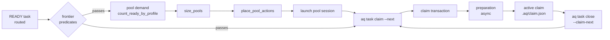

# System spec: scheduling and claims

How ready work becomes a running agent without a language model anywhere in the
path. This covers the frontier query that decides what is claimable, the global
worker pools and how they are sized and placed, the claim path behind
`aq task claim --next`, claim preparation and identity fencing, the
`.aq/claim.json` record, claim timing, and the box-wide resource gates that keep
the machine responsive.

This is system 3 of the 18 in the system inventory. It describes `main` as of
2026-10-20. Where a guide already explains something well, this page gives the
short version and links to it. Line numbers are a starting point for a reader;
they drift.

## Contents

- [Purpose](#purpose)
- [Vocabulary](#vocabulary)
- [How it works today](#how-it-works-today)
- [Data model](#data-model)
- [Boundaries](#boundaries)
- [Design principles and invariants](#design-principles-and-invariants)
- [Known gaps](#known-gaps)
- [Planned work](#planned-work)
- [Source and tests](#source-and-tests)

## Purpose

Agent Queue runs many coding agents on one box against many projects. Every
agent is a CLI harness in a tmux session (see the sessions system). Someone has
to decide which task each agent works on next, start and stop agents as demand
changes, and keep two agents from ever holding the same task or the same
working copy. Someone also has to stop eight agents from each running a full
test suite at once and freezing the machine.

That someone is this system. It has three jobs:

1. **Decide what is claimable.** One SQL predicate set, the *frontier*, says
   which READY tasks a worker may take. The same predicates answer
   `aq task explain` when the answer is "nobody can".
2. **Keep the right number of workers alive.** Pools are sized from measured
   demand every orchestrator cycle, and the starts are placed on the projects
   that need them.
3. **Hand one task to one worker, safely.** A claim is a short database
   transaction plus an asynchronous *preparation* step that readies the
   workspace. The result is fenced by an epoch number, so a stale worker cannot
   act on a task it no longer holds.

Scheduling is deterministic. It makes no model calls. Judgment about failure,
such as reflection, escalation and failover, lives in playbooks that drive
commands. That is the project-wide rule "mechanism in code, policy in
playbooks". The conceptual introduction is
[docs/concepts/scheduling.md](../../concepts/scheduling.md); read it first if
you have never used AQ.

## Vocabulary

| Term | Meaning here |
|---|---|
| Frontier | The set of tasks a pool worker may claim right now: READY, routed, unassigned, and passing every frontier predicate. |
| Pool | An agent profile with `lifecycle: pool`. Its sessions loop on `aq task claim --next` instead of being pushed work. Pools are fleet-wide, keyed by profile id. |
| Pool worker / pool session | One tmux session in a pool. It claims, works, closes and claims again. |
| Claim | A session's exclusive hold on one task, recorded on the session row and in `.aq/claim.json`. |
| Claim epoch | An integer on the task, bumped by every claim. Every later write by the holder must carry it. |
| Claim phase | `claiming`, then `preparing`, then `active`: where a claim is between the transaction and a usable workspace. |
| Preparation | The asynchronous work after the claim transaction: check the checkout, lock and reset the workspace, write the claim file, recheck admission, activate. |
| Admission | Whether a project may take new work at all, for example not paused and not over budget. |
| Push path | The older dispatch path. The orchestrator's `Scheduler.schedule` assigns a task to an idle agent. It is still used for non-pool profiles. |
| Workspace / slot | The working copy a claim runs in. Owned by the projects-workspaces-git system. A worktree slot is a git worktree under `.aq/worktrees/slot-N`. |

The [glossary](../../reference/glossary.md) defines the rest.

## How it works today

### The big picture



There are two dispatch paths.

- **Pull (pools).** This is the main path. Pool sessions ask for work. The
  orchestrator only decides how many sessions should exist and on which
  project. Pool tasks are never push-assigned
  ([src/orchestrator/pools.py](../../../src/orchestrator/pools.py), module
  docstring).
- **Push.** `Scheduler.schedule`
  ([src/scheduler.py](../../../src/scheduler.py), around L272-567) produces
  `AssignAction`s for non-pool profiles. It uses proportional fair share, where
  the project furthest below its `credit_weight` share of rolling token usage
  goes first, with a minimum-task guarantee. Its gates are budget,
  `max_concurrent_agents`, `max_agents_by_type` and workspace availability.
  SYNC tasks run exclusively. The
  [agent reconciler](../../../src/orchestrator/agent_reconciler.py) creates push
  agent rows lazily when push demand needs them. It never creates rows for pool
  profiles.

Both paths are called from the orchestrator cycle (`_schedule` is step 14 and
`_reconcile_pools` is step 16 of `run_one_cycle` in
[src/orchestrator/core.py](../../../src/orchestrator/core.py)). The order of
the cycle belongs to the daemon-core system. This spec only depends on two
facts about it: pools reconcile once per cycle, and the exception path still
runs pools and sessions.

### The frontier

The frontier is a set of SQL predicates in
[src/database/queries/claim_queries.py](../../../src/database/queries/claim_queries.py).
Every consumer composes the same predicates: pool demand, the claim itself, and
explain. That way "a worker would take this" and "a pool will grow for this"
cannot disagree.

- `_frontier_where` (around L275) requires status READY and that the task's
  workspace requirement fits the candidate workspace kind.
- `_frontier_predicates` (around L144) excludes a task that:
  - belongs to the supervisor profile;
  - is dependency-blocked (`tasks.is_blocked`);
  - is already assigned;
  - is a plan subtask;
  - is held for spec ingestion;
  - is under a recovery hold.

  It also applies the hierarchy rules from the task-graph and integration
  systems: `origin_not_materialized`, `sibling_prerequisite_not_delivered`,
  `prerequisite_not_on_default_branch`, `epic_refresh_pending`,
  `container_settles_without_worker`, `has_children` and
  `retired_repair_delegate`.
- Claim-only predicates (`claim_frontier_predicates`, around L616) add
  `stack_prerequisites_conflict`, `workspace_requirement`,
  `claim_prepare_backoff` (a task whose preparation recently failed waits out
  its backoff) and `hold_label`.
- `route_claimable` (around L214) requires a `profile_id` and a claimable
  `route_source`: `router`, `override` or `role`. `legacy` also counts until
  the project's router is ready.
- `_pool_routing_predicates` (around L232) matches the task's intelligence
  class to the pool's.
- `FRONTIER_PREDICATE_DETAILS` (around L641) maps each predicate name to the
  sentence `aq task explain` prints.

The frontier is how this system meets the
[work graph](../design/work-graph.md). The task graph decides readiness and
`is_blocked`. The frontier only reads them.

The ordered scan is historical design:
[2026-09-09-claim-frontier-ordered-scan-design.md](../../superpowers/specs/2026-09-09-claim-frontier-ordered-scan-design.md).

### Pools: measure, size, place, converge

A pool is an `AgentProfile` with `lifecycle == "pool"`. Its bounds are
`min_active`, `max_active` and `min_per_project`
([src/models.py](../../../src/models.py)). Pools are keyed by `PoolKey(profile_id)`.
A pool is fleet-wide: one `standard-high-claude` pool serves every project. The
operator guide, [worker-pools.md](../../guides/worker-pools.md), covers setup,
the config keys, quarantine and the runbook. Its §3 is the authoritative
description of sizing and placement. In outline:

1. **Measure** (`_measure_pools`, `pools.py` around L238-450).
   - **Demand** is routed, claimable work only (`count_ready_by_profile` per
     workspace kind), across ACTIVE projects that pass structural admission.
   - **Capacity** is available workspaces minus launches that have not taken
     one yet.
   - **Sessions** are classified as starting, draining, busy, unresponsive or
     idle. An *unresponsive* session is an idle session whose claim loop has
     not touched its activity for `max(1, prepare_timeout, 2 × claim_wait_max)`
     seconds (`idle_pool_claim_loop_stalled` in
     [src/pool_claims.py](../../../src/pool_claims.py)). It is live but not
     counted as supply.
   - **Bounds** are zero when the profile is disabled or its provider is
     suppressed. Otherwise the lower bound is `max(min_active, sum of warm
     floors)` and the upper bound is `max_active`.
2. **Size** (`size_pools`, `scheduler.py` around L645-754).
   - The target is `want = busy + demand`, clamped to the bounds and never
     below `busy + starting`, so a launch in flight is never cut.
   - Starts go up to `swarm.max_starts_per_tick` per tick under the global cap.
     Repair demand goes first, then pools are served round robin.
   - Scale-down drains only idle sessions, oldest first. A pool must be in
     surplus for `scale_down_grace` first, and at most `max_drains_per_tick`
     drain per tick.
3. **Place** (`place_pool_actions`, `scheduler.py` around L881-1042). Starts
   are given to (project, workspace kind) pairs. The order is `train_repair`,
   then `warm_floor`, then `deficit`, then `spread`; within a reason, fewest
   live workers first, then backlog, then project id. A project is skipped when
   it:
   - is quarantined;
   - has no unserved demand of that kind;
   - has no capacity;
   - is at its project cap;
   - already has an idle worker.

   Drains skip projects at or below their warm floor. `rebalance_idle_pools`
   moves idle workers that sit on the wrong project. Busy workers are never
   preempted.
   [shared-pool-fairness.md](../design/shared-pool-fairness.md) is the design
   behind this ordering.
4. **Converge** (`_reconcile_pools_inner`, `pools.py` around L586-619).
   Launches are queued as background tasks. Drains set
   `desired_state="stopped"`. A starvation report emits `pool.placement_starved`
   once per distinct signature, and every change emits `pool.scaled`.

**Launching** (`_launch_pool_session_inner`, `pools.py` around L963-1314):
1. Recheck provider availability.
2. Reuse an idle agent row with a matching harness, or create one.
3. Run the provider's `admit_launch` canary.
4. Take a per-(project, kind) lock, ensure the worktree slots exist, and
   acquire one workspace.
5. Refuse a base checkout.
6. Mint the session token, build the pool session spec, and launch the tmux
   session.

A session that dies during startup is charged to the provider. Any other launch
failure quarantines the (project, profile) key for 60 s.

**Retiring** (`_terminate_pool_session_locked`, `pools.py` around L1349-1485):
1. Write RETIRED and desired-stopped first.
2. Revoke the token and stop the provider. Resources are kept unless the stop
   is confirmed.
3. Let an integration owner retain the workspace if it needs it.
4. Otherwise remove the claim file and return the agent to IDLE.

**Watchdog.** `_check_pool_progress` runs every 30 s from
[src/main.py](../../../src/main.py). After three ticks without start progress it
emits `pool.scaler_stalled` and forces a reconcile.

`aq pool status` (`_cmd_pool_status` in
[src/commands/ops_commands.py](../../../src/commands/ops_commands.py)) shows the
same measurement the scaler used. It has one row per profile, with per-project
detail and key quarantine. Filtering by project narrows the view, not the
counters.

### The claim path

A pool session runs one loop:

```bash
aq task claim --next --wait 60
# … do the task …
aq task close <id> --outcome pass --summary "…" --claim-next --wait 60
```

The handler is `_cmd_task_claim` and `_claim_request` in
[src/commands/claim_commands.py](../../../src/commands/claim_commands.py)
(around L291-500). A request goes through these steps.

1. **Gate the request.**
   - Claims are refused unless `swarm.enabled` is true.
   - The session's activity lease is touched, which proves the loop is alive.
   - A session that is draining gets `drain_requested`.
2. **Check admission.** `_admission_reason` (around L243) returns
   `project_inactive`, `scheduling_paused` or `budget_exhausted`. Integration
   admission is observed through
   [src/integration/admission.py](../../../src/integration/admission.py). If a
   delivery or stack snapshot changes underneath the request, the check is
   retried up to three times.
3. **Run the claim transaction** (`_attempt_claim_once`, around L674). It is one
   `db.immediate()` transaction on one connection, which holds locks in the
   order session slot, then task, then agent, workspace and metadata:
   1. `take_claim_slot` (claim_queries around L855) is a conditional UPDATE. It
      sets `claim_phase='claiming'` only if the session holds nothing and is
      under its claim cap. The cap is 1 when `swarm.fresh_context_per_task` is
      true, otherwise the profile's `max_claims_per_session`.
   2. `select_ready_for_profile` (around L987) probes affinity and train-repair
      candidates first, then unpinned work, ordered by
      `priority, created_at LIMIT 1 FOR UPDATE SKIP LOCKED`. Two workers
      claiming at once never block on each other; they take different rows.
   3. `_pool_claim_routing` (around L544) checks that the candidate's harness
      and class are compatible with the session.
   4. `take_task` (around L1073) is one fenced UPDATE. The agent goes IDLE to
      BUSY, the task goes READY to IN_PROGRESS, and `claim_epoch` goes up by
      one.
   5. `record_holder` (around L1165) sets `claim_phase='preparing'`, locks the
      workspace, writes the `claim_workspace` receipt metadata, and inserts a
      `task_session_attempts` row.
4. **Start preparation in the background.** `asyncio.create_task` runs
   `_run_claim_preparation` (around L1234). The request waits up to
   `_PREPARATION_RESPONSE_SECONDS` (0.5 s, L42). If preparation finishes in
   that time the response is `claimed`. Otherwise it is `claim_in_progress`,
   and the worker claims again to collect the result.
5. **Long-poll when there is no work.** The waiter subscribes *before* it
   checks, so an event between the check and the wait is not lost. Admission
   waiters wake on `project.resumed`, `constraint.released` and
   `snapshot.refreshed`. Frontier waiters wake on `task.ready`,
   `gate.resolved`, `task.restarted` and `task.completed`. The wait is
   `min(--wait, swarm.claim_wait_max)`.

The transaction is held to a statement budget. A claim may issue at most 20
statements ([tests/perf/test_claim_statements.py](../../../tests/perf/test_claim_statements.py)).

**Result codes** are documented in
[terminals-and-claims.md, Part 2](../../reference/terminals-and-claims.md#claim-result-codes):

| Code | Meaning |
|---|---|
| `claimed` | The claim is active. |
| `no_ready_work` | The frontier was empty for the whole wait. |
| `claim_conflict` | Another session won the row. |
| `claim_in_progress` | Preparation is still running. |
| `prepare_failed` | Preparation refused, with a reason and `retry_after`. |
| `not_admissible` | The project may not take work, with a reason. |
| `session_exhausted` | The session reached its claim cap. |
| `drain_requested` | The session should exit. |
| `stale_claim` | The caller's epoch no longer matches. |
| `out_of_scope` | The token cannot claim this. |

### Preparation

`_prepare_and_activate` (claim_commands around L1316) runs under the task's
control lock. It retries transient failures up to three times. The steps are:

1. `check_checkout`. If the slot already holds a *different* claim, the
   workspace is disabled and the task goes back to READY.
2. Take the workspace locks.
3. `reset_slot_for_task` brings the slot to the task's branch. This step
   belongs to the projects-workspaces-git system.
4. `write_claim_file` writes `.aq/claim.json`.
5. Recheck admission. A project paused during preparation does not get a
   started task.
6. `activate_claim` (claim_queries around L1397) is a compare-and-swap from
   `preparing` to `active`. It bumps the session's `claims` count and clears
   the refusal counters.

Activation emits `task.claimed`, `task.started` and `pool.session_claimed`.
[src/claim_preparation.py](../../../src/claim_preparation.py) holds the
identity comparison, `same_session_launch`. It compares eleven identity fields,
so a relaunched session with the same id but a new instance cannot inherit a
preparation that belonged to its predecessor.

**When preparation fails**, two counters on the session decide what happens.
They answer different questions, and older docs conflate them.

- **`sessions.claim_refusal`** (JSONB, `record_claim_refusal` in
  [src/database/queries/session_queries.py](../../../src/database/queries/session_queries.py)
  around L430) counts *identical consecutive refusals* of `prepare_failed` or
  `not_admissible`.
  - The cooldown is 60 s after the first refusal, then
    `min(1800, 300·2^min(n-2, 3))` seconds.
  - The response carries `retry_after` and `refusal_count`.
  - At a count of two, an idle session is set to desired-stopped.
- **`sessions.claim_failure_count`** counts *identical preparation failures*.
  At `MAX_IDENTICAL_CLAIM_FAILURES` (3, in
  [src/pool_claims.py](../../../src/pool_claims.py)) the session is stopped with
  end reason `claim_refusals`. Its workspace is disabled with reason
  `CLAIM_FAILURES`, and the response is `drain_requested` with
  "workspace quarantined".

A slot reset that keeps failing follows its own ladder. The backoff is
`min(120·2^(n-1), 300)` seconds, and at the third attempt the task goes to
BLOCKED for a manual retry.

When cleanup cannot be proved, preparation is *retained*, not discarded. The
`prepare_failure` metadata
([src/preparation_failure.py](../../../src/preparation_failure.py)) and the
`PREPARE_CLEANUP_HOLD` veto keep the task held, so no other worker resets a
slot that may still hold someone's commits. `cleanup_unproved` and
`integration_prepare_failed_attached` are the two retained cases. The pool
guide's section on
[repeated claim preparation refusals](../../guides/worker-pools.md#repeated-claim-preparation-refusals)
is the operator view. The
[preparation-cancellation report](../../reports/preparation-cancellation-2026-10-13/README.md)
explains why preparation became asynchronous and fenced.

### Identity fencing and the claim file

Every write a worker makes about its task carries `(session_id, claim_epoch)`.
`_assert_session_owns` (claim_commands around L195) refuses with `stale_claim`
if a pool session omits the epoch or sends the wrong one. A displaced worker,
for example one that kept running after a restart re-dispatched its task,
cannot close, comment as holder or push for the new holder.

`.aq/claim.json` is the worker-visible proof of what it holds:

```json
{"task_id": "demo.1", "claim_epoch": 1, "session_id": "…", "claimed_at": 1792535505.38}
```

[src/claim_file.py](../../../src/claim_file.py) writes it atomically. It is
removed only by `remove_claim_file_if_matches` or
`remove_claim_file_if_identical`, which compare content and inode so an A-B-A
replacement is not deleted by mistake. The module imports only the standard
library on purpose. Importing these helpers from `src.commands.claim_commands`
instead creates an import cycle between `src.sessions` and `src.commands`.
[terminals-and-claims.md](../../reference/terminals-and-claims.md#the-claim-file-module)
documents the file and its phases.

### Claim timing

[src/claim_timing.py](../../../src/claim_timing.py) records where a claim's
wall-clock time went:

1. `frontier_select`
2. `owner_lease`
3. `fetch`
4. `checkout`
5. `reset`
6. `setup`

The timer is request-local. It logs one `pool.claim_timing` line and persists a
snapshot to the task's metadata, so a slow claim can be explained after the
fact. Leases come from `touch_session_activity`. "Stalled" is always derived
from the lease time-to-live and never stored, so it cannot go stale.

### Resource gating

[src/resources/](../../../src/resources/) keeps a box that runs many agents
usable. [resource-gating.md](../../guides/resource-gating.md) is the full
guide; [default-tuning.md](../../guides/default-tuning.md) explains the derived
defaults. There are three layers.

1. **Per-session caps** ([src/resources/limits.py](../../../src/resources/limits.py)).
   Each session's environment gets `PYTEST_XDIST_AUTO_NUM_WORKERS`, thread caps,
   and `AQ_CPU_SHARE`, `AQ_CPU_CORES`, `AQ_TEST_SLOTS` and `AQ_TEST_WORKERS`.
   Its argv is wrapped in `nice -n session_nice`.
   - This is applied at launch in
     [src/sessions/spec.py](../../../src/sessions/spec.py), and for jobs in
     [src/jobs/service.py](../../../src/jobs/service.py).
   - The CPU share is `per_session_cpu_share`, otherwise
     `cores // max_concurrent_agents`, and never below 1.
2. **Box-wide test slots** ([semaphore.py](../../../src/resources/semaphore.py),
   [box_lock.py](../../../src/resources/box_lock.py)).
   - There is one `flock` file per slot. The kernel releases a slot when its
     holder dies, and a process holds at most one.
   - A full-suite run also holds a separate one-slot lock, so at most one
     full-suite run is ever in progress.
   - `aq test` enforces this
     ([src/cli/test_runner.py](../../../src/cli/test_runner.py)); the daemon
     does not. The job runner and the test-database reaper also use it.
   - A run that waits past `test_wait_timeout` exits 75.
   - `aq test` itself belongs to the test-service-and-jobs system. This system
     owns the gate.
3. **cgroups (optional, off by default).** `systemd-run --user --scope` with
   `CPUQuota` and `MemoryMax`, when delegation is available.

CPU load and pytest process counts are reported by
[procs.py](../../../src/resources/procs.py) and checked by doctor. They are
never used as a gate.

"Usage-aware concurrency" is not a feature of its own today. In practice it is
three things:
- Provider availability suppression zeroes a pool's bounds when a provider hits
  a usage limit or a login screen (providers system).
- A harness stuck on such a screen shows up as unresponsive.
- The push scheduler weights projects by token usage.

The dedicated design,
[2026-08-24-usage-aware-concurrency.md](../../superpowers/specs/2026-08-24-usage-aware-concurrency.md),
is an unstarted draft. The token tracker it builds on was removed.

### Timers and recurring schedules

There are three separate time-driven mechanisms. None of them shares code with
another.

- **[src/timer_service.py](../../../src/timer_service.py)** emits
  `timer.{N}m|h` (minimum 60 s) and daily local-time `cron.HH:MM` events on the
  event bus as playbook triggers. It does not fire on boot, and it restores
  persisted fire times. See [playbooks.md §7](../design/playbooks.md).
- **[src/schedule.py](../../../src/schedule.py)** `matches_schedule` decides
  when *plugin* cron jobs run (`tick_cron` in the plugin registry). It uses UTC
  with a 60 s tolerance and de-duplicates fires.
  [docs/specs/schedule.md](../schedule.md) is its historical spec.
- **Agent cron** ([src/agent_cron.py](../../../src/agent_cron.py)) is a
  separate system owned by the playbooks spec.

`src/scheduler.py` is not a timer system despite its name. It holds the push
scheduler and the pure pool sizing and placement functions.

### Sweeps that return work to the frontier

Several orchestrator modules exist to keep the frontier honest. They are listed
here because they decide whether work is claimable; the cycle that calls them
belongs to daemon-core.

- **[route_needed.py](../../../src/orchestrator/route_needed.py)** emits
  `task.route_needed` for tasks that still lack a claimable route, throttled to
  once per 120 s per task. The project's assignment playbook then routes them.
  It writes no database state. Unrouted work is never in the frontier, so
  without this sweep it would sit forever.
- **[stranded_work.py](../../../src/orchestrator/stranded_work.py)** runs on
  non-pass closes, slot resets and stops; it is not a cycle step. It pushes
  commits that exist on no remote to `aq/<task>`, then `-wip`, then
  `-wip-<sha7>`, and never forces. A failed push refuses the close and keeps
  the claim. A claim is never released over unpushed work.
- **[merge_slot.py](../../../src/orchestrator/merge_slot.py)** holds a
  per-project integration lease. Expired leases are broken every cycle with
  `merge.lease_broken`.
- **[task_checkpoint.py](../../../src/orchestrator/task_checkpoint.py)**
  snapshots and restores a paused task's working state under
  `refs/aq/task-pauses/`.
- **[sync_workflow.py](../../../src/orchestrator/sync_workflow.py)** runs an
  exclusive SYNC task: pause the project, wait for in-flight work, merge.
- **[layout_step.py](../../../src/orchestrator/layout_step.py)** and
  **[pr_polling.py](../../../src/orchestrator/pr_polling.py)** are filed here by
  the inventory. They feed graph layout and the gate sweep, not claims.
- **[triage.py](../../../src/orchestrator/triage.py)** has no caller. See
  [known gaps](#known-gaps).

## Data model

All tables are in [src/database/tables.py](../../../src/database/tables.py).

| Table | Columns this system reads or writes |
|---|---|
| `sessions` | `task_id`, `state`, `desired_state`, `claims`, `agent_id`, `claim_phase`, `claim_phase_at`, `last_claim_epoch`, `last_claim_result`, `claim_failure_count` / `_reason` / `_at`, `failed_preparation`, `claim_refusal` (JSONB), `work_dir`, `instance_token`, `last_activity`, `intelligence_class`, `git_identity_digest` |
| `tasks` | `status`, `priority`, `created_at`, `profile_id`, `route_source`, `intelligence_class`, `is_blocked`, `claim_epoch`, `assigned_agent_id` |
| `task_metadata` | `claim_workspace` receipt, `prepare_failure`, the claim timing snapshot, cleanup holds |
| `task_session_attempts` | One row per claim attempt, written by `record_holder` |
| `workspaces` | `locked_by_agent_id`, `generation`, `slot_index`, disabled reason |
| `agents` | IDLE / BUSY / RETIRED, harness |
| `agent_profiles` | `lifecycle`, `min_active`, `max_active`, `min_per_project`, `max_claims_per_session` |
| `task_assignment_routes` | The route history that `route_source` summarises |

Some state lives in daemon memory only and is lost on restart:
`claim_waiters`, `claim_preparations`, `claim_preparation_results` (capped at
256) and the claim timers. This is deliberate. A worker whose preparation was
lost claims again, and the durable claim phase and epoch on the session row say
what it holds.

Configuration (see [config.md](../config.md) §4.11 `swarm` and §4.11a
`resources`) is in `~/.agent-queue/config.yaml`.

| Section | Keys this system owns |
|---|---|
| `swarm` | `enabled`, `fresh_context_per_task`, `claim_wait_max`, `global_max_active`, `max_starts_per_tick`, `max_drains_per_tick`, `scale_down_grace`, `prepare_timeout`, `max_filings_per_task` |
| `resources` | `enabled`, `cores`, `max_concurrent_agents`, `per_session_cpu_share`, `session_nice`, `test_slots`, `test_workers`, `test_wait_timeout`, `test_poll_interval`, `test_deselect_markers`, `load_warn_ratio`, `max_pytest_processes`, `cgroups.*` |
| `scheduling` | `rolling_window_hours`, `min_task_guarantee`, `affinity_wait_seconds` (push path) |

Read the defaults from [src/config.py](../../../src/config.py) or
`aq config show`, not from this page.

## Boundaries

| Neighbour | What it owns | Where it meets this system |
|---|---|---|
| `daemon-core` | `run_one_cycle` ordering, the event bus, startup | Calls `_schedule` and `_reconcile_pools` once per cycle. Delivers the events claim waiters wake on. |
| `task-graph` | Status, dependencies, `is_blocked`, hierarchy | The frontier reads readiness. It never computes it. |
| `routing-and-profiles` | `profile_id`, `route_source`, intelligence classes, derived worker rungs | Only routed work is demand or claimable. Pool bounds live on the profile. |
| `sessions-and-harnesses` | tmux sessions, `aq prime`, waits, handoffs, the activity lease | Pools launch and retire sessions through it. The claim loop runs inside a session. |
| `projects-workspaces-git` | Workspaces, worktree slots, `reset_slot_for_task`, `GitManager` | Preparation locks and resets a slot through it. Capacity is its workspace count. |
| `integration-and-delivery` | Origin materialization, trains, repair delegates, delivery observer | Supplies the hierarchy frontier predicates, `train_repair` placement and integration admission. It can retain a released workspace. |
| `providers` | Availability, suppression, failover, spill | Suppression zeroes pool bounds. Launches run the provider's `admit_launch` canary. |
| `playbooks` | Assignment routing, failure policy, timers as triggers | `task.route_needed` and timer events go to playbooks. Policy never runs in the scheduler. |
| `supervisors-and-policy` | The supervisor profile, operator decisions | The supervisor is excluded from the frontier and receives refusal reports. |
| `test-service-and-jobs` | `aq test`, `src/jobs/` | Uses the test-slot gate and per-session caps this system defines. |
| `configuration-and-vault` | Config loading, the tuner | The tuner writes the `swarm` and `resources` values a fresh install runs with. |
| `operations-and-recovery` | doctor, restart, recovery runbooks | Doctor checks pools and resource load. Restart drops in-memory preparation state. |
| `dashboard` / `api-and-clients` | Pool and agent views | Read `aq pool status` and session claim state. |

## Design principles and invariants

These hold in the code today. A change that breaks one needs a spec.

1. **No model calls in scheduling.** Sizing, placement, frontier and claim are
   pure functions of database state and config.
2. **One frontier.** Demand, claim and explain compose the same predicates. A
   new exclusion is added once, in `claim_queries.py`, with an
   explain sentence.
3. **Only routed work counts.** Unrouted tasks are neither demand nor
   claimable (`pools.py` measure, `claim_commands.py` claim).
4. **One claim per session at a time,** taken by a conditional UPDATE on the
   session row.
5. **The epoch bump and the status transition are one statement.** There is no
   window where a task is IN_PROGRESS under an old epoch.
6. **Lock order is session slot, then task, then agent, workspace and
   metadata.** `FOR UPDATE SKIP LOCKED` means claimers never wait on each
   other's candidate rows.
7. **A claim file is deleted only by the claim that wrote it.**
8. **Busy workers are never preempted, and caps are never raised to place a
   start.** A launch in flight is never cut by sizing.
9. **Retire writes RETIRED before stopping,** and resources are kept until the
   stop is confirmed.
10. **No claim is released over unpushed work.** The stranded-work push either
    succeeds or the close is refused.
11. **Failure records are diagnostic.** `claim_failure_count`, `claim_refusal`
    and `prepare_failure` explain and back off. Only the documented
    thresholds act on them.
12. **Historical and displaced releases are fenced.** A release carrying an old
    epoch or instance changes nothing.
13. **Claim cost is budgeted.** At most 20 statements per claim
    ([tests/perf/test_claim_statements.py](../../../tests/perf/test_claim_statements.py)).
14. **Test slots are kernel locks.** A dead holder frees its slot, and lock
    files are never unlinked.

## Known gaps

### Where the docs and the code disagree

The code is right in each case.

- **`swarm.enabled` defaults to `false`** in `src/config.py`. The installer's
  tuner ([src/config_tuning.py](../../../src/config_tuning.py)) writes `true`.
  So a fresh install has pools on and a hand-written config does not. Pages
  that say "ships enabled" are describing the tuner.
- **`swarm.max_starts_per_tick`** defaults to 2 in code. The tuner writes 1, 2
  or 3 by machine size.
- **`resources.max_concurrent_agents` and `swarm.global_max_active`.** The pool
  global cap is `global_max_active` when set, otherwise
  `max_concurrent_agents` (`pools.py` around L452). The push scheduler and the
  agent reconciler use `max_concurrent_agents` directly. They are one budget
  only when `global_max_active` is unset.
- **Project caps are not unified.** Push and pull count a project's agents
  separately. `size_pools` deliberately ignores per-project caps, and placement
  applies them ([global worker pools design](../../superpowers/specs/2026-09-08-global-worker-pools-design.md)
  §9).
- **The dashboard Agents page is not re-keyed** to fleet-wide pools (same
  design, §6.4).
- **[swarm-work-model](../../superpowers/specs/2026-08-28-swarm-work-model-design.md)**
  describes per-(project, profile) pools. Global pools superseded that.
- **The refusal threshold.** Some pages say a session drains on the second
  refusal and others say the third. Both are true, of different counters (see
  [preparation](#preparation)).
- **`pools.stale_worktree_checkouts`** is a doctor check that the
  [worker-pools §5](../../guides/worker-pools.md#5-doctor-checks) table does not
  list.

### Stale code and comments

- `triage.py` (`_reconcile_triage_tasks`) is imported by the orchestrator but
  never called. Triage-task routing is retired behaviour, so this module is a
  removal candidate.
- The `timer_service.py` module docstring says it fires on startup and is not
  persisted. The code does neither. Its `PlaybookManager` type hint is also
  never imported.
- The `pr_polling.py` docstring says unknowable cases return True. The code
  returns False when there is no repository URL.
- Comments in `core.py` still say "(project, profile) pool", list an
  "Approvals" step that has no code, and say stubs are off by default.
  `scheduler.py` refers to `src/orchestrator.py::_schedule()`, a path that no
  longer exists.
- `AgentReconciler._runtime_requires_workspace` always returns True. It is a
  leftover from the in-process runtimes, which no longer exist.

### Behaviour gaps

- **In-memory preparation state is lost on restart.** Workers recover by
  claiming again, but the claim timing for that attempt is gone.
- **Idle workers burn session-hours.** The withdrawn retrospective
  (`2026-10-19-retrospective-why-work-stalls-before-reaching-dev-4-weeks-of.md`,
  review `rev-quick-pinnacle`) counted, over four weeks:
  - 294 pool sessions drained with zero claims, about 578 session-hours;
  - 213 sessions ended `claim_loop_stalled`;
  - preparation failures led by `integration_origin` (42), `claim_file_check`
    (19), `ensure_slot_checkout` (19) and `slot_reset` (14);
  - the most common frontier exclusions were
    `prerequisite_not_on_default_branch`, `origin_not_materialized` and
    `sibling_prerequisite_not_delivered`.

  The pools size from routed READY demand. They cannot see that the frontier
  then excludes much of it, so they keep workers alive that cannot claim.
- **Slot git operations on slow filesystems** hit the 120 s preparation timeout
  on `/mnt/d` worktrees (26 sessions in the same retrospective).
- **Retained workspaces after a stop.**
  [2026-10-13-retained-workspace-stop-rework.md](../../superpowers/specs/2026-10-13-retained-workspace-stop-rework.md)
  is implemented, but its live acceptance is unproved.

## Planned work

This is a snapshot of open tasks, re-queried on 2026-10-20. Vault documents are
under `projects/agent-queue/specs/` in the operator vault and are cited by file
name, with the review id and state at the time of writing.

### Open epics and tasks

**`stark-willow-95`, fast and smooth integration** (IN_PROGRESS). It implements
`2026-10-13-fast-smooth-integration-revision-2.md`, review `rev-fair-lantern`,
revision 2 approved 2026-10-14. A revision 3
(`2026-10-13-fast-smooth-integration-rev3-playbook-policy.md`) exists only in
the vault and was never submitted. Revision 4 decisions are in
`2026-10-20-fast-smooth-integration-rev4-retrospective-decisions.md`. The items
that change this system:

| Task | State | What it changes here |
|---|---|---|
| `.13` One admission view | READY | Pools, explain and delivery guards share one `AdmissionView` with the frontier, across hierarchy_queries, claim_queries, the delivery observer, integration admission, pools and explain. Receipts become non-authoritative. A missing observer fails closed per candidate, not for the whole project. Activation rechecks the graph, generation, target and policy fences. Pool floors are labelled. This is the fix for pools sizing on demand the frontier then refuses. |
| `.11` Warm workspaces | DEFINED | Preparation resets with `reset --hard` rather than `clean -fdx`, and slots are worktrees off the primary checkout. A `workspaces.build_cache` (`ccache` or `sccache`) is shared across slots. Cache metrics go to wait measurements. This should cut the checkout and reset phases of claim timing. |
| `.14` Retained prerequisite stacks by default | DEFINED | Stacked prerequisites become the default, which changes when `stack_prerequisites_conflict` applies. |
| `.7` Idle and busy train dispatch | READY | Changes how `train_repair` demand is created and placed. |
| `.3` Delivery watchdog | READY | Integration-side. It affects the delivery receipts the frontier reads. |
| `.9` Parallel fixers in place | DEFINED | Revision 4: fixers work in place on the batch branch with no task and no claim. This is the first planned execution path that bypasses the claim entirely. |

The acceptance for `.13` is
`aq test tests/test_claim_commands.py tests/test_hierarchy_queries.py tests/test_pool_sizing.py tests/test_pool_reconciler.py`
plus the [end-to-end swarm smoke](../../guides/e2e-swarm.md).

**`bold-zenith-11`.** Only `.22` is open (READY): flip the new defaults on and
add the matching doctor checks. Its completed `.7` added derived scheduler
waits and admission reservations.

**`amber-cascade-54`** is COMPLETED (PR #1697). It fixed the claim-preparation
instance handoff regression. The inventory's snapshot still lists it as
IN_PROGRESS.

**`nimble-bridge` `.1`–`.13`** (provider worker allocation) are all COMPLETED.

### In-flight and recent specs

| Document | Review and state | What it means for this system |
|---|---|---|
| `2026-10-13-canonical-origin-admission-expired-reservation-lease-diagnos.md` | `rev-prime-current`, approved | Implemented as `_reacquire_expired_reservation` in [src/integration/hierarchy.py](../../../src/integration/hierarchy.py) after the 480 s lease expires. This clears an `origin_not_materialized` exclusion that would otherwise never lift. Open policy question: should backfill reserve origins for COMPLETED tasks? |
| `2026-10-13-paused-acceptance-task-resumes-operator-receipt-and-bounded.md` | `rev-prime-summit`, withdrawn | Investigation only. The resumes came from an operator `aq task resume`. No change. |
| plans `2026-09-27-provider-worker-allocation-controls.md` | Approved in chat, fully implemented | Spill, allocation and reroute in [src/providers/](../../../src/providers/). It changes which pool work lands in, not claims, admission or fairness. |
| `2026-09-24-resource-aware-planner-2.md` | `rev-grand-cascade`, in review (revision 1) | Proposes an adaptive resource planner (`resources.jobs.adaptive`) on top of the static gates. Not implemented. |
| `2026-10-06-distributed-worker-nodes.md` | `rev-eager-quest`, in review (revision 2) | Proposes workers on other machines, which would make test slots and workspace capacity per node. Not implemented. |
| `2026-10-19-retrospective-why-work-stalls-before-reaching-dev-4-weeks-of.md` | `rev-quick-pinnacle`, withdrawn | The evidence behind `stark-willow-95` revision 4. See [behaviour gaps](#behaviour-gaps). |

In the repository, the workspaces-v2 and worktree-execution designs are still
drafts, and
[2026-08-24-usage-aware-concurrency.md](../../superpowers/specs/2026-08-24-usage-aware-concurrency.md)
is unstarted.

### What the October changes established

The month's merged work set the current shape. Later changes should keep it:
- claim statement budgets;
- asynchronous, fenced preparation (`4bc902c16`);
- stale-claim release;
- one shared frontier with cross-project capacity (`819174c15`, `0e8b84336`);
- refusal backoff (`358ab4eb9`, `cfaa0a88b`);
- ingestion holds (`e5de6a52e`);
- git-proven and stacked prerequisites;
- fenced ref leases (`969c52e3f`).

## Source and tests

| Area | Source | Focused tests |
|---|---|---|
| Frontier and claim queries | [src/database/queries/claim_queries.py](../../../src/database/queries/claim_queries.py) | `aq test tests/test_claim_queries.py` |
| Claim command and preparation | [src/commands/claim_commands.py](../../../src/commands/claim_commands.py), [src/claim_preparation.py](../../../src/claim_preparation.py), [src/preparation_failure.py](../../../src/preparation_failure.py) | `aq test tests/test_claim_commands.py` |
| Claim file, timing, pool claim helpers | [src/claim_file.py](../../../src/claim_file.py), [src/claim_timing.py](../../../src/claim_timing.py), [src/pool_claims.py](../../../src/pool_claims.py) | `aq test tests/ -k "claim_file or claim_timing"` |
| Pool sizing and placement | [src/scheduler.py](../../../src/scheduler.py), [src/orchestrator/pools.py](../../../src/orchestrator/pools.py) | `aq test tests/test_pool_sizing.py tests/test_pool_reconciler.py` |
| Push path | [src/scheduler.py](../../../src/scheduler.py), [src/orchestrator/agent_reconciler.py](../../../src/orchestrator/agent_reconciler.py) | `aq test tests/ -k "scheduler or agent_reconciler"` |
| Resource gates | [src/resources/](../../../src/resources/) | `aq test tests/ -k "resource or semaphore or box_lock"` |
| Timers and schedules | [src/timer_service.py](../../../src/timer_service.py), [src/schedule.py](../../../src/schedule.py) | `aq test tests/ -k "timer_service or schedule"` |
| Claim statement budget | — | `AQ_PERF_STRICT=1 aq test -m perf -p no:xdist tests/perf/test_claim_statements.py` |

After any change to claims, pools, formulas, the task hierarchy or provider
failover, run the swarm end-to-end smoke:
`scripts/e2e-env.sh --reset && scripts/e2e-smoke.sh`
([e2e-swarm.md](../../guides/e2e-swarm.md)).

Related reading, in order: [concepts/scheduling.md](../../concepts/scheduling.md)
for the idea, [worker-pools.md](../../guides/worker-pools.md) for running
pools, [terminals-and-claims.md](../../reference/terminals-and-claims.md) for
the claim reference, [resource-gating.md](../../guides/resource-gating.md) for
the box, and [factory-policy.md](../../concepts/factory-policy.md) for the
policy that admits and recovers work.
