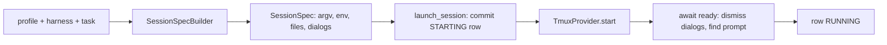

# System spec: sessions and harnesses

Status: describes the system as of 2026-10-20 (base `22cffd1b7`). This is system 5 of the
eighteen in the agent-queue system inventory (vault
`projects/agent-queue/specs/2026-10-20-agent-queue-system-inventory.md`, review
`rev-bright-rapids`, in review at revision 1 when this was written). Written for epic
eager-vault-55, task eager-vault-55.5. It explains what the system is for, how it works
today, where it stops, and what is planned. It links to the existing concept, reference
and design documents rather than repeating them. The inventory folds waits, hibernation,
handoffs and stall watch into this system, so they are covered here.

## 1. Purpose

Agent Queue does not run models itself. Every agent is a third-party coding CLI (Claude
Code, Codex, Gemini CLI, OpenCode) running in its own tmux session on the daemon's machine.
The CLIs were built for a person at a keyboard: they show trust dialogs, wait at a prompt,
crash, hit usage limits, compact their context, and sometimes sit at a finished turn
forever. This system turns them into workers that a scheduler can start, watch, talk to,
restart and stop without a human in the loop. It owns:

- **Harnesses**: one markdown file per CLI saying how to launch it, how to tell it is
  ready, which dialogs to dismiss, how to resume it, and how to submit text into it.
- **Launching**: building the argv, the scrubbed environment and the hook files, then
  starting the tmux session only after its database row is committed.
- **Watching**: the session reconciler that observes every session each daemon cycle,
  classifies exits, nudges stalled agents, restarts crashed ones and quarantines the
  hopeless ones.
- **Talking to agents between turns**: `aq prime`, the message nudge, handoff notes,
  durable waits and agent questions.
- **Looking at agents**: transcripts (usage and context measurement), the live pane
  stream and the interactive terminal.

The problems it solves are:

- an agent is always a real, inspectable terminal a human can attach to, never a hidden
  in-process loop;
- a crashed, wedged, rate-limited or context-thrashing agent is detected and handled by
  mechanism, without anyone watching;
- a restarted or resumed agent gets its task, its messages and its own notes back;
- no agent can act on a task it no longer owns, and no session can outlive its
  registration unnoticed;
- the daemon can restart without killing the agents it runs.

## 2. How it works today

### 2.1 Vocabulary

[Sessions](../../concepts/sessions.md) is the main concept page and explains most of this
section with a worked example. In brief:

- A **harness** is the CLI an agent runs in (`claude`, `codex`, `gemini`, plus
  operator-authored ones such as `opencode`). A profile names it in its `harness` key.
- A **session provider** is the mechanism that hosts the process: `tmux` in production,
  `subprocess` and `fake` for tests (`src/sessions/provider.py`, `tmux.py`,
  `subprocess.py`, `fake.py`).
- A **session** is one row in the `sessions` table plus the tmux session it describes.
- A **lifecycle** is `task` (one session per task, name `s-<task_id>`), `pool` (a
  long-lived claiming worker, `p-<profile>--<project>--<nonce>`) or `named` (supervisors
  and other standing agents, `n-<profile>[--<project>]`; the global supervisor is
  `n-supervisor--global`). Names are built in `src/sessions/spec.py`.
- A **claim** is a task's `claim_epoch` plus the `.aq/claim.json` file in the work
  folder. It is owned by `scheduling-and-claims`; this system carries and checks it.
- An **attempt** is one row of `task_session_attempts`: which session and model worked on
  which task, and how it ended.

The page's
[four identities](../../concepts/sessions.md#four-identities-and-why-they-are-not-one-thing)
section explains why task, claim, session and process are kept apart.

### 2.2 Harnesses

The harness file format is specified in the [harness reference](../../reference/harnesses.md).
Three harnesses ship in `src/sessions/default_harnesses/` (`claude.md`, `codex.md`,
`gemini.md`). OpenCode harnesses (`opencode`, `opencode-zen`, …) are written by the
operator in the vault; the code supports them (`src/sessions/opencode_store.py`,
`native_questions.py`) but none ships.

- **Parsing.** `parse_harness_markdown` (`src/sessions/harness_parser.py`) reads YAML
  frontmatter plus one JSON block. `HARNESS_KNOWN_KEYS` lists every key; unknown keys are
  rejected. Keys cover the executable and argv, prompt mode (`arg`, `flag`, `none`),
  readiness prefix and delay, process names, dialog rules, resume style, composer
  clearing, hook support, environment and the context window. A harness may name one
  `base` to inherit from (`resolve_base`).
- **Registry.** `HarnessRegistry.get` (`src/sessions/harness_registry.py`) looks in the
  project's vault scope (`vault/projects/<pid>/harnesses/`) first, then the system scope
  (`vault/harnesses/<id>.md`).
- **Seeding and drift.** `sync_vault_harnesses` (`src/sessions/harness_manifest.py`)
  writes a missing copy and compares installed copies with `SHIPPED_HARNESS_HASHES`. Each
  copy is classified as missing, current, stale (an older shipped version, safe to
  refresh) or edited (operator changes, never overwritten). The doctor check
  `harness.drift` reports the last two, and `aq vault reset-harness` restores the
  shipped copy.
- **Selection.** A task session takes its profile's `harness`
  (`src/orchestrator/execution.py`); a pool session takes it from the pool's profile
  (`src/orchestrator/pools.py`). Which profile runs a task is decided by
  `routing-and-profiles`.

### 2.3 Launching a session

**The spec.** `SessionSpecBuilder` (`src/sessions/spec.py`) turns a profile, a harness
and a task into an immutable `SessionSpec` (`src/sessions/provider.py`). It holds the
argv, environment, work folder, startup prompt, readiness and dialog rules, files to write
(hook settings), the instance token and the git identity digest.

- **Argv** (`_compose_argv`): if the task carries a `session_resume_key` in its metadata,
  the harness's resume subcommand or flag is used; otherwise the harness's session-id
  flag pins a fresh id. Named sessions resume only when a key exists.
- **Class configuration** (`_resolve_class_config`): the intelligence class picks the
  model and effort for this harness. The rules belong to `routing-and-profiles`; this
  system applies them. Claude gets `CLAUDE_CODE_AUTO_COMPACT_WINDOW`; Codex gets
  `model_auto_compact_token_limit` (`src/sessions/context.py`).
- **Startup prompt**: the bootstrap text says "Run `aq prime` first"; prime carries the
  task (§2.6).

**The environment.** `build_session_env` (`src/sessions/env.py`) layers, outermost first:
the scrubbed daemon environment, database isolation, the harness's own `env`, the AQ
markers, then launch extras.

- `src/env_scrub.py` removes credential-looking variables (a denylist plus a regex for
  URIs with passwords), keeps a short harness credential allowlist, and always strips
  the CLIs' own session markers (`CLAUDE*`, `CODEX_*` and the like) so a worker never
  inherits the daemon operator's CLI session. Every inherited `AQ_*` key is dropped and
  `AQ_INTEGRATION_GITHUB_APP_*` is always removed.
- Nine markers are set: `AQ_SESSION_ID`, `AQ_TASK_ID` (not for named sessions),
  `AQ_PROJECT_ID`, `AQ_PROFILE`, `AQ_DAEMON_EPOCH`, `AQ_INSTANCE_TOKEN`, `AQ_WORK_DIR`,
  `AQ_API_URL` and `AQ_API_TOKEN`. Pool sessions add `AQ_SESSION_KIND=pool`, their agent
  and profile ids and `GIT_*` identity; push launches add `AQ_CLAIM_EPOCH`. The
  [terminals and claims reference](../../reference/terminals-and-claims.md#the-nine-identity-markers)
  lists them.
- `session_db_isolation` sets `AQ_DB_SCOPE=worker` and points `AQ_DATABASE_URL` and
  `AGENT_QUEUE_DB` at the refusal sentinel `aq-worker-no-direct-db://`, so an agent can
  reach state only through the API with its scoped token.

**Hooks.** For harnesses with `supports_hooks: true`, `SessionSpecBuilder._hook_files`
renders `src/prime/templates/hooks/claude.json` or `codex.json` into the work folder, and
`sessions.hooks_provisioned` records whether it did:

| Hook | Runs | Why |
|---|---|---|
| `SessionStart` (matcher `resume\|compact`) | `aq prime --hook-json` | Re-inject the task after a resume or a compaction |
| `PreCompact` | `aq handoff --auto` | Save a facts note before context is lost |
| `SubagentStart`, `SubagentStop` | `aq subagent event --hook-json` | Record subagents the CLI spawns |

There is no `Stop` or `UserPromptSubmit` hook. Gemini declares `supports_hooks: false`.

**Register, then spawn.** `launch_session` (`src/sessions/launch.py`) is the only
production way to start an agent. It commits a `starting` row first and only then calls
the provider. `default_session_registry` wraps every provider's `start` with
`require_launch_authorization`, which raises `PermissionError("agent launch requires a
committed flock registration")` outside `launch_session`. Callers are task execution,
pools, the message lens (supervisor cold starts) and the agent terminals endpoint. A
launch that dies is recorded as `stopped` with reason `startup_exit`.

**Starting tmux.** `TmuxProvider.start` (`src/sessions/tmux.py`) runs `tmux new-session -d`
with `exec /usr/bin/env -i` and only the spec's environment, stores a few harness hints in
the tmux session environment, and sets `remain-on-exit on` so an exited pane can still be
read. `_await_ready` waits for the shell to give way to the CLI, then dismisses dialogs
(`src/sessions/dialogs.py`, one shared 8 s budget) while looking for the ready prefix. A
dialog marked `quarantine`, or one left unresolved, writes
`~/.agent-queue/sessions/<name>/start-stderr.log`, kills the session and raises
`SessionDiedDuringStartup`. A timeout with a live pane is not fatal.

The [worker startup output guide](../../guides/worker-startup-output.md) describes what an
operator sees during this.

### 2.4 Data model

All tables are in `src/database/tables.py`; the schema itself is owned by `daemon-core`.

| Table | What it holds |
|---|---|
| `sessions` | One row per session: name, lifecycle, profile, task, work folder, `state` (observed: starting, running, draining, sleeping, stopped, quarantined), `desired_state` (intended: running, sleeping, stopped), `instance_token`, daemon epoch, lease, stall and restart counters, `hooks_provisioned`. It is also the flock registry; there is no separate one. |
| `task_session_attempts` | Attempt history: session, task, model, start, end and verdict. |
| `agent_waits` | v1 durable waits (§2.8), fenced by `claim_epoch` and `session_instance_token`. |
| `agent_questions` | Questions detected in transcripts (§2.9). |
| `transcript_checkpoints` | Per-session read offset into each transcript. |
| `transcript_usage_calls` | Per-call token usage read from transcripts; also written to `token_ledger`. |
| `collaboration_threads`, `collaboration_members`, `collaboration_messages` | Bounded agent-to-agent threads (§2.10). |

Two more things live outside tables: the task's `session_resume_key` and failure streaks
in `tasks.metadata`, and handoff notes as `task_context` rows of type `handoff`.

**State rules** (`src/database/queries/session_queries.py`):

- `stopped` and `quarantined` are terminal. `sleeping` can only become `stopped` or
  `quarantined`: waking a sleeping named session creates a new row.
- Only one live row (starting, running or draining) may exist per name.
- `stalled` is never stored. It is derived from the lease (default 480 s).

### 2.5 The session reconciler

`SessionReconciler.tick` (`src/sessions/reconciler.py`) runs inside every
`run_one_cycle` (default every 5 s, `scheduling.cycle_interval_seconds`). Where the tick
sits in the cycle is owned by `daemon-core`. The tick runs these steps in order:

1. **observe**: list sessions from each provider and compare them with the rows;
2. **flock_audit** (at most every 30 s): `src/sessions/flock_audit.py` reports probe
   failures, hidden rows, live sessions with no row, live sessions whose row is terminal,
   and processes carrying this daemon's `AQ_INSTANCE_TOKEN` with no active row;
3. **claim_refusals**;
4. **drain_ack**: finish sessions that acknowledged a drain;
5. **prepare_timeout**;
6. **exits**: classify every exited session (below);
7. **abandoned_pool_claim_loop**;
8. **orphans**: kill sessions no row explains;
9. **disabled_project_supervisors**;
10. **idle_stop_intent**: a finished session idle for 60 s is told to stop;
11. **stall_ladder** (below);
12. **named**: `_converge_named_up` restarts wanted named sessions, with backoff and a
    restart budget, quarantining with `start_failed` when it runs out;
13. **backstop**.

**Unknown is not dead.** If a provider cannot list a prefix (`PartialListError`), every
destructive step for that prefix is deferred. Before a kill, `confirm_stopped` re-probes,
and the instance token is checked again so a recycled name is never killed by mistake
(`src/sessions/proctable.py`).

**Exit verdicts.** `classify_exit` (`src/sessions/exit_classifier.py`) picks, in order:

| Verdict | When | What follows |
|---|---|---|
| `drained` | A pool row asked to stop, or the task is closed or gone | Clean finish |
| `context_thrash` | The screen shows autocompact thrashing | Guarded recovery; the resume key is dropped |
| `rate_limit` | A usage-limit screen (`src/sessions/usage_limit_screen.py`) or rate-limit text | 900 s cooldown; provider availability is told |
| `rapid_crash` | Died within 600 s of starting | Counts toward quarantine |
| `productive_death` | Anything else | Restart with the resume key |

`src/sessions/worker_recovery.py` keeps a failure streak per cause in task metadata. Two
failures from the same guarded cause (`context_thrash`, `stalled`, `stuck_timeout`) block
the task with `needs_attention` instead of relaunching it again.

**The stall ladder.** A session idle past its lease, or wedged mid-turn, is nudged up to
`stall_max_nudges` times (default 3, 300 s apart). When nudges run out the session is
restarted with its resume key, and after `max_restarts` (3) it is quarantined, or the task
is paused with `resume_after` and released. A session holding a wait lease, or waiting on
an open question, is exempt. For OpenCode, whose spinner keeps the pane looking busy,
liveness comes from OpenCode's own SQLite store (`src/sessions/opencode_store.py`). The
concept page covers [the ladder](../../concepts/sessions.md#the-stall-ladder) and
[exit verdicts](../../concepts/sessions.md#exit-verdicts) in more depth.

**Adoption.** On daemon start, `adopt_on_start` lists the `s-`, `n-` and `p-` prefixes. A
live session whose instance token matches its row is adopted and re-stamped with the new
daemon epoch; a row with no live session is marked dead; a live session with no row is
killed. That is why `aq restart` keeps agents running
([restarts and adoption](../../concepts/sessions.md#restarts-and-adoption)).

**Sleeping and draining.** Named sessions go to sleep after their idle timeout and are
woken by a message or `aq session wake`. A drain asks a pool session to finish its claim
and exit; the session confirms with `aq session drain-ack`
([idle sessions and drains](../../concepts/sessions.md#idle-sessions-and-drains)).

**Pausing.** Pausing a task commits its work to `refs/aq/task-pauses/<hex>`
(`src/orchestrator/task_checkpoint.py`) before the session is stopped, so a later session
resumes from the checkpoint
([pausing a task](../../concepts/sessions.md#pausing-a-task-without-losing-its-work)).

### 2.6 Prime: what an agent is told

`aq prime` renders the agent's working brief. `render_for_task`
(`src/prime/renderer.py`) builds ten sections in a fixed order: role, project role, task,
task context, workspaces, messages, two knowledge sections, tool guidance and the
completion protocol (`src/prime/models.py`, `sections.py`).

- **Budgets** (`src/prime/budgets.py`): description 4096 bytes, context 6144 bytes. A cut
  preview ends with the exact `aq task show … --offset --limit` command that pages the
  rest. Bounded workers shrink sections until the whole brief fits.
- **Messages section**: open collaboration threads, pending messages (marked delivered
  with `via="prime"`), the last five durable waits, and the newest handoff note plus
  current facts.
- **Completion protocol**: pool sessions get `completion_protocol_pool.md` (close with
  `--claim-next`); development-mode projects get different delivery text; emergent-work
  text appears only when the profile may create tasks.
- **Override**: `<work_dir>/.aq/PRIME.md` replaces the body with `{{var}}` substitution.
  A paused-project notice is always appended after it.

Prime runs on first launch (the bootstrap prompt), on resume and after compaction (the
`SessionStart` hook, returned as `hookSpecificOutput.additionalContext` by
`src/prime/hook_envelopes.py`). A startup hook is skipped when
`AQ_STARTUP_PROMPT_DELIVERED=1`, so the first brief is not delivered twice. A message
wake-up does not re-prime.

### 2.7 Between turns: messages, nudges and handoffs

**Message nudges.** Messages themselves belong to `messaging-and-human-asks`; this system
delivers the wake-up. `MessageDeliveryEngine` (`src/messages/delivery.py`) looks at the
recipient's activity through `src/messages/session_lens.py`: busy (skip for now), idle
(nudge), sleeping (cold-start, supervisors only) or absent. Activity comes from the
transcript's turn-complete signal, or else pane activity in the last 30 s. The nudge is a
single line pointing at a command, such as ``aq message status <id> --json``; running
that command is what marks the message read. A consumer retries periodically within a
120 s budget per recipient, and three failed attempts escalate. Delivery is at least once.
This came from the approved RCA `2026-10-07-missed-supervisor-message-wake-up-rca-and-bounded-delivery-f.md`
(review `rev-keen-current`).

**The composer guard.** Typing into a CLI that a human is also using is dangerous.
`TmuxProvider.nudge` (`src/sessions/tmux.py`) refuses when a human typed recently, when
the terminal is in copy mode or attached, when the prompt is unknown or the cursor is
outside the pane, when the pane changes between two reads, or when the composer holds a
draft. It clears its own earlier unsent text, checks twice that the composer is empty,
types or pastes, and waits for its marker to render before submitting. A refusal raises
`NudgeDeferred` with a named reason and the message stays pending
([a nudge that was typed but never submitted](../../concepts/sessions.md#a-nudge-that-was-typed-but-never-submitted)).

**Handoffs.** `aq handoff` stores a structured note for the current claim
(`src/commands/surface_commands.py`, `src/handoffs.py`): the agent's own fields (goal,
next step, waiting for, completed, files, decisions, things not to repeat, constraints,
evidence) plus facts the daemon gathers (branch, HEAD, dirty paths, subtasks, context
size, jobs, waits, open gates). `--auto` runs from the `PreCompact` hook. Prime shows the
newest note, quoted and capped at 8 KiB, and labels it stale when the claim, session,
folder, branch or HEAD changed since it was written. See
[wake context and compaction](../../guides/wake-context-compaction.md).

### 2.8 Durable waits (v1, on main today)

An agent that is waiting for a job, another task, a message or a timer should not burn
turns polling. A durable wait lets it say so and keep its claim. The
[agent waits guide](../../guides/agent-waits.md) is the user guide.

- Kinds: `job`, `task`, `message`, `timer`. States: `active`, `satisfied`, `expired`,
  `cancelled`. Default timeout 7200 s, maximum 86400 s (`src/agent_waits.py`).
- Registration (`src/commands/wait_commands.py`,
  `src/database/queries/agent_wait_queries.py`) derives the owner on the server: a live
  session on the current claim epoch with the task in progress. Replaying the same
  idempotency key returns the existing wait. One active task wait is allowed per claim.
- While a wait is active and its producer has not finished, the reconciler renews the
  session's lease up to the wait's deadline and skips the stall ladder.
- `AgentWaitReconciler` runs each orchestrator cycle, resolves satisfied or expired
  waits, cancels waits whose claim ended, and writes a `wait:<id>:result` message through
  an outbox.
- The agent resumes with `aq wait show WAIT_ID --consume --json` (`src/cli/waits.py`).

Playbook waits (`playbook_waits`, `src/playbooks/waits.py`) are a separate mechanism that
parks playbook runs, owned by `playbooks`.

### 2.9 Agent questions

`src/sessions/questions.py` detects a question an agent asks in its transcript and
records it in `agent_questions`. Every question starts in state `supervisor` and is
routed to `supervisor-<project_id>`; the supervisor answers or escalates it to a human
through `create_escalation` (state `human`). The tick sends a notice after 15 minutes but
does not escalate on its own. OpenCode's native question dialogs are read from its store
(`src/sessions/native_questions.py`). `src/sessions/input_prompts.py` only observes
on-screen input prompts for the doctor and pool status. Human escalations themselves
belong to `messaging-and-human-asks`.

### 2.10 Collaboration threads

A supervisor or operator can open a short thread between two to four agents
(`src/collaboration.py`, `src/commands/collaboration_commands.py`): at most 7200 s, a
budget of up to 40 messages, 4096 bytes per message, 5 sends a minute per sender. Each
member accepts for its current claim epoch, and sending needs an accepted, live claim.
`aq message wait` registers a real `agent_waits` row and long-polls. See
[agent collaboration](../../guides/agent-collaboration.md).

### 2.11 Transcripts and context

`src/sessions/transcripts/` has readers for Claude and Codex. `TranscriptWatcher` polls
about every 2 s, records per-call usage in `transcript_usage_calls` and `token_ledger`,
and keeps offsets in `transcript_checkpoints`. For Codex the session key is learned from
the transcript. `src/sessions/context.py` measures how full the context window is from
the transcript tail; for OpenCode it reads OpenCode's store. Gemini has no reader. What
AQ reads and keeps is described under
[privacy](../../concepts/sessions.md#privacy-what-aq-reads-and-what-it-keeps); usage
accounting is in [usage accounting](../../reference/usage-accounting.md).

### 2.12 Terminals

There are three ways to look at a session, all in the
[terminals and claims reference](../../reference/terminals-and-claims.md):

- **Live pane**: `src/sessions/pane_broadcaster.py` captures up to 12 sessions every
  second (60 lines) and serves them over server-sent events at
  `GET /api/sessions/{id}/pane`.
- **Interactive terminal**: a websocket using protocol `aq-terminal-v1` at
  `/ws/terminal/{id}` attaches a PTY to the tmux session
  (`src/sessions/terminal_pty.py`); `/ws/terminal/{id}/input` carries input from elsewhere
  (`src/sessions/terminal_input.py`). Reconnection is client-side
  ([terminal reconnection](../terminal-reconnection.md)).
- **Host shell**: `src/sessions/host_shell.py`.

`src/panes/registry.py` is the dashboard's view registry, not tmux panes.

### 2.13 Stall watches outside the reconciler

Besides the ladder in §2.5, three things report stuck work. None repairs anything.

- **Stuck-task watch**: a playbook on `timer.10m` calls `get_stuck_tasks`
  (`src/stall_watch.py`, `src/commands/system_commands.py`) and messages the global
  supervisor about orphaned, stale active, stuck ready and waiting-on-delivery tasks,
  excluding held ones ([stuck-task watch](../stuck-task-watch.md)).
- **Doctor** `aq doctor --check stall.sweep` (`src/doctor/stall_checks.py`).
- **Operator script** `scripts/operator-checks/stall-sweep.py`
  ([operator stall sweep](../operator-stall-sweep.md)).

### 2.14 Command and doctor surface

- Session commands: `aq session list|show|wake|stop|drain-ack|cleanup`
  (`src/commands/session_commands.py`; [session cleanup](../operations/session-cleanup.md)).
- Agent surface: `aq prime`, `aq handoff`, `aq wait …`, `aq message wait`,
  `aq subagent event` (`src/cli/agent_surface.py`, `src/cli/waits.py`).
- `aq task close --obsolete|--no-change|--done` is implemented in
  `src/sessions/obsolete.py` and refuses tasks held by a live session.
- Doctor checks in `src/doctor/session_checks.py` (including the flock audit),
  `harness.drift` and `stall.sweep`. The
  [session troubleshooting guide](../../guides/session-troubleshooting.md) and
  [flock sessions guide](../../guides/flock-sessions.md) are the operator entry points.

## 3. Boundaries

| Neighbour | This system owns | The neighbour owns |
|---|---|---|
| `daemon-core` | `SessionReconciler.tick`, `AgentWaitReconciler`, `adopt_on_start` as callables | Where they run in `run_one_cycle`, start-up order, the schema and migrations |
| `task-graph` | Reading task status to classify exits; pausing a task with a checkpoint ref | Task statuses, hierarchy, gates |
| `scheduling-and-claims` | Carrying the claim into the session (`AQ_CLAIM_EPOCH`, `.aq/claim.json` via `src/claim_file.py`), lease renewal, stall-exempt waits | Claims, epochs, the frontier, pools, `_assert_session_owns` and `stale_claim` |
| `routing-and-profiles` | Launching the harness the profile names; applying the class slice | Which profile runs a task; profile and class formats and resolution rules |
| `projects-workspaces-git` | Starting the session in the prepared folder; the pause checkpoint ref | Workspace preparation and release, branches, git identity |
| `integration-and-delivery` | Nothing beyond launching repair and fixer sessions like any other | Delivery, trains, validation |
| `playbooks` | The stuck-task watch's query and message | Playbook runtime, `playbook_waits`, the timer that drives the watch |
| `messaging-and-human-asks` | The wake-up nudge, the composer guard, question detection | Messages, inboxes, escalations, the human-ask surface |
| `supervisors-and-policy` | Starting, sleeping and waking named supervisor sessions | What supervisors decide; stall and recovery policy written as playbooks |
| `providers` | Detecting usage-limit screens and rate-limit exits | Provider availability, cooldown windows, failover |
| `configuration-and-vault` | Harness file format, harness seeding and drift | Vault layout, `config.yaml`, secrets |
| `api-and-clients` | Pane stream and terminal websocket handlers' session side | The HTTP and websocket routes, auth, generated clients |
| `dashboard` | The data behind terminals and pane streams | Their presentation, the mobile terminal, the view registry |
| `test-service-and-jobs` | Jobs as a wait condition | Managed jobs, the test service |
| `operations-and-recovery` | Session, harness and stall doctor checks | The doctor framework, runbooks, `aq restart` |
| `plugins-mcp-and-tools` | Writing hook files into the work folder | MCP servers, plugins and their tools |
| `reviews-and-knowledge` | Rendering knowledge context into prime when enabled | Knowledge records and reviews |

## 4. Principles and invariants

- **Every agent is a tmux session.** There is no in-process runtime. `src/runtimes/`
  registers nothing (`tests/test_runtimes_registry.py`), and profile keys `runtime` and
  `agent_name` are rejected (`src/profiles/parser.py`).
- **Register before spawn.** No agent process starts without a committed `sessions` row;
  the provider wrapper enforces it, and the flock audit looks for anything that slipped
  through.
- **Observation and intention are separate columns.** `state` is what the daemon saw;
  `desired_state` is what it wants. Convergence is the reconciler's job.
- **Unknown is not dead.** A failed or partial probe defers every destructive action; a
  kill re-probes and re-checks the instance token.
- **Fence everything by epoch and token.** A stale claim epoch is refused, and every
  process carries an instance token that ties it to exactly one row.
- **Agents never touch the database.** Sessions get a scoped API token and a database
  sentinel that refuses direct connections.
- **Scrub the environment.** No daemon credential or CLI session marker reaches an
  agent unless allowlisted.
- **Never type over a human.** The composer guard refuses rather than risk clobbering a
  draft, and every refusal is named.
- **Restarting the daemon must not kill agents.** Adoption by instance token is what
  makes `aq restart` safe.
- **Mechanism here, policy elsewhere.** The reconciler and the ladder are deterministic
  and make no LLM calls; judgment (what to do with a stuck task, a question, a failed
  provider) belongs to supervisors and playbooks.
- **Shipped harnesses are write-if-absent.** Operator edits are kept and reported as
  drift, never overwritten.

## 5. Known gaps

These were found while writing this spec. None is tracked by an open task as of
2026-10-20 unless noted.

1. **The concept page is behind the code.** [Sessions](../../concepts/sessions.md):
   - lists four exit verdicts; the code has five (`context_thrash` is missing);
   - lists ten reconciler steps, leaving out `flock_audit`, `claim_refusals` and
     `disabled_project_supervisors`;
   - draws `sleeping → starting` and `starting → quarantined` on a dialog. In code a
     sleeping row cannot restart (waking creates a new row) and a launch that dies is
     `stopped` with `startup_exit`;
   - says the subprocess provider has no `confirm_stopped`; it does.
2. **The harness reference is behind the code.** [Harnesses](../../reference/harnesses.md):
   - calls a `base` chain an error; the code only warns;
   - documents `transcript_paths` and `{work_dir_slug}`, which nothing reads (reader paths
     are hard-coded);
   - describes `--full-auto` handling inaccurately; the code always strips it.
3. **Shipped harness notes are stale.** `codex.md` says only subagent hooks are wired;
   `codex.json` also wires `SessionStart` and `PreCompact`. `gemini.md` still describes
   the removed `aq inbox --inject`.
4. **Gemini is a second-class harness.** It has no transcript reader, so it reports no
   usage or context, and with no hooks and no resume key a restart starts fresh.
5. **Codex resume is half wired.** The session key is learned from the transcript, but
   the harness declares `resume: none`, so it is never used.
6. **The question-routing spec is stale.**
   [Agent question routing](../../superpowers/specs/2026-08-30-agent-question-routing.md)
   describes escalation after 5 minutes. Today every question starts at the supervisor and
   the 15-minute timeout only sends a notice.
7. **`session.restart_requested` has no subscriber.** A plain `aq handoff` emits it
   (`src/commands/surface_commands.py`, `src/event_schemas.py`), and nothing listens.
8. **A latent break in the sync workflow.** `src/orchestrator/sync_workflow.py` still calls
   `self._runtimes.create("")` on the empty runtime registry, which raises `ValueError` if
   that path is ever reached.
9. **`max_session_age` is unused.** The field exists (`src/models.py`) but nothing
   recycles old sessions.
10. **Doctor and the ladder disagree about waits.** The reconciler skips the ladder for a
    session with an active wait, but the `stall.sweep` `idle_worker` finding still fires
    after 15 idle minutes.
11. **The collaboration guide is behind the code.**
    [Agent collaboration](../../guides/agent-collaboration.md) says `aq message wait`
    gives back no durable wait (it registers one), lists a `collaboration.budget_exhausted`
    code (the code returns `collaboration.closed`), and says a thread closes when a
    member's task ends (only an explicit removal or the deadline closes it).
12. **The compaction guide is behind the code.**
    [Wake context and compaction](../../guides/wake-context-compaction.md) says job and
    wait lists in handoff facts are empty; they are filled now.
13. **Stale code text.** Docstrings in `src/sessions/provider.py` and `subprocess.py` say
    tmux and the process table "land with a later wave"; `LIFECYCLES` comments and the
    `sessions` table comment omit `pool`; the reconciler docstring's step list does not
    match the tick; prime docstrings describe a `.aq/prompt.md` nothing writes.
14. **The design records are historical.**
    [Session runtime design](../design/session-runtime.md) and its
    [implementation plan](../implementation/session-runtime.md) are marked historical and
    differ from the code (adoption prefixes, subprocess capabilities, pool lifecycle).
    Where they disagree, the code is right.

## 6. Planned work

The main open epic is **bold-zenith-11** (IN_PROGRESS), event-driven hibernation and
verified waits. It replaces v1 waits. Task states were re-queried on 2026-10-20 just
before writing.

### 6.1 Event-driven hibernation and verified waits (bold-zenith-11)

**Why.** Three incidents on 2026-10-13: a train repair sat READY for 11.5 hours at
priority 100 while holding the development branch; nine Codex sessions kept waking on
expiry, lease renewal and patrol notes; and agents' claimed blockers could not be checked.

**What the design changes** (vault
`2026-10-13-event-driven-agent-hibernation-and-verified-waits.md`, review
`rev-bold-pinnacle`, approved at revision 2; Jack's decisions in
`2026-10-13-hibernation-rev2-decisions.md`):

- **Typed conditions AQ can observe**: task, dependency, job, CI run or check, pull
  request, batch, message, human, timer, resource and playbook condition. Registration
  refuses a condition that is missing, out of scope or already satisfied
  (`wait.already_satisfied`), so an agent's claimed blocker is checked.
- **Wake only on the condition or a supervisor decision.** Routine mail is held until the
  wake. A timeout escalates to the supervisor (`wait_decide`: extend, wake, cancel,
  reroute or escalate to Jack). Three registrations in an hour count as a loop and force
  hibernation. Human waits never time out.
- **Sleep in place or hibernate.** A short wait keeps the session (ceiling 1800 s). A
  longer one, or slot pressure, hibernates it: write an 8 KiB compaction summary, push a
  WIP commit, prove the session stopped within 120 s, advance the claim epoch and release
  the folder. Both modes exist because some rebuilds take 20 minutes or more; human waits
  always hibernate.
- **Resume is a fresh session**, primed with the outcome, the summary, the ticket, all
  comments and the held mail; the agent acknowledges with `wait_ack`. Native transcript
  resume was removed in revision 2.
- **New task statuses**: `WAITING`, `HIBERNATED`, `RESUME_PENDING`.
- **The wait graph raises priority.** A blocker inherits its most urgent waiter's
  priority, and a branch-holding blocker left unclaimed for 1800 s escalates and gets a
  reserved slot.
- **Event sources**: a transactional outbox (`wait_source_events`), `LISTEN/NOTIFY`, a
  lease-elected timer driver and one CI watcher per repository.

**Implementation** (vault `…-implementa.md`, review `rev-fleet-orbit`, approved at
revision 1). Children .1–.21 and .23–.36 are COMPLETED. Their work is on
`aq/epic/event-driven-hibernation-and-verified-waits-implementation` and **not on main**
at this base. It adds:

- migrations `a00000000103`–`a00000000106` and the tables `wait_records`, `wait_edges`,
  `wait_source_events`, `wait_listener_cursors`, `wait_deadlines`, `wait_escalations`,
  `continuations`, `admission_reservations`, `wait_measurements`,
  `wait_priority_projection` and `wait_bridge_progress`;
- `src/waits/` (registry, conditions, admission, decisions, graph, holding, mail, loops,
  sources, timers, adapters per kind, a CI watcher) and `src/wait_runtime/` (hibernate,
  resume, eviction, scheduler, legacy bridge);
- `wait_v2` commands (`wait_ack`, `wait_checkpoint`, `wait_decide`, `wait_lift`,
  `wait_explain`, `wait_graph`, `wait_evict`, and internal verbs for deadlines, sources,
  resume dispatch and the legacy bridge);
- prime sections for the wait outcome and the compaction summary;
- `src/config_wait_policy.py`, with `wait_policy.v2_enabled`, `hibernation_enabled` and
  `scheduler_waits_enabled` all false and `v1_bodies: translate`.

Defaults: escalation after 14400 s for task, dependency, pull request and batch waits,
7200 s for job, message and playbook condition, 5400 s for CI, 1800 s for resource and
300 s for timer; resume margin 2.0 against a 10-minute resume cost; two resume attempts.
Rollback is flags only, and continuations are never deleted.

**Remaining: bold-zenith-11.22** (READY, routed to `standard-high-codex`): flip the
defaults, refuse v1 bodies (`wait.upgrade_required`), ship the `waits.schema` and
`waits.orphans --fix` doctor checks and the cutover runbook, rewrite the agent-waits and
wake-context-compaction guides, sync grants and regenerate. The live migration and flip
are done by the global supervisor as operator, with no human gate (owner directive
2026-10-19). Gaps on the epic branch at writing time: no per-project `v2_enabled` for a
canary, no `src/doctor/wait_checks.py`, no runbook, and the legacy bridge keeps
`deadline_at` with no grace period.

When it lands, §2.8 is replaced: v1 waits become a translated legacy body, then a refusal.

### 6.2 Other open work that touches this system

| Item | State | What it changes |
|---|---|---|
| stark-willow-95.3 — redrive stuck delivery once, with one waiting view (epic stark-willow-95, fast smooth integration) | READY | A waiting view built on the wait records. |
| stark-willow-95.7 — idle-busy dispatch replaces the timed train window | READY | Needs v2 waits and exact-SHA CI check waits. |
| stark-willow-95.13 — one admission view for frontier, pools explain and delivery guards | READY | Admission reads the waits API. Owned by `scheduling-and-claims`. |
| stark-willow-95.15 — keep author context through the fenced parent merge, with budgets as verified waits | DEFINED | Authors wait on verified integration conditions instead of exiting. |
| stark-willow-95.11 — keep candidate and fixer workspaces warm | DEFINED | Workspace reuse across sessions. Owned by `projects-workspaces-git`. |
| stark-willow-95.17 — align shipped policy, profile instructions and retirement ratchets | DEFINED | Changes prime text and worker instructions. |
| eager-vault-55.19 — rewrite the vision spec from all eighteen system specs | DEFINED | Consumes this document. |

The fast smooth integration spec (vault `2026-10-12-fast-smooth-integration.md`, review
`rev-fair-lantern`) was in review at revision 3 when this was written.

### 6.3 Research not yet planned

**Distributed worker nodes** (vault `2026-10-06-distributed-worker-nodes.md`, review
`rev-eager-quest`, in review at revision 2). It recommends one control plane plus an
execution-worker service on every host, including the daemon's own machine. tmux
sessions, transcripts, the PTY terminal and the flock audit would move behind that
service, and session records would gain a node dimension. No task is filed.

### 6.4 Recently completed work this spec reflects

These specs describe behaviour already on main and are worth reading for the reasoning:
[worker context thrash recovery](../../superpowers/specs/2026-10-10-worker-context-thrash-recovery.md),
[context thrash deferred handoff](../../superpowers/specs/2026-10-13-context-thrash-deferred-handoff.md),
[retained workspace stop rework](../../superpowers/specs/2026-10-13-retained-workspace-stop-rework.md),
[stopped-task rerouting](../../superpowers/specs/2026-10-12-stopped-task-rerouting.md),
[task branch recovery](../../superpowers/specs/2026-10-09-task-branch-recovery-design.md),
[mobile terminal](../../superpowers/specs/2026-10-08-mobile-terminal-design.md),
[worker provider usage exhaustion](../../superpowers/specs/2026-10-06-worker-provider-usage-exhaustion.md),
[project supervisor opt-in](../../superpowers/specs/2026-10-12-project-supervisor-opt-in.md)
and [pool header terminal selector](../../superpowers/specs/2026-10-01-pool-header-terminal-selector.md).
The vault spec `2026-10-03-local-opencode-compaction-loops-and-permanent-stalls-fleet-t.md`
(review `rev-noble-glacier`, approved) is behind the OpenCode liveness reader.

The gaps in §5 are candidates for follow-up work. None has a filed task.

## 7. Related documents and source

**Concepts and guides**
- [Sessions](../../concepts/sessions.md)
- [Agent waits](../../guides/agent-waits.md)
- [Agent collaboration](../../guides/agent-collaboration.md)
- [Wake context and compaction](../../guides/wake-context-compaction.md)
- [Flock sessions](../../guides/flock-sessions.md)
- [Session troubleshooting](../../guides/session-troubleshooting.md)
- [Worker startup output](../../guides/worker-startup-output.md)
- [Worker pools](../../guides/worker-pools.md)

**Reference**
- [Harnesses](../../reference/harnesses.md)
- [Terminals and claims](../../reference/terminals-and-claims.md)
- [Sessions module catalog](../../reference/modules/sessions.md)
- [Usage accounting](../../reference/usage-accounting.md)

**Specs and designs**
- [Worker context](../worker-context.md)
- [Stuck-task watch](../stuck-task-watch.md)
- [Operator stall sweep](../operator-stall-sweep.md)
- [Terminal reconnection](../terminal-reconnection.md)
- [Session cleanup](../operations/session-cleanup.md)
- [Agent coordination](../design/agent-coordination.md)

**History** (historical records; the code is right where they differ)
- [Session runtime design](../design/session-runtime.md) and
  [implementation](../implementation/session-runtime.md)
- [Worktree execution](../design/worktree-execution.md)
- [Session desired state](../../superpowers/specs/2026-08-27-session-desired-state-design.md)
- [Agent flock](../../superpowers/specs/2026-08-30-agent-flock-design.md)
- [Agent question routing](../../superpowers/specs/2026-08-30-agent-question-routing.md)
- [Live pane streaming](../../superpowers/specs/2026-08-25-live-pane-streaming-design.md)
- [Retired in-process runtimes](../runtimes/README.md)

**Source**
- Sessions: `src/sessions/` (`provider.py`, `tmux.py`, `subprocess.py`, `fake.py`,
  `spec.py`, `env.py`, `launch.py`, `reconciler.py`, `exit_classifier.py`,
  `worker_recovery.py`, `flock_audit.py`, `proctable.py`, `dialogs.py`,
  `usage_limit_screen.py`, `context.py`, `opencode_store.py`, `questions.py`,
  `native_questions.py`, `input_prompts.py`, `obsolete.py`)
- Harnesses: `src/sessions/harness_parser.py`, `harness_registry.py`,
  `harness_manifest.py`, `src/sessions/default_harnesses/`
- Transcripts: `src/sessions/transcripts/`
- Terminals: `src/sessions/pane_broadcaster.py`, `terminal_pty.py`, `terminal_input.py`,
  `host_shell.py`
- Between turns: `src/prime/`, `src/handoffs.py`, `src/agent_waits.py`,
  `src/commands/wait_commands.py`, `src/commands/message_wait_commands.py`,
  `src/collaboration.py`, `src/stall_watch.py`, `src/messages/delivery.py`,
  `src/messages/session_lens.py`
- Environment and claims: `src/env_scrub.py`, `src/claim_file.py`
- Tables: `sessions`, `task_session_attempts`, `agent_waits`, `agent_questions`,
  `transcript_checkpoints`, `transcript_usage_calls`, `collaboration_*` in
  `src/database/tables.py`
