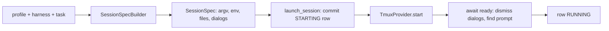

# System spec: sessions and harnesses

Status: audited against development source `52d2efe4c` on 2026-10-22.
Originally written against `22cffd1b7` on 2026-10-20. This is system 5 of the
eighteen in the agent-queue system inventory (vault
`projects/agent-queue/specs/2026-10-20-agent-queue-system-inventory.md`, review
`rev-bright-rapids`; the inventory is approved). Written for epic
eager-vault-55, task eager-vault-55.5. It explains what the system is for, how it works
today, where it stops, and which historical plans have landed. It links to the existing concept, reference
and design documents rather than repeating them. The inventory folds waits, hibernation,
handoffs and stall watch into this system, so they are covered here.

## 1. Purpose

Agent Queue does not run models itself. Every agent is a third-party coding CLI (Claude
Code, Codex, Gemini CLI, OpenCode) running in its own tmux session on the daemon's machine.
The CLIs were built for a person at a keyboard: they show trust dialogs, wait at a prompt,
crash, hit usage limits, compact their context, and sometimes sit at a finished turn
forever. This system turns them into workers that a scheduler can start, watch, talk to,
restart and stop without a human in the loop. It owns:

- **Harnesses**: one markdown file per CLI saying how to launch it, how to tell it is
  ready, which dialogs to dismiss, how to resume it, and how to submit text into it.
- **Launching**: building the argv, the scrubbed environment and the hook files, then
  starting the tmux session only after its database row is committed.
- **Watching**: the session reconciler that observes every session each daemon cycle,
  classifies exits, nudges stalled agents, restarts crashed ones and quarantines the
  hopeless ones.
- **Talking to agents between turns**: `aq prime`, the message nudge, handoff notes,
  durable waits and agent questions.
- **Looking at agents**: transcripts (usage and context measurement), the live pane
  stream and the interactive terminal.

The problems it solves are:

- an agent is always a real, inspectable terminal a human can attach to, never a hidden
  in-process loop;
- a crashed, wedged, rate-limited or context-thrashing agent is detected and handled by
  mechanism, without anyone watching;
- a restarted or resumed agent gets its task, its messages and its own notes back;
- no agent can act on a task it no longer owns, and no session can outlive its
  registration unnoticed;
- the daemon can restart without killing the agents it runs.

## 2. How it works today

### 2.1 Vocabulary

[Sessions](../../concepts/sessions.md) is the main concept page and explains most of this
section with a worked example. In brief:

- A **harness** is the CLI an agent runs in (`claude`, `codex`, `gemini`, plus
  operator-authored ones such as `opencode`). A profile names it in its `harness` key.
- A **session provider** is the mechanism that hosts the process: `tmux` in production,
  `subprocess` and `fake` for tests (`src/sessions/provider.py`, `tmux.py`,
  `subprocess.py`, `fake.py`).
- A **session** is one row in the `sessions` table plus the tmux session it describes.
- A **lifecycle** is `task` (one session per task, name `s-<task_id>`), `pool` (a
  long-lived claiming worker, `p-<profile>--<project>--<nonce>`) or `named` (supervisors
  and other standing agents, `n-<profile>[--<project>]`; the global supervisor is
  `n-supervisor--global`). Names are built in `src/sessions/spec.py`.
- A **claim** is a task's `claim_epoch` plus the `.aq/claim.json` file in the work
  folder. It is owned by `scheduling-and-claims`; this system carries and checks it.
- An **attempt** is one row of `task_session_attempts`: which session and model worked on
  which task, and how it ended.

The page's
[four identities](../../concepts/sessions.md#four-identities-and-why-they-are-not-one-thing)
section explains why task, claim, session and process are kept apart.

### 2.2 Harnesses

The harness file format is specified in the [harness reference](../../reference/harnesses.md).
Three harnesses ship in `src/sessions/default_harnesses/` (`claude.md`, `codex.md`,
`gemini.md`). OpenCode harnesses (`opencode`, `opencode-zen`, …) are written by the
operator in the vault; the code supports them (`src/sessions/opencode_store.py`,
`native_questions.py`) but none ships.

- **Parsing.** `parse_harness_markdown` (`src/sessions/harness_parser.py`) reads YAML
  frontmatter plus one JSON block. `HARNESS_KNOWN_KEYS` lists recognized keys;
  unknown keys are warned about and ignored. Keys cover the executable and argv, prompt mode (`arg`, `flag`, `none`),
  readiness prefix and delay, process names, dialog rules, resume style, composer
  clearing, hook support and environment. Context-window metadata comes from
  model/transcript information, not a harness `context_window` key. A harness may
  name one `base` to inherit from (`resolve_base`); an invalid base logs an error
  and leaves the child unresolved rather than refusing it.
- **Registry.** `HarnessRegistry.get` (`src/sessions/harness_registry.py`) looks in the
  project's vault scope (`vault/projects/<pid>/harnesses/`) first, then the system scope
  (`vault/harnesses/<id>.md`).
- **Seeding and drift.** `sync_vault_harnesses` (`src/sessions/harness_manifest.py`)
  writes a missing copy and compares installed copies with `SHIPPED_HARNESS_HASHES`. Each
  copy is classified as missing, current, stale (an older shipped version, safe to
  refresh automatically) or edited (operator changes, never overwritten). The doctor check
  `harness.drift` reports the last two, and `aq vault reset-harness` restores the
  shipped copy.
- **Selection.** A task session takes its profile's `harness`
  (`src/orchestrator/execution.py`); a pool session takes it from the pool's profile
  (`src/orchestrator/pools.py`). Which profile runs a task is decided by
  `routing-and-profiles`.

### 2.3 Launching a session

**The spec.** `SessionSpecBuilder` (`src/sessions/spec.py`) turns a profile, a harness
and a task into an immutable `SessionSpec` (`src/sessions/provider.py`). It holds the
argv, environment, work folder, startup prompt, readiness and dialog rules, files to write
(hook settings), the instance token and the git identity digest.

- **Argv** (`_compose_argv`): if the task carries a `session_resume_key` in its metadata,
  the harness's resume subcommand or flag is used; otherwise the harness's session-id
  flag pins a fresh id. Named sessions resume only when a key exists.
- **Class configuration** (`_resolve_class_config`): the intelligence class picks the
  model and effort for this harness. The rules belong to `routing-and-profiles`; this
  system applies them. Claude gets `CLAUDE_CODE_AUTO_COMPACT_WINDOW`; Codex gets
  `model_auto_compact_token_limit` (`src/sessions/context.py`).
- **Startup prompt**: the bootstrap text says "Run `aq prime` first"; prime carries the
  task (§2.6).

**The environment.** `build_session_env` (`src/sessions/env.py`) layers, outermost first:
the scrubbed daemon environment, database isolation, the harness's own `env`, the AQ
markers, then launch extras.

- `src/env_scrub.py` removes credential-looking variables (a denylist plus a regex for
  URIs with passwords), keeps a short harness credential allowlist, and always strips
  the CLIs' own session markers (`CLAUDE*`, `CODEX_*` and the like) so a worker never
  inherits the daemon operator's CLI session. Every inherited `AQ_*` key is dropped and
  `AQ_INTEGRATION_GITHUB_APP_*` is always removed.
- Nine markers are set: `AQ_SESSION_ID`, `AQ_TASK_ID` (not for named sessions),
  `AQ_PROJECT_ID`, `AQ_PROFILE`, `AQ_DAEMON_EPOCH`, `AQ_INSTANCE_TOKEN`, `AQ_WORK_DIR`,
  `AQ_API_URL` and `AQ_API_TOKEN`. Pool sessions add `AQ_SESSION_KIND=pool`, their agent
  and profile ids and `GIT_*` identity; push launches add `AQ_CLAIM_EPOCH`. The
  [terminals and claims reference](../../reference/terminals-and-claims.md#the-nine-identity-markers)
  lists them.
- `session_db_isolation` sets `AQ_DB_SCOPE=worker` and points `AQ_DATABASE_URL` and
  `AGENT_QUEUE_DB` at the refusal sentinel `aq-worker-no-direct-db://`, so an agent can
  reach state only through the API with its scoped token.

**Hooks.** For harnesses with `supports_hooks: true`, `SessionSpecBuilder._hook_files`
renders `src/prime/templates/hooks/claude.json` or `codex.json` into the work folder, and
`sessions.hooks_provisioned` records whether it did:

| Hook | Runs | Why |
|---|---|---|
| `SessionStart` (matcher `resume\|compact`) | `aq prime --hook-json` | Re-inject the task after a resume or a compaction |
| `PreCompact` | `aq handoff --auto` | Save a facts note before context is lost |
| `SubagentStart`, `SubagentStop` | `aq subagent event --hook-json` | Record subagents the CLI spawns |

There is no `Stop` or `UserPromptSubmit` hook. Gemini declares `supports_hooks: false`.

**Register, then spawn.** `launch_session` (`src/sessions/launch.py`) is the only
production way to start an agent. It commits a `starting` row first and only then calls
the provider. `default_session_registry` wraps every provider's `start` with
`require_launch_authorization`, which raises `PermissionError("agent launch requires a
committed flock registration")` outside `launch_session`. Callers are task execution,
pools, the message lens (supervisor cold starts) and the agent terminals endpoint. A
launch that dies is recorded as `stopped` with reason `startup_exit`.

**Starting tmux.** `TmuxProvider.start` (`src/sessions/tmux.py`) runs `tmux new-session -d`
with `exec /usr/bin/env -i` and only the spec's environment, stores a few harness hints in
the tmux session environment, and sets `remain-on-exit on` so an exited pane can still be
read. `_await_ready` waits for the shell to give way to the CLI, then dismisses dialogs
(`src/sessions/dialogs.py`, one shared 8 s budget) while looking for the ready prefix. A
dialog marked `quarantine`, or one left unresolved, writes
`~/.agent-queue/sessions/<name>/start-stderr.log`, kills the session and raises
`SessionDiedDuringStartup`. A timeout with a live pane is not fatal.

The [worker startup output guide](../../guides/worker-startup-output.md) describes what an
operator sees during this.

### 2.4 Data model

All tables are in `src/database/tables.py`; the schema itself is owned by `daemon-core`.

| Table | What it holds |
|---|---|
| `sessions` | One row per session: name, lifecycle, profile, task, work folder, `state` (observed: starting, running, draining, sleeping, stopped, quarantined), `desired_state` (intended: running, sleeping, stopped), `instance_token`, daemon epoch, lease, stall and restart counters, `hooks_provisioned`. It is also the flock registry; there is no separate one. |
| `task_session_attempts` | Attempt history: session, task, model, start, end and verdict. |
| `wait_records`, `wait_edges` | Verified waits and their dependency graph (§2.8). |
| `wait_source_events`, `wait_listener_cursors`, `wait_deadlines`, `wait_escalations` | Source outbox, listener progress, escalation deadlines and decisions. |
| `continuations`, `admission_reservations` | Hibernation checkpoints, resume generations and admission reservations. |
| `wait_measurements`, `wait_priority_projection`, `wait_bridge_progress` | Wait cost samples, inherited priorities and legacy migration progress. |
| `agent_waits` | Legacy waits and the collaboration-specific `aq message wait` path; generic CLI registration defaults to v2. |
| `agent_questions` | Questions detected in transcripts (§2.9). |
| `transcript_checkpoints` | Read offsets keyed by transcript path. |
| `transcript_usage_calls` | Per-call token usage read from transcripts; also written to `token_ledger`. |
| `collaboration_threads`, `collaboration_members`, `collaboration_messages` | Bounded agent-to-agent threads (§2.10). |

Two more things live outside tables: the task's `session_resume_key` and failure streaks
in `tasks.metadata`, and handoff notes as `task_context` rows of type `handoff`.

**State rules** (`src/database/queries/session_queries.py`):

- `stopped` and `quarantined` are terminal. `sleeping` can only become `stopped` or
  `quarantined`: waking a sleeping named session creates a new row.
- Only one live row (starting, running or draining) may exist per name.
- `stalled` is never stored. It is derived from the lease (default 480 s).

### 2.5 The session reconciler

`SessionReconciler.tick` (`src/sessions/reconciler.py`) runs inside every
`run_one_cycle` (default every 5 s, `scheduling.cycle_interval_seconds`). Where the tick
sits in the cycle is owned by `daemon-core`. The tick runs these steps in order:

1. **observe**: list sessions from each provider and compare them with the rows;
2. **flock_audit** (at most every 30 s): `src/sessions/flock_audit.py` reports probe
   failures, hidden rows, live sessions with no row, live sessions whose row is terminal,
   and processes carrying this daemon's `AQ_INSTANCE_TOKEN` with no active row;
3. **claim_refusals**;
4. **drain_ack**: finish sessions that acknowledged a drain;
5. **prepare_timeout**;
6. **exits**: classify every exited session (below);
7. **abandoned_pool_claim_loop**;
8. **orphans**: kill sessions no row explains;
9. **disabled_project_supervisors**;
10. **idle_stop_intent**: a finished session idle for 60 s is told to stop;
11. **stall_ladder** (below);
12. **named**: `_converge_named_up` restarts wanted named sessions, with backoff and a
    restart budget, quarantining with `start_failed` when it runs out;
13. **backstop**.

**Unknown is not dead.** If a provider cannot list a prefix (`PartialListError`), every
destructive step for that prefix is deferred. Stop operations check the instance
token so a recycled name is never killed by mistake. Resource release requires
fresh `confirm_stopped` evidence after stopping
(`src/sessions/proctable.py`).

**Exit verdicts.** `classify_exit` (`src/sessions/exit_classifier.py`) picks, in order:

| Verdict | When | What follows |
|---|---|---|
| `drained` | A pool row asked to stop, or the task is closed or gone | Clean finish |
| `context_thrash` | The screen shows autocompact thrashing | Guarded recovery; the resume key is dropped |
| `rate_limit` | A usage-limit screen (`src/sessions/usage_limit_screen.py`) or rate-limit text | Provider availability/failover handling; outside enforce mode use the detected retry time or a 900 s fallback |
| `rapid_crash` | Died within 600 s of starting | Counts toward quarantine |
| `productive_death` | Anything else | Preserve work and record incident/attention evidence; recovery policy may requeue with the resume key |

`src/sessions/worker_recovery.py` keeps a failure streak per cause in task metadata. Two
failures from the same guarded cause (`context_thrash`, `stalled`, `stuck_timeout`) block
the task with `needs_attention` instead of relaunching it again.

**The stall ladder.** A session idle past its lease, or wedged mid-turn, is nudged up to
`stall_max_nudges` times (default 3, 300 s apart). When nudges run out the session is
restarted with its resume key, and after `max_restarts` (3) it is quarantined, or the task
is paused with `resume_after` and released. A session holding a wait lease, or waiting on
an open question, is exempt. For OpenCode, whose spinner keeps the pane looking busy,
liveness comes from OpenCode's own SQLite store (`src/sessions/opencode_store.py`). The
concept page covers [the ladder](../../concepts/sessions.md#the-stall-ladder) and
[exit verdicts](../../concepts/sessions.md#exit-verdicts) in more depth.

**Adoption.** On daemon start, `adopt_on_start` lists the `s-`, `n-` and `p-` prefixes. A
live session whose instance token matches its row is adopted and re-stamped with the new
daemon epoch; a row with no live session is marked dead; a live session with no row is
killed. That is why `aq restart` keeps agents running
([restarts and adoption](../../concepts/sessions.md#restarts-and-adoption)).

**Sleeping and draining.** Named sessions go to sleep after their idle timeout and are
woken by a message or `aq session wake`. A drain asks a pool session to finish its claim
and exit; the session confirms with `aq session drain-ack`
([idle sessions and drains](../../concepts/sessions.md#idle-sessions-and-drains)).

**Supervisor health.** Named convergence also runs the health reconciler in
`src/sessions/supervisor_health.py`. It reads bounded Claude/Codex transcript
tails for completed turns and errors; terminal repainting is not liveness evidence.
Pending turns time out after `supervisor.turn_timeout_seconds` (900 s); retries
use exponential backoff from 60 s, capped at 1800 s, with two retries by default.
A retry-budget restart uses a fresh conversation and retains durable pending
requests. Unanswered worker/question requests produce one global notice after
`supervisor.question_timeout_seconds` (900 s), without fabricating a reply or
resolving the worker's wait. Idle supervisors rotate after `supervisor.max_session_age_seconds`
(86400 s) or at `context_ceiling_tokens` (160000), when transcript evidence is
available. The profile field `max_session_age` is separate and unused.

**Pausing.** Pausing a task commits its work to `refs/aq/task-pauses/<hex>`
(`src/orchestrator/task_checkpoint.py`) before the session is stopped, so a later session
resumes from the checkpoint
([pausing a task](../../concepts/sessions.md#pausing-a-task-without-losing-its-work)).

### 2.6 Prime: what an agent is told

`aq prime` renders the agent's working brief. `render_for_task`
(`src/prime/renderer.py`) builds ten sections in a fixed order: role, project role, task,
task context, workspaces, messages, two knowledge sections, tool guidance and the
completion protocol (`src/prime/models.py`, `sections.py`).

- **Budgets** (`src/prime/budgets.py`): description 4096 bytes, context 6144 bytes. A cut
  preview ends with the exact `aq task show … --offset --limit` command that pages the
  rest. Bounded workers shrink sections until the whole brief fits.
- **Messages section**: open collaboration threads, pending messages (marked delivered
  with `via="prime"`), the last five durable waits, and the newest handoff note plus
  current facts.
- **Completion protocol**: pool sessions get `completion_protocol_pool.md` (close with
  `--claim-next`); development-mode projects get different delivery text; emergent-work
  text appears only when the profile may create tasks.
- **Override**: `<work_dir>/.aq/PRIME.md` replaces the body with `{{var}}` substitution.
  A paused-project notice is always appended after it.

Prime runs on first launch (the bootstrap prompt), on resume and after compaction (the
`SessionStart` hook, returned as `hookSpecificOutput.additionalContext` by
`src/prime/hook_envelopes.py`). A startup hook is skipped when
`AQ_STARTUP_PROMPT_DELIVERED=1` only for non-resume/non-compact hook sources;
continuation hooks always refresh the brief. The launcher does not write
`.aq/prompt.md`. A message
wake-up does not re-prime.

### 2.7 Between turns: messages, nudges and handoffs

**Message nudges.** Messages themselves belong to `messaging-and-human-asks`; this system
delivers the wake-up. `MessageDeliveryEngine` (`src/messages/delivery.py`) looks at the
recipient's activity through `src/messages/session_lens.py`: busy (skip for now), idle
(nudge), sleeping (cold-start, supervisors only) or absent. Activity comes from the
transcript's turn-complete signal, or else pane activity in the last 30 s. The nudge is a
single line pointing at a command, such as ``aq message status <id> --json``; running
that command is what marks the message read. A consumer retries periodically within a
120 s budget per recipient, and three failed attempts escalate. Delivery is at least once.
This came from the approved RCA `2026-10-07-missed-supervisor-message-wake-up-rca-and-bounded-delivery-f.md`
(review `rev-keen-current`).

**The composer guard.** Typing into a CLI that a human is also using is dangerous.
`TmuxProvider.nudge` (`src/sessions/tmux.py`) refuses when a human typed recently, when
the terminal is in copy mode or attached, when the prompt is unknown or the cursor is
outside the pane, when the pane changes between two reads, or when the composer holds a
draft. It clears its own earlier unsent text, checks twice that the composer is empty,
types or pastes, and waits for its marker to render before submitting. A refusal raises
`NudgeDeferred` with a named reason and the message stays pending
([a nudge that was typed but never submitted](../../concepts/sessions.md#a-nudge-that-was-typed-but-never-submitted)).

**Handoffs.** `aq handoff` stores a structured note for the current claim
(`src/commands/surface_commands.py`, `src/handoffs.py`): the agent's own fields (goal,
next step, waiting for, completed, files, decisions, things not to repeat, constraints,
evidence) plus facts the daemon gathers (branch, HEAD, dirty paths, subtasks, context
size, jobs, waits, open gates). `--auto` runs from the `PreCompact` hook. Prime shows the
newest note, quoted and capped at 8 KiB, and labels it stale when the claim, session,
folder, branch or HEAD changed since it was written. See
[wake context and compaction](../../guides/wake-context-compaction.md).

### 2.8 Verified waits and hibernation

Verified waits are shipped, not planned. `src/config_wait_policy.py` defaults to
`v2_enabled: true`, `hibernation_enabled: true`, `scheduler_waits_enabled: true`
and `v1_bodies: refuse`. CLI registration builds schema v2; raw v1 API/MCP bodies
receive `wait.upgrade_required` with an upgrade example. Project policy can
inherit or override the feature flags. The [agent waits guide](../../guides/agent-waits.md)
and [cutover runbook](../../guides/hibernation-cutover-runbook.md) are operational references.

- **Verified conditions.** `src/waits/` validates task, dependency, job, CI run/check,
  pull request, batch, message, human, timer, resource and playbook conditions.
  References must exist, be in scope and still be unsatisfied. Stable idempotency
  keys recover the existing wait; an already satisfied condition is refused with
  `wait.already_satisfied`. Register once and end the turn.
- **AQ chooses the mode.** Short waits can retain the session in `WAITING`;
  longer waits or slot pressure can hibernate it. Human waits always hibernate.
  The in-place ceiling is 1800 s; the decision also uses measured cost, a 2.0
  margin against a ten-minute resume cost, and registration-loop detection
  (three registrations in an hour).
- **Hibernation.** `src/wait_runtime/` checkpoints, publishes WIP, proves the fenced
  process stopped, advances the claim epoch and releases the workspace. The
  transition budget is 120 s. A general `aq handoff` note is not this checkpoint.
- **Event-driven outcomes.** A transactional outbox, source listener, lease-elected
  timer driver and repository CI watchers resolve conditions. A deadline escalates
  to the supervisor without waking the worker or resetting its wait age. Human
  waits have no automatic deadline. Default escalation intervals are four hours
  for task/dependency/pull-request/batch, two hours for job/message/playbook,
  90 minutes for CI, 30 minutes for resource, and five minutes after a timer is due.
- **Resume.** Hibernated work enters `RESUME_PENDING` and launches a fresh session;
  it does not reuse the native transcript. Prime supplies the condition outcome,
  checkpoint, bounded newest task comments with full-history pointers and held
  mail. The agent checks the retained result and acknowledges the exact outcome
  with `aq wait ack`. Ordinary mail is held until acknowledgement. Resume dispatch
  is independent of a slow main cycle, has two launch attempts by default, and
  reports a stalled generation once after 300 s.
- **Operations.** Supervisors decide, lift or extend waits. `waits.schema` and
  `waits.orphans` doctor checks diagnose retained state; fixes are conservative.
  Terminal tasks retire waits. Permanently refused admission is quarantined with
  a notice rather than retried forever. Disabled policy refuses new registration;
  a worker preserves its claim/preparation and awaits supervisor delivery.

`agent_waits` and `AgentWaitReconciler` remain for compatibility and the direct
collaboration message-wait command (§2.10). Their legacy lease renewal and
`aq wait show WAIT_ID --consume --json` result path are distinct from v2
checkpoint/acknowledgement. Playbook waits (`playbook_waits`, `src/playbooks/waits.py`)
park playbook runs and belong to `playbooks`.

### 2.9 Agent questions

`src/sessions/questions.py` detects a question an agent asks in its transcript and
records it in `agent_questions`. Every question starts in state `supervisor` and is
routed to `supervisor-<project_id>`; the supervisor answers or escalates it to a human
through `create_escalation` (state `human`). The tick sends a notice after 15 minutes but
does not escalate on its own. OpenCode's native question dialogs are read from its store
(`src/sessions/native_questions.py`). `src/sessions/input_prompts.py` only observes
on-screen input prompts for the doctor and pool status. Human escalations themselves
belong to `messaging-and-human-asks`.

### 2.10 Collaboration threads

A supervisor or operator can open a short thread between two to four agents
(`src/collaboration.py`, `src/commands/collaboration_commands.py`): at most 7200 s, a
budget of up to 40 messages, 4096 bytes per message, 5 sends a minute per sender. Each
member accepts for its current claim epoch, and sending needs an accepted, live claim.
`aq message wait` still registers a legacy `agent_waits` row directly, even with
v2 enabled, and attaches a bounded long-poll to that durable row. Prefer generic
`aq wait register --kind message` for the verified wait protocol. See
[agent collaboration](../../guides/agent-collaboration.md).

### 2.11 Transcripts and context

`src/sessions/transcripts/` has readers for Claude and Codex. `TranscriptWatcher` polls
about every 2 s, records per-call usage in `transcript_usage_calls` and `token_ledger`,
and keeps offsets in `transcript_checkpoints`. For Codex the session key is learned from
the transcript. `src/sessions/context.py` measures how full the context window is from
the Claude/Codex transcript tail. OpenCode's store supplies liveness, not a
measured context metric; Gemini has no reader. Harness `transcript_paths` is
currently unused metadata; reader discovery paths are implemented in code. What
AQ reads and keeps is described under
[privacy](../../concepts/sessions.md#privacy-what-aq-reads-and-what-it-keeps); usage
accounting is in [usage accounting](../../reference/usage-accounting.md).

### 2.12 Terminals

There are three ways to look at a session, all in the
[terminals and claims reference](../../reference/terminals-and-claims.md):

- **Live pane**: `src/sessions/pane_broadcaster.py` captures up to 12 sessions every
  second (60 lines) and serves them over server-sent events at
  `GET /api/sessions/{id}/pane`.
- **Interactive terminal**: a websocket using protocol `aq-terminal-v1` at
  `/ws/terminal/{id}` attaches a PTY to the tmux session
  (`src/sessions/terminal_pty.py`); `/ws/terminal/{id}/input` carries input from elsewhere
  (`src/sessions/terminal_input.py`). Reconnection is client-side
  ([terminal reconnection](../terminal-reconnection.md)).
- **Host shell**: `src/sessions/host_shell.py`.

`src/panes/registry.py` is the dashboard's view registry, not tmux panes.

### 2.13 Stall watches outside the reconciler

Besides the ladder in §2.5, three things report stuck work. None repairs anything.

- **Stuck-task watch**: the optional reviewed V2 playbook runs on `timer.15m`.
  It combines the five `task_observations_v1` finding kinds, BLOCKED tasks and
  aged ASSIGNED/IN_PROGRESS/orphaned rows from `get_stuck_tasks`. A complete
  active-project inventory and notification manifest gate each scan; incomplete
  partitions cannot clear findings. Notifications to the global supervisor are
  deduplicated per episode. The base policy has no repeat reminder; operators
  explicitly import/activate it ([stuck-task watch](../stuck-task-watch.md)).
- **Doctor** `aq doctor --check stall.sweep` (`src/doctor/stall_checks.py`).
- **Operator script** `scripts/operator-checks/stall-sweep.py`
  ([operator stall sweep](../operator-stall-sweep.md)).

### 2.14 Command and doctor surface

- Session commands: `aq session list|show|wake|sleep|kill|drain-ack|cleanup`
  (`src/commands/session_commands.py`; [session cleanup](../operations/session-cleanup.md)).
- Agent surface: `aq prime`, `aq handoff`, `aq wait …`, `aq message wait`,
  `aq subagent event` (`src/cli/agent_surface.py`, `src/cli/waits.py`).
- `aq task close --obsolete`, `--no-change` and `--done` is implemented in
  `src/sessions/obsolete.py` and refuses tasks held by a live session.
- Doctor checks in `src/doctor/session_checks.py` (including the flock audit),
  `harness.drift` and `stall.sweep`. The
  [session troubleshooting guide](../../guides/session-troubleshooting.md) and
  [flock sessions guide](../../guides/flock-sessions.md) are the operator entry points.

## 3. Boundaries

| Neighbour | This system owns | The neighbour owns |
|---|---|---|
| `daemon-core` | `SessionReconciler.tick`, verified-wait drivers, `AgentWaitReconciler`, `adopt_on_start` as callables | Where they run in `run_one_cycle`, start-up order, the schema and migrations |
| `task-graph` | Reading task status to classify exits; pausing a task with a checkpoint ref | Task statuses, hierarchy, gates |
| `scheduling-and-claims` | Carrying the claim into the session (`AQ_CLAIM_EPOCH`, `.aq/claim.json` via `src/claim_file.py`), lease renewal, stall-exempt waits | Claims, epochs, the frontier, pools, `_assert_session_owns` and `stale_claim` |
| `routing-and-profiles` | Launching the harness the profile names; applying the class slice | Which profile runs a task; profile and class formats and resolution rules |
| `projects-workspaces-git` | Starting the session in the prepared folder; the pause checkpoint ref | Workspace preparation and release, branches, git identity |
| `integration-and-delivery` | Nothing beyond launching repair and fixer sessions like any other | Delivery, trains, validation |
| `playbooks` | The stuck-task watch's query and message | Playbook runtime, `playbook_waits`, the timer that drives the watch |
| `messaging-and-human-asks` | The wake-up nudge, the composer guard, question detection | Messages, inboxes, escalations, the human-ask surface |
| `supervisors-and-policy` | Starting, sleeping and waking named supervisor sessions | What supervisors decide; stall and recovery policy written as playbooks |
| `providers` | Detecting usage-limit screens and rate-limit exits | Provider availability, cooldown windows, failover |
| `configuration-and-vault` | Harness file format, harness seeding and drift | Vault layout, `config.yaml`, secrets |
| `api-and-clients` | Pane stream and terminal websocket handlers' session side | The HTTP and websocket routes, auth, generated clients |
| `dashboard` | The data behind terminals and pane streams | Their presentation, the mobile terminal, the view registry |
| `test-service-and-jobs` | Jobs as a wait condition | Managed jobs, the test service |
| `operations-and-recovery` | Session, harness and stall doctor checks | The doctor framework, runbooks, `aq restart` |
| `plugins-mcp-and-tools` | Writing hook files into the work folder | MCP servers, plugins and their tools |
| `reviews-and-knowledge` | Rendering knowledge context into prime when enabled | Knowledge records and reviews |

## 4. Principles and invariants

- **Every agent is a tmux session.** There is no in-process runtime. `src/runtimes/`
  registers nothing (`tests/test_runtimes_registry.py`), and profile keys `runtime` and
  `agent_name` are rejected (`src/profiles/parser.py`).
- **Register before spawn.** No agent process starts without a committed `sessions` row;
  the provider wrapper enforces it, and the flock audit looks for anything that slipped
  through.
- **Observation and intention are separate columns.** `state` is what the daemon saw;
  `desired_state` is what it wants. Convergence is the reconciler's job.
- **Unknown is not dead.** A failed or partial probe defers every destructive action; a
  kill re-probes and re-checks the instance token.
- **Fence everything by epoch and token.** A stale claim epoch is refused, and every
  process carries an instance token that ties it to exactly one row.
- **Agents never touch the database.** Sessions get a scoped API token and a database
  sentinel that refuses direct connections.
- **Scrub the environment.** No daemon credential or CLI session marker reaches an
  agent unless allowlisted.
- **Never type over a human.** The composer guard refuses rather than risk clobbering a
  draft, and every refusal is named.
- **Restarting the daemon must not kill agents.** Adoption by instance token is what
  makes `aq restart` safe.
- **Mechanism here, policy elsewhere.** The reconciler and the ladder are deterministic
  and make no LLM calls; judgment (what to do with a stuck task, a question, a failed
  provider) belongs to supervisors and playbooks.
- **Shipped harness drift is classified.** Missing copies are installed and known
  stale shipped copies refresh automatically. Operator edits are kept and reported
  as drift, never overwritten.

## 5. Current limitations and suspected code gaps

These are source observations at the audited revision, not claims about live task
status. Documentation corrections from the audit are reflected in the linked
concept, reference and guides. The supervisor should triage code findings.

- **Collaboration waits bypass v2.** `message_wait_commands.py` writes directly to
  `agent_waits`, so the collaboration-specific long-poll does not use verified
  admission, hibernation or exact outcome acknowledgement. Use generic message
  wait registration for the current protocol.
- **A plain handoff does not restart a session.** It emits
  `session.restart_requested`, but no subscriber handles that event.
- **The sync workflow still uses the retired registry.**
  `src/orchestrator/sync_workflow.py` calls `_runtimes.create` on a registry with
  no production implementations; reaching that path raises `ValueError`.
- **Stall reporting disagrees with wait exemption.** The reconciler exempts active
  waits from its stall ladder; `stall.sweep` can still flag `idle_worker` after
  15 idle minutes without the same wait check.
- **Harness inheritance fails open.** Invalid bases log an error and return the
  unresolved child. `transcript_paths` is parsed/inherited but unused by readers.
- **Harness coverage differs.** Gemini has no transcript reader, hooks or native
  resume and restarts fresh. Codex learns a transcript key but deliberately ships
  `resume: none`, so it also launches fresh. OpenCode observation requires an
  operator-authored harness; its store supports liveness, not context measurement.
- **Profile age is not supervisor age.** `max_session_age` on profiles is unused;
  supervisor rotation uses the active `supervisor.max_session_age_seconds` setting.
- **Source commentary can be historical.** Shipped Codex notes omit its prime and
  compaction hooks, and some source docstrings still describe later-wave process
  support or a `.aq/prompt.md` writer. The hook templates and launch code are
  authoritative. The removed Gemini inbox hook does not mean the supported
  `aq inbox --inject` command was removed.

## 6. Rollout history and design records

The original 2026-10-20 version of this page described event-driven hibernation
(epic `bold-zenith-11`) as unmerged work and listed live task states. That is a
historical snapshot: verified waits, continuation storage, source drivers,
resume dispatch, per-project flags, doctor checks and cutover defaults are now
in this checkout. §2.8 describes current behavior; do not use the old queue
snapshot to decide which features exist.

The approved vault design
`2026-10-13-event-driven-agent-hibernation-and-verified-waits.md` (review
`rev-bold-pinnacle`, revision 2) and
`2026-10-13-hibernation-rev2-decisions.md` record the rationale. The operator
[cutover runbook](../../guides/hibernation-cutover-runbook.md) governs migration
and rollback; worker sessions never migrate the operator database.

Earlier design records remain historical rather than operational instructions:
[session runtime design](../design/session-runtime.md), its
[implementation plan](../implementation/session-runtime.md), and
[agent question routing](../../superpowers/specs/2026-08-30-agent-question-routing.md).
In particular, the question-routing design's five-minute automatic escalation
is superseded by the supervisor-first routing and fifteen-minute notice in §2.9.

Recent implemented changes also include
[worker context thrash recovery](../../superpowers/specs/2026-10-10-worker-context-thrash-recovery.md),
[context thrash deferred handoff](../../superpowers/specs/2026-10-13-context-thrash-deferred-handoff.md),
[retained workspace stop rework](../../superpowers/specs/2026-10-13-retained-workspace-stop-rework.md),
[stopped-task rerouting](../../superpowers/specs/2026-10-12-stopped-task-rerouting.md),
[task branch recovery](../../superpowers/specs/2026-10-09-task-branch-recovery-design.md),
[mobile terminal](../../superpowers/specs/2026-10-08-mobile-terminal-design.md),
[worker provider usage exhaustion](../../superpowers/specs/2026-10-06-worker-provider-usage-exhaustion.md),
and [project supervisor opt-in](../../superpowers/specs/2026-10-12-project-supervisor-opt-in.md).
The profile/supervisor age distinction in §5 also reflects the newer transcript-based
supervisor health reconciler, rather than the original no-rotation snapshot.

Distributed worker nodes remain a design/research direction in the vault's
`2026-10-06-distributed-worker-nodes.md`. This checkout has no execution-worker
service; local providers, tmux adoption and local transcript readers remain the
implemented boundary. Current queue state belongs to the task service, not this spec.

## 7. Related documents and source

**Concepts and guides**
- [Sessions](../../concepts/sessions.md)
- [Agent waits](../../guides/agent-waits.md)
- [Agent collaboration](../../guides/agent-collaboration.md)
- [Wake context and compaction](../../guides/wake-context-compaction.md)
- [Flock sessions](../../guides/flock-sessions.md)
- [Session troubleshooting](../../guides/session-troubleshooting.md)
- [Worker startup output](../../guides/worker-startup-output.md)
- [Worker pools](../../guides/worker-pools.md)

**Reference**
- [Harnesses](../../reference/harnesses.md)
- [Terminals and claims](../../reference/terminals-and-claims.md)
- [Sessions module catalog](../../reference/modules/sessions.md)
- [Usage accounting](../../reference/usage-accounting.md)

**Specs and designs**
- [Worker context](../worker-context.md)
- [Stuck-task watch](../stuck-task-watch.md)
- [Operator stall sweep](../operator-stall-sweep.md)
- [Terminal reconnection](../terminal-reconnection.md)
- [Session cleanup](../operations/session-cleanup.md)
- [Agent coordination](../design/agent-coordination.md)

**History** (historical records; the code is right where they differ)
- [Session runtime design](../design/session-runtime.md) and
  [implementation](../implementation/session-runtime.md)
- [Worktree execution](../design/worktree-execution.md)
- [Session desired state](../../superpowers/specs/2026-08-27-session-desired-state-design.md)
- [Agent flock](../../superpowers/specs/2026-08-30-agent-flock-design.md)
- [Agent question routing](../../superpowers/specs/2026-08-30-agent-question-routing.md)
- [Live pane streaming](../../superpowers/specs/2026-08-25-live-pane-streaming-design.md)
- [Retired in-process runtimes](../runtimes/README.md)

**Source**
- Sessions: `src/sessions/` (`provider.py`, `tmux.py`, `subprocess.py`, `fake.py`,
  `spec.py`, `env.py`, `launch.py`, `reconciler.py`, `exit_classifier.py`,
  `worker_recovery.py`, `supervisor_health.py`, `flock_audit.py`, `proctable.py`, `dialogs.py`,
  `usage_limit_screen.py`, `context.py`, `opencode_store.py`, `questions.py`,
  `native_questions.py`, `input_prompts.py`, `obsolete.py`)
- Harnesses: `src/sessions/harness_parser.py`, `harness_registry.py`,
  `harness_manifest.py`, `src/sessions/default_harnesses/`
- Transcripts: `src/sessions/transcripts/`
- Terminals: `src/sessions/pane_broadcaster.py`, `terminal_pty.py`, `terminal_input.py`,
  `host_shell.py`
- Between turns: `src/prime/`, `src/handoffs.py`, `src/waits/`, `src/wait_runtime/`,
  `src/config_wait_policy.py`, `src/agent_waits.py`,
  `src/commands/wait_commands.py`, `src/commands/message_wait_commands.py`,
  `src/collaboration.py`, `src/stall_watch.py`, `src/messages/delivery.py`,
  `src/messages/session_lens.py`
- Environment and claims: `src/env_scrub.py`, `src/claim_file.py`
- Tables: `sessions`, `task_session_attempts`, `agent_waits`, `agent_questions`,
  `transcript_checkpoints`, `transcript_usage_calls`, `collaboration_*` in
  `src/database/tables.py`
